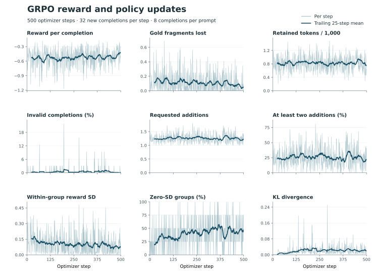

# 任务11 · 第二轮 GRPO 的证据保留与单步奖励

按预登记的闭环证据丢失率，四个候选中选中 **checkpoint-125**。起点 SFT v3 checkpoint-3000 与所选模型分别丢失 886/1,494 和 714/1,494 条轨迹，最终平均召回分别为 90.46% 和 92.66%（各 n=1,494）。四次评测中最终召回最高的是 checkpoint-500（92.74%，n=1,494），它丢失 724/1,494 条轨迹。

同一留出集上的平均单步奖励由 −0.469241 变为 −0.494518（各 n=13,956 步，μ=0.5）。按奖励公式分解，每步少丢失金段贡献 +0.025437，保留更多 token 贡献 −0.041901，无效输出增加贡献 −0.008813，合计 −0.025277（每项各 n=13,956 步）。

## A　起点、合并与两步训练冒烟

任务10选中的 SFT v3 checkpoint-3000 在留出集上丢失证据 886/1,494 条，低于预登记的起点上限 956/1,494 条。将这一适配器在 CPU 上以 fp32 合并到 Qwen3-1.7B，保存为 bf16。随后在 30 个固定训练首步提示上比较贪心生成，文本差异为 1/30，token ID 差异也为 1/30。两处差异来自同一提示。紧预算只追加任务 3825 的原适配器新增 `[13]`，合并模型新增 `[13,3]`。[起点回执](start_model.json) · [合并与冒烟回执](a_checks.json)

冒烟通过正式 Swift 训练入口加载合并模型，用任务08冻结训练集中的 8 个不同提示执行 2 个优化步。每组采样 8 次，每步产生 32 个新样本。Swift 解析到 `ctx_step_reward_v2`、μ=0.5、`scale_rewards=none`、学习率 0.000015、KL 系数 0.04；优势估计及损失函数均为 `grpo`（n=1 次冒烟）。下表的均值都以对应优化步新生成的样本为分母。

| 优化步 | 新样本 n | 平均奖励 | 平均丢失金段 | 平均保留 token / 1,000 | 无效 | 平均请求新增段数 | 请求 ≥2 段 | 每步用时 |
|---|---:|---:|---:|---:|---:|---:|---:|---:|
| 1 | 32 | −0.437859 | 0.06250 | 0.750719 | 0/32 | 1.28125 | 9/32 | 39.12 秒 |
| 2 | 32 | −0.631641 | 0.15625 | 0.950781 | 0/32 | 1.50000 | 16/32 | 43.89 秒 |

8 个采样组中 7/8 组有奖励变化。Swift 结束时重复记录了最后 32 个样本，合计 96 条日志、64 条新生成。逐条复算奖励及“奖励减组均值”的优势，两项差异均为 0/96。两步损失与梯度范数均有限（2/2 步），OOM 为 0/1 次训练，GPU 1 监控峰值为 27,865 MiB（n=1 次冒烟）。

## F0　合并起点与原 SFT 的留出轨迹

在同一组 249 个任务、6 个模式与预算组合上，F0 与任务10的 SFT v3 checkpoint-3000 各有 1,494 条轨迹、13,956 个动作步。下表差值均为 F0 减起点，百分点列按各自的原始分母计算。原始输出逐字比较要求任务、步序、候选、可见提示及输入状态一致；首步用户文本与提示 token 均逐项相同（各 1,494/1,494）。

| 范围 | 轨迹 n | 动作步 n | 起点 → F0 证据丢失数 | 最终召回差（百分点） | 单步召回差（百分点） | 末步占用差（百分点） | 平均缓存成本差（等价 token/轨迹） | 平均奖励差/步 | 相同状态上 raw 不同/相同状态步 |
|---|---|---|---|---|---|---|---|---|---|
| 合并 | 1,494 | 13,956 | 886 → 884 | +0.006 | -0.022 | +0.047 | +2.73 | -0.000034 | 252/13,057 |
| append / tight | 249 | 2,326 | 137 → 137 | -0.129 | -0.097 | +0.302 | +8.26 | -0.002428 | 39/2,138 |
| append / mid | 249 | 2,326 | 132 → 130 | -0.064 | -0.085 | -0.104 | -5.17 | +0.002219 | 39/2,139 |
| append / loose | 249 | 2,326 | 127 → 132 | -0.298 | -0.090 | -0.012 | -1.51 | -0.002280 | 34/2,174 |
| reselect / tight | 249 | 2,326 | 165 → 163 | +0.147 | +0.047 | +0.048 | -1.36 | +0.001633 | 50/2,207 |
| reselect / mid | 249 | 2,326 | 164 → 161 | +0.288 | +0.058 | -0.017 | +9.10 | +0.003564 | 46/2,195 |
| reselect / loose | 249 | 2,326 | 161 → 161 | +0.092 | +0.032 | +0.069 | +7.05 | -0.002913 | 44/2,204 |

各单元的无效分项、轨迹宏平均单步召回以及起点的奖励分解和差值保存在 [F0 扩展统计](merged_start/extra.json)。

## B　起点策略的闭环训练状态

SFT v3 checkpoint-3000 以贪心策略在 n=400 个训练任务上运行，每个任务覆盖两种模式和三档预算，共 n=2,400 条轨迹、n=22,494 个决策状态。训练任务抽样种子为 20261123（n=400 个任务）。任务 08、任务 10 的历史训练任务各自与本轮重合 0/400。选中任务来自 n=1,600 个训练样例 ID。与留出样例比对后重合 0/400（参照 n=996 个 ID），与包含锁定测试来源的完整原始 dev ID 集比对后重合 0/400（参照 n=2,417 个 ID）。

首步提示与 SFT 文本比较时，原预算档逐字节差异为 0/800，其他档仅替换预算头后逐字节差异为 0/1,600。逐步金段重算、提示重编码、重渲染的差异均为 0/22,494。下表的“保留非金段”指动作前存在已保留的非金段。“已见金段缺失”指截至当前步已经出现、但在动作前的已保留与本步新段中均不可得的金段。执行增选数按不同段计，无效动作增选零段。

| 模式 / 预算 | 状态 n | 无效动作 | 保留非金段 | 已见金段缺失 | 实际增选 0 / 1 / 2 / ≥3 段（分母为本行状态 n） |
| --- | --- | --- | --- | --- | --- |
| 合并 | 22,494 | 0.33% (75/22,494) | 30.96% (6,964/22,494) | 23.56% (5,299/22,494) | 79 / 21,230 / 1,185 / 0 |
| append / loose | 3,749 | 0.03% (1/3,749) | 34.06% (1,277/3,749) | 21.05% (789/3,749) | 2 / 3,592 / 155 / 0 |
| append / mid | 3,749 | 0.03% (1/3,749) | 34.25% (1,284/3,749) | 20.62% (773/3,749) | 2 / 3,587 / 160 / 0 |
| append / tight | 3,749 | 1.28% (48/3,749) | 34.06% (1,277/3,749) | 21.15% (793/3,749) | 50 / 3,546 / 153 / 0 |
| reselect / loose | 3,749 | 0.03% (1/3,749) | 28.03% (1,051/3,749) | 26.35% (988/3,749) | 1 / 3,507 / 241 / 0 |
| reselect / mid | 3,749 | 0.03% (1/3,749) | 27.77% (1,041/3,749) | 26.17% (981/3,749) | 1 / 3,504 / 244 / 0 |
| reselect / tight | 3,749 | 0.61% (23/3,749) | 27.58% (1,034/3,749) | 26.01% (975/3,749) | 23 / 3,494 / 232 / 0 |

| 模式 / 预算 | 提示 n | 最短（token） | 中位数 | P99 | 最长 | 超过 8,392 token |
| --- | --- | --- | --- | --- | --- | --- |
| 合并 | 22,494 | 1,126 | 3,089 | 5,242 | 8,789 | 4/22,494 |
| append / loose | 3,749 | 1,126 | 3,106 | 5,266 | 8,789 | 1/3,749 |
| append / mid | 3,749 | 1,126 | 3,108 | 5,247 | 8,789 | 1/3,749 |
| append / tight | 3,749 | 1,126 | 3,106 | 5,244 | 8,319 | 0/3,749 |
| reselect / loose | 3,749 | 1,127 | 3,067 | 5,201 | 8,429 | 1/3,749 |
| reselect / mid | 3,749 | 1,127 | 3,067 | 5,201 | 8,429 | 1/3,749 |
| reselect / tight | 3,749 | 1,127 | 3,067 | 5,196 | 8,308 | 0/3,749 |

## C　组内采样信号及历史对照

对每个训练状态独立采样 n=8 条回答（共 n=179,952），参数为 temperature=1、top_p=1、top_k=−1、最多 256 个生成 token，采样种子 20261123。按 μ=0.5 的同一奖励给这 n=22,494 组打分。组内奖励总体标准差大于 1e−9 判为有信号；组内丢失金段数或无效标志发生变化归入“金段或有效性变化”，仅使用 token 数导致的奖励变化归入“仅 token 变化”。

三次实验均从各自存档回答按 reward v2 重算。任务 10 F 与本轮使用同一个 SFT v3 采样模型，任务 10 F“胜过贪心”的参照为存档的 SFT v2 包装前输出。任务 08 C 的采样与贪心参照均为 SFT v2。各实验使用各自的训练状态，表内分母给出相应样本量。

| 实验 | 模式 / 预算 | 组 n | 零标准差 | 有信号 | 金段或有效性变化 | 仅 token 变化 | 至少一条胜过贪心 |
| --- | --- | --- | --- | --- | --- | --- | --- |
| 本轮 | 合并 | 22,494 | 45.83% (10,309/22,494) | 54.17% (12,185/22,494) | 14.86% (3,343/22,494) | 39.31% (8,842/22,494) | 10.07% (2,266/22,494) |
| 本轮 | append / loose | 3,749 | 47.29% (1,773/3,749) | 52.71% (1,976/3,749) | 11.47% (430/3,749) | 41.24% (1,546/3,749) | 7.87% (295/3,749) |
| 本轮 | append / mid | 3,749 | 46.92% (1,759/3,749) | 53.08% (1,990/3,749) | 11.28% (423/3,749) | 41.80% (1,567/3,749) | 8.06% (302/3,749) |
| 本轮 | append / tight | 3,749 | 47.64% (1,786/3,749) | 52.36% (1,963/3,749) | 12.35% (463/3,749) | 40.01% (1,500/3,749) | 7.92% (297/3,749) |
| 本轮 | reselect / loose | 3,749 | 44.36% (1,663/3,749) | 55.64% (2,086/3,749) | 17.87% (670/3,749) | 37.77% (1,416/3,749) | 12.51% (469/3,749) |
| 本轮 | reselect / mid | 3,749 | 44.23% (1,658/3,749) | 55.77% (2,091/3,749) | 17.90% (671/3,749) | 37.88% (1,420/3,749) | 12.08% (453/3,749) |
| 本轮 | reselect / tight | 3,749 | 44.55% (1,670/3,749) | 55.45% (2,079/3,749) | 18.30% (686/3,749) | 37.16% (1,393/3,749) | 12.00% (450/3,749) |
| 任务 10 F | 合并 | 300 | 49.67% (149/300) | 50.33% (151/300) | 13.00% (39/300) | 37.33% (112/300) | 22.67% (68/300) |
| 任务 10 F | append / loose | 41 | 53.66% (22/41) | 46.34% (19/41) | 2.44% (1/41) | 43.90% (18/41) | 9.76% (4/41) |
| 任务 10 F | append / mid | 53 | 58.49% (31/53) | 41.51% (22/53) | 5.66% (3/53) | 35.85% (19/53) | 7.55% (4/53) |
| 任务 10 F | append / tight | 56 | 51.79% (29/56) | 48.21% (27/56) | 12.50% (7/56) | 35.71% (20/56) | 5.36% (3/56) |
| 任务 10 F | reselect / loose | 51 | 45.10% (23/51) | 54.90% (28/51) | 21.57% (11/51) | 33.33% (17/51) | 33.33% (17/51) |
| 任务 10 F | reselect / mid | 44 | 52.27% (23/44) | 47.73% (21/44) | 18.18% (8/44) | 29.55% (13/44) | 25.00% (11/44) |
| 任务 10 F | reselect / tight | 55 | 38.18% (21/55) | 61.82% (34/55) | 16.36% (9/55) | 45.45% (25/55) | 52.73% (29/55) |
| 任务 08 C | 合并 | 22,158 | 80.14% (17,758/22,158) | 19.86% (4,400/22,158) | 17.97% (3,982/22,158) | 1.89% (418/22,158) | 5.48% (1,214/22,158) |
| 任务 08 C | append / loose | 3,693 | 80.75% (2,982/3,693) | 19.25% (711/3,693) | 17.52% (647/3,693) | 1.73% (64/3,693) | 5.25% (194/3,693) |
| 任务 08 C | append / mid | 3,693 | 80.69% (2,980/3,693) | 19.31% (713/3,693) | 17.55% (648/3,693) | 1.76% (65/3,693) | 5.25% (194/3,693) |
| 任务 08 C | append / tight | 3,693 | 80.86% (2,986/3,693) | 19.14% (707/3,693) | 17.38% (642/3,693) | 1.76% (65/3,693) | 5.04% (186/3,693) |
| 任务 08 C | reselect / loose | 3,693 | 79.61% (2,940/3,693) | 20.39% (753/3,693) | 18.36% (678/3,693) | 2.03% (75/3,693) | 5.77% (213/3,693) |
| 任务 08 C | reselect / mid | 3,693 | 79.42% (2,933/3,693) | 20.58% (760/3,693) | 18.47% (682/3,693) | 2.11% (78/3,693) | 5.82% (215/3,693) |
| 任务 08 C | reselect / tight | 3,693 | 79.53% (2,937/3,693) | 20.47% (756/3,693) | 18.55% (685/3,693) | 1.92% (71/3,693) | 5.74% (212/3,693) |

下表记录回答请求增选的不同段数。能解析的回答纳入四个桶；多增选率和无效率以本行全部回答为分母。无效原因按评估解析器的互斥类别计数。

| 实验 | 模式 / 预算 | 回答 n | 可解析 n | 请求增选 0 / 1 / 2 / ≥3 段（可解析 n） | 请求 ≥2 段 | 无效 | JSON / 候选 ID / append 删除 / 超预算（回答 n） |
| --- | --- | --- | --- | --- | --- | --- | --- |
| 本轮 | 合并 | 179,952 | 179,939 | 74 / 143,145 / 36,605 / 115 | 20.41% (36,720/179,952) | 0.54% (965/179,952) | 13 / 298 / 0 / 654 |
| 本轮 | append / loose | 29,992 | 29,991 | 22 / 24,080 / 5,870 / 19 | 19.64% (5,889/29,992) | 0.17% (51/29,992) | 1 / 50 / 0 / 0 |
| 本轮 | append / mid | 29,992 | 29,991 | 24 / 24,056 / 5,891 / 20 | 19.71% (5,911/29,992) | 0.17% (52/29,992) | 1 / 48 / 0 / 3 |
| 本轮 | append / tight | 29,992 | 29,990 | 22 / 24,074 / 5,872 / 22 | 19.65% (5,894/29,992) | 1.69% (508/29,992) | 2 / 49 / 0 / 457 |
| 本轮 | reselect / loose | 29,992 | 29,988 | 2 / 23,634 / 6,334 / 18 | 21.18% (6,352/29,992) | 0.17% (50/29,992) | 4 / 46 / 0 / 0 |
| 本轮 | reselect / mid | 29,992 | 29,989 | 2 / 23,636 / 6,333 / 18 | 21.18% (6,351/29,992) | 0.20% (60/29,992) | 3 / 55 / 0 / 2 |
| 本轮 | reselect / tight | 29,992 | 29,990 | 2 / 23,665 / 6,305 / 18 | 21.08% (6,323/29,992) | 0.81% (244/29,992) | 2 / 50 / 0 / 192 |
| 任务 10 F | 合并 | 2,400 | 2,400 | 2 / 1,978 / 420 / 0 | 17.50% (420/2,400) | 0.75% (18/2,400) | 0 / 6 / 0 / 12 |
| 任务 10 F | append / loose | 328 | 328 | 1 / 267 / 60 / 0 | 18.29% (60/328) | 0.00% (0/328) | 0 / 0 / 0 / 0 |
| 任务 10 F | append / mid | 424 | 424 | 0 / 364 / 60 / 0 | 14.15% (60/424) | 0.00% (0/424) | 0 / 0 / 0 / 0 |
| 任务 10 F | append / tight | 448 | 448 | 1 / 379 / 68 / 0 | 15.18% (68/448) | 2.90% (13/448) | 0 / 1 / 0 / 12 |
| 任务 10 F | reselect / loose | 408 | 408 | 0 / 324 / 84 / 0 | 20.59% (84/408) | 0.74% (3/408) | 0 / 3 / 0 / 0 |
| 任务 10 F | reselect / mid | 352 | 352 | 0 / 295 / 57 / 0 | 16.19% (57/352) | 0.00% (0/352) | 0 / 0 / 0 / 0 |
| 任务 10 F | reselect / tight | 440 | 440 | 0 / 349 / 91 / 0 | 20.68% (91/440) | 0.45% (2/440) | 0 / 2 / 0 / 0 |
| 任务 08 C | 合并 | 177,264 | 177,257 | 28 / 177,229 / 0 / 0 | 0.00% (0/177,264) | 0.16% (284/177,264) | 7 / 144 / 0 / 133 |
| 任务 08 C | append / loose | 29,544 | 29,544 | 7 / 29,537 / 0 / 0 | 0.00% (0/29,544) | 0.09% (26/29,544) | 0 / 26 / 0 / 0 |
| 任务 08 C | append / mid | 29,544 | 29,544 | 8 / 29,536 / 0 / 0 | 0.00% (0/29,544) | 0.11% (33/29,544) | 0 / 25 / 0 / 8 |
| 任务 08 C | append / tight | 29,544 | 29,544 | 7 / 29,537 / 0 / 0 | 0.00% (0/29,544) | 0.31% (92/29,544) | 0 / 23 / 0 / 69 |
| 任务 08 C | reselect / loose | 29,544 | 29,542 | 2 / 29,540 / 0 / 0 | 0.00% (0/29,544) | 0.08% (25/29,544) | 2 / 23 / 0 / 0 |
| 任务 08 C | reselect / mid | 29,544 | 29,542 | 2 / 29,540 / 0 / 0 | 0.00% (0/29,544) | 0.12% (34/29,544) | 2 / 24 / 0 / 8 |
| 任务 08 C | reselect / tight | 29,544 | 29,541 | 2 / 29,539 / 0 / 0 | 0.00% (0/29,544) | 0.25% (74/29,544) | 3 / 23 / 0 / 48 |

吞吐包括生成、逐组打分和写出，各阶段按原始计时回执计算。任务 10 F 交织各格采样，仅记录总耗时。

| 实验 | 模式 / 预算 | 状态 n | 回答 n | 秒 | 状态/秒 | 回答/秒 |
| --- | --- | --- | --- | --- | --- | --- |
| 本轮 | 合并 | 22,494 | 179,952 | 7,905.645 | 2.845 | 22.762 |
| 本轮 | append / loose | 3,749 | 29,992 | 1,311.233 | 2.859 | 22.873 |
| 本轮 | append / mid | 3,749 | 29,992 | 1,308.614 | 2.865 | 22.919 |
| 本轮 | append / tight | 3,749 | 29,992 | 1,309.480 | 2.863 | 22.904 |
| 本轮 | reselect / loose | 3,749 | 29,992 | 1,325.162 | 2.829 | 22.633 |
| 本轮 | reselect / mid | 3,749 | 29,992 | 1,325.602 | 2.828 | 22.625 |
| 本轮 | reselect / tight | 3,749 | 29,992 | 1,325.554 | 2.828 | 22.626 |
| 任务 10 F | 合并 | 300 | 2,400 | 108.511 | 2.765 | 22.118 |
| 任务 10 F | append / loose | 41 | 328 | 未单独计时 | 未单独计时 | 未单独计时 |
| 任务 10 F | append / mid | 53 | 424 | 未单独计时 | 未单独计时 | 未单独计时 |
| 任务 10 F | append / tight | 56 | 448 | 未单独计时 | 未单独计时 | 未单独计时 |
| 任务 10 F | reselect / loose | 51 | 408 | 未单独计时 | 未单独计时 | 未单独计时 |
| 任务 10 F | reselect / mid | 44 | 352 | 未单独计时 | 未单独计时 | 未单独计时 |
| 任务 10 F | reselect / tight | 55 | 440 | 未单独计时 | 未单独计时 | 未单独计时 |
| 任务 08 C | 合并 | 22,158 | 177,264 | 7,273.362 | 3.046 | 24.372 |
| 任务 08 C | append / loose | 3,693 | 29,544 | 1,183.787 | 3.120 | 24.957 |
| 任务 08 C | append / mid | 3,693 | 29,544 | 1,211.190 | 3.049 | 24.393 |
| 任务 08 C | append / tight | 3,693 | 29,544 | 1,284.779 | 2.874 | 22.995 |
| 任务 08 C | reselect / loose | 3,693 | 29,544 | 1,193.366 | 3.095 | 24.757 |
| 任务 08 C | reselect / mid | 3,693 | 29,544 | 1,191.848 | 3.099 | 24.788 |
| 任务 08 C | reselect / tight | 3,693 | 29,544 | 1,208.392 | 3.056 | 24.449 |

任务 08 C 在原奖励 v1 下登记的有信号率为 18.06% (4,002/22,158)，零标准差率为 81.94% (18,156/22,158)，能胜过贪心的比例为 4.20% (931/22,158)。上述对照表统一采用 v2，原口径和逐格差值另存于结果 JSON。依据原始样本复核 n=179,952 个奖励和分项三元组，全部一致。

## D　从有信号状态组建训练集

从 n=12,185 个有信号状态中按六格排序分配配额，使用种子 20261124 抽取并打乱 n=2,000 条训练提示。独立复现后，入选身份和顺序为 2,000/2,000 一致。

| 模式 / 预算 | 有信号状态 n | 目标条数（总 n=2,000） | 实际条数（总 n=2,000） | 配额缺口 |
| --- | --- | --- | --- | --- |
| append / loose | 1,976 | 334 | 334 | 0 |
| append / mid | 1,990 | 334 | 334 | 0 |
| append / tight | 1,963 | 333 | 333 | 0 |
| reselect / loose | 2,086 | 333 | 333 | 0 |
| reselect / mid | 2,091 | 333 | 333 | 0 |
| reselect / tight | 2,079 | 333 | 333 | 0 |

训练 split 覆盖 2,000/2,000，用户文本与 B 状态逐字节一致 2,000/2,000，插件对原贪心输出与 C 阶段所记奖励一致 2,000/2,000。训练文件 SHA-256 为 `fa2250427c42eb524e899a23dd15c0b6249823359a8f7088ab0422638053a733`。

## E　GRPO 训练过程

本轮训练 n=1 次，n=2,000 个提示各用一次。每个优化步有 n=4 个提示，每个提示 n=8 条回答，完成 n=500/500 步、n=16,000 条独立生成记录。Swift 解析的 advantage_estimator 与 loss_type 都是 grpo，scale_rewards 为 none。学习率 1.5×10⁻⁵，cosine 调度，warmup 比例 0.03，KL 系数 0.04。新 LoRA 作用于 all-linear，秩 16、α=32、dropout=0.05。每 n=125 步存一次，共 n=4 个 checkpoint（125、250、375、500）。

E 训练进程墙钟 **19,072.39 秒**（5 小时 17 分 52.39 秒，n=1 次训练）；GPU 整卡占用峰值 **33,701 MiB**（n=1,894 次原监控采样），PyTorch allocated/reserved 峰值分别为 **28.54 / 31.69 GiB（n=500 步）。loss 与梯度范数均为有限值（500/500 步），OOM 为 0/1 次训练。

图中浅线为单步值，深线为向前追溯 25 步的均值。表中均值按步等权，每步回答数相同；组内离散程度采用 Swift 所记 reward_std。训练分项使用评估解析器与训练插件相同的奖励口径，增选按请求的不同段计。每步的 loss、grad_norm、学习率、回答长度、截断率、显存与步时也在逐步 CSV 中。 [逐步训练数据（CSV）](training_curve.csv)

| 步区间 | 步 / 组 / 回答 n | 奖励均值 | 丢金段数 | 使用 token/千 | 无效率 | 请求增选数 | 请求 ≥2 段 | 组内奖励 SD | 零 SD 组占比 | KL |
| --- | --- | --- | --- | --- | --- | --- | --- | --- | --- | --- |
| 1–125 | 125 / 500 / 4,000 | -0.53891 | 0.13025 | 0.81232 | 0.25% | 1.24325 | 24.57% | 0.12732 | 29.80% | 0.00956 |
| 126–250 | 125 / 500 / 4,000 | -0.54998 | 0.12250 | 0.84447 | 0.53% | 1.27800 | 27.68% | 0.10128 | 40.40% | 0.02510 |
| 251–375 | 125 / 500 / 4,000 | -0.50640 | 0.09725 | 0.80880 | 0.47% | 1.24875 | 24.70% | 0.09694 | 46.40% | 0.02347 |
| 376–500 | 125 / 500 / 4,000 | -0.50180 | 0.08525 | 0.82460 | 0.43% | 1.25950 | 25.87% | 0.08871 | 43.20% | 0.02252 |
| 1–500 | 500 / 2,000 / 16,000 | -0.52427 | 0.10881 | 0.82255 | 0.42% | 1.25737 | 25.71% | 0.10356 | 39.95% | 0.02016 |

Swift 在最后一批重复写入 n=32 条回答；逐条比对确认末批内容重复。奖励复核覆盖全部 n=16,032 条日志（含重复），reward 的差异为 0/16,032，按组均值中心化的 advantage 差异为 0/16,032（容差 1e−5）。CSV 从优化日志、完成日志和原显存监控独立重建后逐字节一致（n=500 步）。

## F　留出集选点与执行诊断

四个 GRPO checkpoint 按合并证据丢失率升序、最终召回降序、优化步升序排序。在 4 个候选中选中 **checkpoint-125**。每个候选的轨迹口径及动作步口径与 F0 相同。

| 策略 | 丢失轨迹/轨迹总数 | 证据丢失率 | 最终召回（轨迹均值） | 单步召回（步均值） | 每步平均实际新增 | 实际新增 ≥2 /全部步 | 平均奖励/步 |
|---|---|---|---|---|---|---|---|
| F0（仅合并起点） | 884/1,494 | 59.17% | 90.46%（n=1,494） | 96.91%（n=13,956） | 1.0614（n=13,956） | 904/13,956 | -0.469276（n=13,956） |
| checkpoint-125 | 714/1,494 | 47.79% | 92.66%（n=1,494） | 97.71%（n=13,956） | 1.1935（n=13,956） | 2,867/13,956 | -0.494518（n=13,956） |
| checkpoint-250 | 718/1,494 | 48.06% | 92.60%（n=1,494） | 97.68%（n=13,956） | 1.1916（n=13,956） | 2,826/13,956 | -0.487860（n=13,956） |
| checkpoint-375 | 735/1,494 | 49.20% | 92.66%（n=1,494） | 97.61%（n=13,956） | 1.1654（n=13,956） | 2,438/13,956 | -0.480738（n=13,956） |
| checkpoint-500 | 724/1,494 | 48.46% | 92.74%（n=1,494） | 97.63%（n=13,956） | 1.1705（n=13,956） | 2,513/13,956 | -0.481741（n=13,956） |

每个策略的第一张表以有效动作步统计实际新增段数。多加命中率为新增至少两段的有效步中，新增集合含本步金标的比例；多加片段金标率按这些步新增的片段计。丢弃精确率的分子为已丢弃且截至当前尚未揭示为金标的片段。旧金标存活按 reselect 步中此前已揭示且原在保留区的金标片段计，混有非金标时丢旧金标按首步后、保留区含非金标的有效 reselect 步计。表中 0/0 表示没有合格分母。

第二张表按轨迹计末步占用、累计缓存成本与首错。首次错误按无效动作、漏加可得新金标、丢失已保留旧金标、同一步同时漏新丢旧分类，并列出无错轨迹；无效动作优先计入无效类。按标题分组时，另一不同段号的原始检索候选与目标标题完全相同即归入同标题组。两个标题组的分母均为当前新返回且此前未保留的已揭示金标片段数，包含无效步。

第三张表在全部动作步上平均，μ=0.5。每步奖励为负的可得金标丢失数，减去 0.5 倍保留 token 数/1,000，再减去无效指示。每个单元的分子、分母和未舍入均值见[结果 JSON](grpo_r2_results.json)。

### F0（仅合并起点）

| 范围 | 实际新增 0 / 1 / 2 / ≥3（有效步 n） | 多加命中当前金标 | 多加片段金标率 | 丢弃精确率 | 旧金标存活率 | 混有非金标时丢旧金标 |
|---|---|---|---|---|---|---|
| 合并 | 1 / 13,005 / 904 / 0（n=13,910） | 799/904 | 817/1,808 | 524/780 | 26,357/26,611 | 170/2,261 |
| append / tight | 1 / 2,177 / 121 / 0（n=2,299） | 104/121 | 107/242 | —（0/0） | —（0/0） | —（0/0） |
| append / mid | 0 / 2,205 / 119 / 0（n=2,324） | 106/119 | 110/238 | —（0/0） | —（0/0） | —（0/0） |
| append / loose | 0 / 2,205 / 120 / 0（n=2,325） | 108/120 | 111/240 | —（0/0） | —（0/0） | —（0/0） |
| reselect / tight | 0 / 2,138 / 174 / 0（n=2,312） | 155/174 | 157/348 | 170/250 | 8,795/8,875 | 54/742 |
| reselect / mid | 0 / 2,139 / 186 / 0（n=2,325） | 161/186 | 164/372 | 180/267 | 8,785/8,871 | 57/755 |
| reselect / loose | 0 / 2,141 / 184 / 0（n=2,325） | 165/184 | 168/368 | 174/263 | 8,777/8,865 | 59/764 |

| 范围 | 轨迹 n | 末步占用均值 | 缓存成本均值（等价 token/轨迹） | 首错轨迹数（无效 / 漏新 / 丢旧 / 同时 / 无错） | 同标题新金标加段率 | 异标题新金标加段率 |
|---|---|---|---|---|---|---|
| 合并 | 1,494 | 44.37% | 1,983.23 | 17 / 741 / 129 / 9 / 598 | 2,602/3,176 | 10,222/10,925 |
| append / tight | 249 | 68.73% | 1,890.95 | 9 / 132 / 0 / 0 / 108 | 426/530 | 1,687/1,821 |
| append / mid | 249 | 46.61% | 1,918.95 | 1 / 133 / 0 / 0 / 115 | 433/530 | 1,705/1,821 |
| append / loose | 249 | 23.40% | 1,925.85 | 1 / 134 / 0 / 0 / 114 | 434/531 | 1,705/1,819 |
| reselect / tight | 249 | 63.37% | 2,036.12 | 4 / 115 / 42 / 3 / 85 | 433/528 | 1,702/1,823 |
| reselect / mid | 249 | 42.64% | 2,061.77 | 1 / 113 / 44 / 3 / 88 | 437/528 | 1,713/1,820 |
| reselect / loose | 249 | 21.47% | 2,065.76 | 1 / 114 / 43 / 3 / 88 | 439/529 | 1,710/1,821 |

| 范围 | 动作步 n | 平均奖励 v2 | 平均可得金标丢失数 | 平均保留 token 数/1,000 | 无效步/全部步 |
|---|---|---|---|---|---|
| 合并 | 13,956 | -0.469276 | 0.109845 | 0.712268 | 46/13,956 |
| append / tight | 2,326 | -0.481862 | 0.102322 | 0.735865 | 27/2,326 |
| append / mid | 2,326 | -0.461754 | 0.091574 | 0.738641 | 2/2,326 |
| append / loose | 2,326 | -0.460889 | 0.090714 | 0.739491 | 1/2,326 |
| reselect / tight | 2,326 | -0.475558 | 0.127257 | 0.684563 | 14/2,326 |
| reselect / mid | 2,326 | -0.465648 | 0.122528 | 0.685381 | 1/2,326 |
| reselect / loose | 2,326 | -0.469942 | 0.124678 | 0.689670 | 1/2,326 |

### checkpoint-125

| 范围 | 实际新增 0 / 1 / 2 / ≥3（有效步 n） | 多加命中当前金标 | 多加片段金标率 | 丢弃精确率 | 旧金标存活率 | 混有非金标时丢旧金标 |
|---|---|---|---|---|---|---|
| 合并 | 0 / 10,922 / 2,867 / 0（n=13,789） | 2,376/2,867 | 2,419/5,734 | 799/1,035 | 26,995/27,231 | 219/2,934 |
| append / tight | 0 / 1,797 / 423 / 0（n=2,220） | 350/423 | 357/846 | —（0/0） | —（0/0） | —（0/0） |
| append / mid | 0 / 1,843 / 474 / 0（n=2,317） | 394/474 | 400/948 | —（0/0） | —（0/0） | —（0/0） |
| append / loose | 0 / 1,847 / 476 / 0（n=2,323） | 398/476 | 404/952 | —（0/0） | —（0/0） | —（0/0） |
| reselect / tight | 0 / 1,799 / 482 / 0（n=2,281） | 396/482 | 405/964 | 266/345 | 8,989/9,068 | 73/947 |
| reselect / mid | 0 / 1,818 / 506 / 0（n=2,324） | 418/506 | 425/1,012 | 262/342 | 8,996/9,076 | 72/1,003 |
| reselect / loose | 0 / 1,818 / 506 / 0（n=2,324） | 420/506 | 428/1,012 | 271/348 | 9,010/9,087 | 74/984 |

| 范围 | 轨迹 n | 末步占用均值 | 缓存成本均值（等价 token/轨迹） | 首错轨迹数（无效 / 漏新 / 丢旧 / 同时 / 无错） | 同标题新金标加段率 | 异标题新金标加段率 |
|---|---|---|---|---|---|---|
| 合并 | 1,494 | 49.81% | 2,253.16 | 66 / 510 / 148 / 13 / 757 | 2,809/3,147 | 10,288/10,895 |
| append / tight | 249 | 75.31% | 2,078.19 | 38 / 83 / 0 / 0 / 128 | 442/526 | 1,670/1,818 |
| append / mid | 249 | 54.30% | 2,229.01 | 5 / 92 / 0 / 0 / 152 | 474/525 | 1,725/1,812 |
| append / loose | 249 | 27.32% | 2,241.17 | 3 / 90 / 0 / 0 / 156 | 476/524 | 1,731/1,812 |
| reselect / tight | 249 | 69.65% | 2,279.40 | 16 / 79 / 47 / 5 / 102 | 465/524 | 1,702/1,819 |
| reselect / mid | 249 | 48.21% | 2,345.90 | 2 / 84 / 51 / 4 / 108 | 475/524 | 1,729/1,817 |
| reselect / loose | 249 | 24.07% | 2,345.27 | 2 / 82 / 50 / 4 / 111 | 477/524 | 1,731/1,817 |

| 范围 | 动作步 n | 平均奖励 v2 | 平均可得金标丢失数 | 平均保留 token 数/1,000 | 无效步/全部步 |
|---|---|---|---|---|---|
| 合并 | 13,956 | -0.494518 | 0.084623 | 0.795858 | 167/13,956 |
| append / tight | 2,326 | -0.555037 | 0.099742 | 0.819446 | 106/2,326 |
| append / mid | 2,326 | -0.486400 | 0.059329 | 0.846402 | 9/2,326 |
| append / loose | 2,326 | -0.480716 | 0.055460 | 0.847932 | 3/2,326 |
| reselect / tight | 2,326 | -0.503545 | 0.109630 | 0.749137 | 45/2,326 |
| reselect / mid | 2,326 | -0.472136 | 0.093293 | 0.755966 | 2/2,326 |
| reselect / loose | 2,326 | -0.469276 | 0.090284 | 0.756266 | 2/2,326 |

### checkpoint-250

| 范围 | 实际新增 0 / 1 / 2 / ≥3（有效步 n） | 多加命中当前金标 | 多加片段金标率 | 丢弃精确率 | 旧金标存活率 | 混有非金标时丢旧金标 |
|---|---|---|---|---|---|---|
| 合并 | 0 / 10,978 / 2,826 / 0（n=13,804） | 2,339/2,826 | 2,372/5,652 | 950/1,209 | 26,931/27,187 | 230/2,707 |
| append / tight | 0 / 1,799 / 423 / 0（n=2,222） | 346/423 | 352/846 | —（0/0） | —（0/0） | —（0/0） |
| append / mid | 0 / 1,842 / 474 / 0（n=2,316） | 397/474 | 403/948 | —（0/0） | —（0/0） | —（0/0） |
| append / loose | 0 / 1,840 / 483 / 0（n=2,323） | 400/483 | 406/966 | —（0/0） | —（0/0） | —（0/0） |
| reselect / tight | 0 / 1,833 / 464 / 0（n=2,297） | 382/464 | 387/928 | 307/391 | 8,970/9,053 | 75/889 |
| reselect / mid | 0 / 1,831 / 492 / 0（n=2,323） | 409/492 | 414/984 | 323/412 | 8,981/9,069 | 79/903 |
| reselect / loose | 0 / 1,833 / 490 / 0（n=2,323） | 405/490 | 410/980 | 320/406 | 8,980/9,065 | 76/915 |

| 范围 | 轨迹 n | 末步占用均值 | 缓存成本均值（等价 token/轨迹） | 首错轨迹数（无效 / 漏新 / 丢旧 / 同时 / 无错） | 同标题新金标加段率 | 异标题新金标加段率 |
|---|---|---|---|---|---|---|
| 合并 | 1,494 | 48.97% | 2,248.79 | 63 / 505 / 162 / 12 / 752 | 2,797/3,153 | 10,316/10,891 |
| append / tight | 249 | 75.27% | 2,077.09 | 38 / 86 / 0 / 0 / 125 | 438/526 | 1,672/1,820 |
| append / mid | 249 | 54.13% | 2,223.13 | 5 / 91 / 0 / 0 / 153 | 472/526 | 1,731/1,813 |
| append / loose | 249 | 27.31% | 2,240.70 | 3 / 92 / 0 / 0 / 154 | 475/526 | 1,732/1,813 |
| reselect / tight | 249 | 67.55% | 2,279.67 | 11 / 79 / 54 / 4 / 101 | 464/525 | 1,716/1,816 |
| reselect / mid | 249 | 46.35% | 2,336.55 | 3 / 77 / 54 / 4 / 111 | 475/525 | 1,733/1,814 |
| reselect / loose | 249 | 23.17% | 2,335.61 | 3 / 80 / 54 / 4 / 108 | 473/525 | 1,732/1,815 |

| 范围 | 动作步 n | 平均奖励 v2 | 平均可得金标丢失数 | 平均保留 token 数/1,000 | 无效步/全部步 |
|---|---|---|---|---|---|
| 合并 | 13,956 | -0.487860 | 0.085268 | 0.783402 | 152/13,956 |
| append / tight | 2,326 | -0.555697 | 0.101462 | 0.819047 | 104/2,326 |
| append / mid | 2,326 | -0.485938 | 0.058469 | 0.846339 | 10/2,326 |
| append / loose | 2,326 | -0.481931 | 0.056750 | 0.847784 | 3/2,326 |
| reselect / tight | 2,326 | -0.479617 | 0.105331 | 0.723637 | 29/2,326 |
| reselect / mid | 2,326 | -0.461726 | 0.094583 | 0.731707 | 3/2,326 |
| reselect / loose | 2,326 | -0.462251 | 0.095013 | 0.731897 | 3/2,326 |

### checkpoint-375

| 范围 | 实际新增 0 / 1 / 2 / ≥3（有效步 n） | 多加命中当前金标 | 多加片段金标率 | 丢弃精确率 | 旧金标存活率 | 混有非金标时丢旧金标 |
|---|---|---|---|---|---|---|
| 合并 | 0 / 11,388 / 2,438 / 0（n=13,826） | 1,967/2,438 | 2,006/4,876 | 781/1,000 | 27,064/27,283 | 200/2,657 |
| append / tight | 0 / 1,877 / 361 / 0（n=2,238） | 290/361 | 296/722 | —（0/0） | —（0/0） | —（0/0） |
| append / mid | 0 / 1,920 / 398 / 0（n=2,318） | 320/398 | 326/796 | —（0/0） | —（0/0） | —（0/0） |
| append / loose | 0 / 1,924 / 399 / 0（n=2,323） | 320/399 | 326/798 | —（0/0） | —（0/0） | —（0/0） |
| reselect / tight | 0 / 1,887 / 412 / 0（n=2,299） | 330/412 | 338/824 | 255/329 | 9,006/9,080 | 66/874 |
| reselect / mid | 0 / 1,893 / 431 / 0（n=2,324） | 352/431 | 358/862 | 262/335 | 9,033/9,106 | 67/889 |
| reselect / loose | 0 / 1,887 / 437 / 0（n=2,324） | 355/437 | 362/874 | 264/336 | 9,025/9,097 | 67/894 |

| 范围 | 轨迹 n | 末步占用均值 | 缓存成本均值（等价 token/轨迹） | 首错轨迹数（无效 / 漏新 / 丢旧 / 同时 / 无错） | 同标题新金标加段率 | 异标题新金标加段率 |
|---|---|---|---|---|---|---|
| 合并 | 1,494 | 48.44% | 2,186.08 | 55 / 555 / 135 / 12 / 737 | 2,787/3,156 | 10,303/10,898 |
| append / tight | 249 | 73.93% | 2,038.92 | 33 / 92 / 0 / 0 / 124 | 442/526 | 1,677/1,820 |
| append / mid | 249 | 52.55% | 2,159.16 | 4 / 100 / 0 / 0 / 145 | 468/526 | 1,724/1,812 |
| append / loose | 249 | 26.38% | 2,165.70 | 3 / 100 / 0 / 0 / 146 | 473/526 | 1,724/1,814 |
| reselect / tight | 249 | 67.82% | 2,216.29 | 11 / 87 / 45 / 4 / 102 | 461/526 | 1,716/1,819 |
| reselect / mid | 249 | 46.56% | 2,260.38 | 2 / 87 / 46 / 4 / 110 | 471/527 | 1,732/1,816 |
| reselect / loose | 249 | 23.37% | 2,276.04 | 2 / 89 / 44 / 4 / 110 | 472/525 | 1,730/1,817 |

| 范围 | 动作步 n | 平均奖励 v2 | 平均可得金标丢失数 | 平均保留 token 数/1,000 | 无效步/全部步 |
|---|---|---|---|---|---|
| 合并 | 13,956 | -0.480738 | 0.084766 | 0.773313 | 130/13,956 |
| append / tight | 2,326 | -0.536438 | 0.097592 | 0.802025 | 88/2,326 |
| append / mid | 2,326 | -0.477912 | 0.062769 | 0.823408 | 8/2,326 |
| append / loose | 2,326 | -0.474259 | 0.061479 | 0.822982 | 3/2,326 |
| reselect / tight | 2,326 | -0.477710 | 0.104041 | 0.724122 | 27/2,326 |
| reselect / mid | 2,326 | -0.458481 | 0.091574 | 0.732095 | 2/2,326 |
| reselect / loose | 2,326 | -0.459628 | 0.091144 | 0.735248 | 2/2,326 |

### checkpoint-500

| 范围 | 实际新增 0 / 1 / 2 / ≥3（有效步 n） | 多加命中当前金标 | 多加片段金标率 | 丢弃精确率 | 旧金标存活率 | 混有非金标时丢旧金标 |
|---|---|---|---|---|---|---|
| 合并 | 0 / 11,310 / 2,513 / 0（n=13,823） | 2,047/2,513 | 2,084/5,026 | 790/1,008 | 27,051/27,269 | 203/2,694 |
| append / tight | 0 / 1,864 / 372 / 0（n=2,236） | 299/372 | 305/744 | —（0/0） | —（0/0） | —（0/0） |
| append / mid | 0 / 1,906 / 412 / 0（n=2,318） | 338/412 | 344/824 | —（0/0） | —（0/0） | —（0/0） |
| append / loose | 0 / 1,912 / 411 / 0（n=2,323） | 333/411 | 339/822 | —（0/0） | —（0/0） | —（0/0） |
| reselect / tight | 0 / 1,871 / 427 / 0（n=2,298） | 348/427 | 355/854 | 259/330 | 9,002/9,073 | 66/878 |
| reselect / mid | 0 / 1,878 / 446 / 0（n=2,324） | 363/446 | 369/892 | 267/341 | 9,014/9,088 | 69/908 |
| reselect / loose | 0 / 1,879 / 445 / 0（n=2,324） | 366/445 | 372/890 | 264/337 | 9,035/9,108 | 68/908 |

| 范围 | 轨迹 n | 末步占用均值 | 缓存成本均值（等价 token/轨迹） | 首错轨迹数（无效 / 漏新 / 丢旧 / 同时 / 无错） | 同标题新金标加段率 | 异标题新金标加段率 |
|---|---|---|---|---|---|---|
| 合并 | 1,494 | 48.69% | 2,197.75 | 57 / 542 / 135 / 11 / 749 | 2,794/3,157 | 10,302/10,894 |
| append / tight | 249 | 74.20% | 2,046.63 | 36 / 92 / 0 / 0 / 121 | 442/526 | 1,676/1,818 |
| append / mid | 249 | 52.89% | 2,172.12 | 4 / 97 / 0 / 0 / 148 | 471/526 | 1,726/1,813 |
| append / loose | 249 | 26.61% | 2,184.06 | 2 / 98 / 0 / 0 / 149 | 472/526 | 1,726/1,813 |
| reselect / tight | 249 | 68.18% | 2,223.23 | 11 / 84 / 44 / 3 / 107 | 463/526 | 1,712/1,817 |
| reselect / mid | 249 | 46.82% | 2,281.21 | 2 / 88 / 45 / 4 / 110 | 471/527 | 1,731/1,816 |
| reselect / loose | 249 | 23.45% | 2,279.24 | 2 / 83 / 46 / 4 / 114 | 475/526 | 1,731/1,817 |

| 范围 | 动作步 n | 平均奖励 v2 | 平均可得金标丢失数 | 平均保留 token 数/1,000 | 无效步/全部步 |
|---|---|---|---|---|---|
| 合并 | 13,956 | -0.481741 | 0.084050 | 0.776323 | 133/13,956 |
| append / tight | 2,326 | -0.538548 | 0.097163 | 0.805386 | 90/2,326 |
| append / mid | 2,326 | -0.477874 | 0.061049 | 0.826770 | 8/2,326 |
| append / loose | 2,326 | -0.476161 | 0.060619 | 0.828505 | 3/2,326 |
| reselect / tight | 2,326 | -0.477517 | 0.102752 | 0.725455 | 28/2,326 |
| reselect / mid | 2,326 | -0.460845 | 0.092433 | 0.735104 | 2/2,326 |
| reselect / loose | 2,326 | -0.459501 | 0.090284 | 0.736715 | 2/2,326 |

CPU 从 5/5 份留出步归档重放 69,780/69,780 个决策步。逐步检查原始输出的解析与执行，逐格复算轨迹连续性、首错、加丢段、召回、缓存成本和奖励分项，核对了全部 35/35 个合并及分层单元。起点与各次评估的首步提示共 7,470/7,470 对，文本与 token ID 全部一致。[选点回执](selected_checkpoint.json)

## 同一留出集上的策略比较

七种策略使用相同的 249 个留出任务。在两种模式和三档预算下，每种策略覆盖 1,494 条轨迹、13,956 个决策步。逐条核对任务、步序、预算、金段与按序检索结果（97,692/97,692 条原始记录）。所有比较均为单次实验的点估计。

### PLAN §4 预注册指标

| 指标 | SFT v3 起点 | GRPO r2 所选 |
|---|---:|---:|
| 只追加、紧预算的轨迹证据丢失率 | 55.02%（137/249） | 46.18%（115/249） |
| 重选、紧预算的轨迹证据丢失率 | 66.27%（165/249） | 57.83%（144/249） |
| 合并轨迹证据丢失率 | 59.30%（886/1,494） | 47.79%（714/1,494） |
| 合并最终召回 | 90.46%（n=1,494） | 92.66%（n=1,494） |

### 召回、证据丢失、缓存与动作

最终召回、末步缓存占用与累计缓存成本按轨迹平均；单步召回和实际新增段数按所有决策步平均。实际新增至少两段按执行前后保留集的差计数。丢弃精确率以实际丢弃片段为分母，无丢弃记作“—（0/0）”。

#### 合并（每策略 n=1,494 条轨迹、13,956 步）

| 策略 | 最终召回 | 证据丢失率 | 单步召回 | 末步占用 | 缓存成本（等价输入 token/轨迹） | 实际新增/步 | 至少新增两段 | 丢弃精确率 |
|---|---:|---:|---:|---:|---:|---:|---:|---:|
| GRPO r2 checkpoint-125 | 92.66% | 47.79%（714/1,494） | 97.71% | 49.81% | 2,253.16 | 1.193 | 20.54%（2,867/13,956） | 77.20%（799/1,035） |
| SFT v3 checkpoint-3000 | 90.46% | 59.30%（886/1,494） | 96.94% | 44.32% | 1,980.51 | 1.061 | 6.38%（890/13,956） | 66.33%（526/793） |
| SFT v2 checkpoint-2000 | 89.01% | 63.99%（956/1,494） | 96.18% | 43.36% | 1,802.57 | 0.998 | 0.00%（0/13,956） | 47.29%（61/129） |
| GRPO r1 checkpoint-500 | 89.30% | 63.39%（947/1,494） | 96.24% | 43.60% | 1,799.63 | 0.998 | 0.00%（0/13,956） | 23.81%（10/42） |
| H1（τ=0.99） | 90.62% | 53.95%（806/1,494） | 97.32% | 51.17% | 2,478.70 | 1.325 | 33.38%（4,659/13,956） | 73.57%（1,587/2,157） |
| BM25 | 30.74% | 99.93%（1,493/1,494） | 73.07% | 99.50% | 15,910.42 | 5.661 | 50.44%（7,040/13,956） | 96.20%（30,918/32,140） |
| Oracle | 99.78% | 1.61%（24/1,494） | 99.97% | 43.65% | 1,807.52 | 0.998 | 0.00%（0/13,956） | 0.00%（0/9） |

#### 只追加 · 紧预算（每策略 n=249 条轨迹、2,326 步）

| 策略 | 最终召回 | 证据丢失率 | 单步召回 | 末步占用 | 缓存成本（等价输入 token/轨迹） | 实际新增/步 | 至少新增两段 | 丢弃精确率 |
|---|---:|---:|---:|---:|---:|---:|---:|---:|
| GRPO r2 checkpoint-125 | 91.62% | 46.18%（115/249） | 97.65% | 75.31% | 2,078.19 | 1.136 | 18.19%（423/2,326） | —（0/0） |
| SFT v3 checkpoint-3000 | 91.41% | 55.02%（137/249） | 97.21% | 68.43% | 1,882.69 | 1.035 | 4.69%（109/2,326） | —（0/0） |
| SFT v2 checkpoint-2000 | 89.43% | 62.25%（155/249） | 96.26% | 65.13% | 1,786.66 | 0.994 | 0.00%（0/2,326） | —（0/0） |
| GRPO r1 checkpoint-500 | 89.24% | 63.86%（159/249） | 96.23% | 65.23% | 1,789.16 | 0.995 | 0.00%（0/2,326） | —（0/0） |
| H1（τ=0.99） | 90.97% | 46.18%（115/249） | 97.68% | 81.43% | 2,247.83 | 1.247 | 29.62%（689/2,326） | —（0/0） |
| BM25 | 11.66% | 100.00%（249/249） | 52.77% | 99.36% | 3,101.38 | 2.019 | 13.46%（313/2,326） | —（0/0） |
| Oracle | 99.24% | 4.42%（11/249） | 99.90% | 65.16% | 1,786.94 | 0.992 | 0.00%（0/2,326） | —（0/0） |

#### 只追加 · 中预算（每策略 n=249 条轨迹、2,326 步）

| 策略 | 最终召回 | 证据丢失率 | 单步召回 | 末步占用 | 缓存成本（等价输入 token/轨迹） | 实际新增/步 | 至少新增两段 | 丢弃精确率 |
|---|---:|---:|---:|---:|---:|---:|---:|---:|
| GRPO r2 checkpoint-125 | 95.00% | 36.95%（92/249） | 98.26% | 54.30% | 2,229.01 | 1.200 | 20.38%（474/2,326） | —（0/0） |
| SFT v3 checkpoint-3000 | 92.32% | 53.01%（132/249） | 97.34% | 46.71% | 1,924.13 | 1.048 | 4.90%（114/2,326） | —（0/0） |
| SFT v2 checkpoint-2000 | 89.59% | 62.65%（156/249） | 96.31% | 43.77% | 1,799.41 | 1.000 | 0.00%（0/2,326） | —（0/0） |
| GRPO r1 checkpoint-500 | 89.69% | 62.65%（156/249） | 96.30% | 43.75% | 1,798.39 | 1.000 | 0.00%（0/2,326） | —（0/0） |
| H1（τ=0.99） | 95.37% | 34.54%（86/249） | 98.42% | 59.59% | 2,443.53 | 1.337 | 33.92%（789/2,326） | —（0/0） |
| BM25 | 16.70% | 100.00%（249/249） | 62.55% | 99.60% | 4,632.73 | 2.943 | 20.64%（480/2,326） | —（0/0） |
| Oracle | 99.96% | 0.40%（1/249） | 100.00% | 44.02% | 1,807.65 | 1.000 | 0.00%（0/2,326） | —（0/0） |

#### 重选 · 紧预算（每策略 n=249 条轨迹、2,326 步）

| 策略 | 最终召回 | 证据丢失率 | 单步召回 | 末步占用 | 缓存成本（等价输入 token/轨迹） | 实际新增/步 | 至少新增两段 | 丢弃精确率 |
|---|---:|---:|---:|---:|---:|---:|---:|---:|
| GRPO r2 checkpoint-125 | 90.30% | 57.83%（144/249） | 97.20% | 69.65% | 2,279.40 | 1.188 | 20.72%（482/2,326） | 77.10%（266/345） |
| SFT v3 checkpoint-3000 | 88.66% | 66.27%（165/249） | 96.54% | 63.32% | 2,037.49 | 1.070 | 7.61%（177/2,326） | 67.05%（173/258） |
| SFT v2 checkpoint-2000 | 88.21% | 65.86%（164/249） | 95.97% | 64.37% | 1,796.87 | 0.994 | 0.00%（0/2,326） | 47.50%（19/40） |
| GRPO r1 checkpoint-500 | 88.70% | 64.66%（161/249） | 96.11% | 65.11% | 1,794.34 | 0.995 | 0.00%（0/2,326） | 15.38%（2/13） |
| H1（τ=0.99） | 87.16% | 69.48%（173/249） | 96.46% | 67.63% | 2,558.66 | 1.334 | 33.71%（784/2,326） | 73.50%（527/717） |
| BM25 | 31.77% | 100.00%（249/249） | 73.60% | 99.07% | 13,689.11 | 5.037 | 68.01%（1,582/2,326） | 95.30%（7,274/7,633） |
| Oracle | 99.53% | 4.42%（11/249） | 99.94% | 64.56% | 1,818.14 | 0.999 | 0.00%（0/2,326） | 0.00%（0/9） |

#### 重选 · 中预算（每策略 n=249 条轨迹、2,326 步）

| 策略 | 最终召回 | 证据丢失率 | 单步召回 | 末步占用 | 缓存成本（等价输入 token/轨迹） | 实际新增/步 | 至少新增两段 | 丢弃精确率 |
|---|---:|---:|---:|---:|---:|---:|---:|---:|
| GRPO r2 checkpoint-125 | 91.70% | 55.82%（139/249） | 97.38% | 48.21% | 2,345.90 | 1.217 | 21.75%（506/2,326） | 76.61%（262/342） |
| SFT v3 checkpoint-3000 | 88.85% | 65.86%（164/249） | 96.56% | 42.66% | 2,052.67 | 1.078 | 7.87%（183/2,326） | 66.04%（175/265） |
| SFT v2 checkpoint-2000 | 88.51% | 65.46%（163/249） | 96.08% | 43.37% | 1,817.25 | 1.000 | 0.00%（0/2,326） | 48.84%（21/43） |
| GRPO r1 checkpoint-500 | 89.15% | 63.05%（157/249） | 96.21% | 43.71% | 1,805.75 | 1.000 | 0.00%（0/2,326） | 28.57%（4/14） |
| H1（τ=0.99） | 87.27% | 69.48%（173/249） | 96.48% | 45.62% | 2,582.20 | 1.346 | 34.57%（804/2,326） | 72.85%（526/722） |
| BM25 | 39.27% | 100.00%（249/249） | 80.32% | 99.48% | 21,578.66 | 6.945 | 76.91%（1,789/2,326） | 96.10%（9,686/10,079） |
| Oracle | 99.96% | 0.40%（1/249） | 100.00% | 44.02% | 1,807.65 | 1.000 | 0.00%（0/2,326） | —（0/0） |

### 四类无效动作与留出集奖励

四类无效动作均列出计数，每行的共同分母在“决策步 n”列；无效总率另列。每个奖励分项均按同一行的决策步平均，R = −丢失可得金段数 − 0.5 × 保留 token 数 / 1,000 − 无效指示值。H1 按阈值包装器最后执行的动作评分；BM25 与 oracle 按历史文件中确定性策略的动作评分。

| 范围 | 策略 | 决策步 n | JSON 无效 数/率 | 非法候选 ID 数/率 | 只追加模式丢段 数/率 | 超预算 数/率 | 无效总率 | 平均丢失金段 | 平均保留千 token | 平均奖励 v2 |
|---|---|---:|---:|---:|---:|---:|---:|---:|---:|---:|
| 合并 | GRPO r2 checkpoint-125 | 13,956 | 0 / 0.00% | 18 / 0.13% | 0 / 0.00% | 149 / 1.07% | 1.20%（167/13,956） | 0.08462 | 0.79586 | -0.49452 |
| 合并 | SFT v3 checkpoint-3000 | 13,956 | 0 / 0.00% | 4 / 0.03% | 0 / 0.00% | 40 / 0.29% | 0.32%（44/13,956） | 0.11006 | 0.71206 | -0.46924 |
| 合并 | SFT v2 checkpoint-2000 | 13,956 | 0 / 0.00% | 0 / 0.00% | 0 / 0.00% | 30 / 0.21% | 0.21%（30/13,956） | 0.13005 | 0.68473 | -0.47457 |
| 合并 | GRPO r1 checkpoint-500 | 13,956 | 0 / 0.00% | 0 / 0.00% | 0 / 0.00% | 22 / 0.16% | 0.16%（22/13,956） | 0.12776 | 0.68670 | -0.47269 |
| 合并 | H1（τ=0.99） | 13,956 | 0 / 0.00% | 0 / 0.00% | 0 / 0.00% | 128 / 0.92% | 0.92%（128/13,956） | 0.10583 | 0.81965 | -0.52483 |
| 合并 | BM25 | 13,956 | 0 / 0.00% | 0 / 0.00% | 0 / 0.00% | 0 / 0.00% | 0.00%（0/13,956） | 0.77150 | 3.21336 | -2.37818 |
| 合并 | Oracle | 13,956 | 0 / 0.00% | 0 / 0.00% | 0 / 0.00% | 0 / 0.00% | 0.00%（0/13,956） | 0.00244 | 0.68634 | -0.34560 |
| 只追加 · 紧预算 | GRPO r2 checkpoint-125 | 2,326 | 0 / 0.00% | 4 / 0.17% | 0 / 0.00% | 102 / 4.39% | 4.56%（106/2,326） | 0.09974 | 0.81945 | -0.55504 |
| 只追加 · 紧预算 | SFT v3 checkpoint-3000 | 2,326 | 0 / 0.00% | 1 / 0.04% | 0 / 0.00% | 25 / 1.07% | 1.12%（26/2,326） | 0.10189 | 0.73273 | -0.47943 |
| 只追加 · 紧预算 | SFT v2 checkpoint-2000 | 2,326 | 0 / 0.00% | 0 / 0.00% | 0 / 0.00% | 14 / 0.60% | 0.60%（14/2,326） | 0.12597 | 0.68614 | -0.47506 |
| 只追加 · 紧预算 | GRPO r1 checkpoint-500 | 2,326 | 0 / 0.00% | 0 / 0.00% | 0 / 0.00% | 11 / 0.47% | 0.47%（11/2,326） | 0.12898 | 0.68660 | -0.47701 |
| 只追加 · 紧预算 | H1（τ=0.99） | 2,326 | 0 / 0.00% | 0 / 0.00% | 0 / 0.00% | 114 / 4.90% | 4.90%（114/2,326） | 0.10791 | 0.88786 | -0.60085 |
| 只追加 · 紧预算 | BM25 | 2,326 | 0 / 0.00% | 0 / 0.00% | 0 / 0.00% | 0 / 0.00% | 0.00%（0/2,326） | 1.00774 | 1.85132 | -1.93340 |
| 只追加 · 紧预算 | Oracle | 2,326 | 0 / 0.00% | 0 / 0.00% | 0 / 0.00% | 0 / 0.00% | 0.00%（0/2,326） | 0.00860 | 0.68501 | -0.35111 |
| 只追加 · 中预算 | GRPO r2 checkpoint-125 | 2,326 | 0 / 0.00% | 4 / 0.17% | 0 / 0.00% | 5 / 0.21% | 0.39%（9/2,326） | 0.05933 | 0.84640 | -0.48640 |
| 只追加 · 中预算 | SFT v3 checkpoint-3000 | 2,326 | 0 / 0.00% | 1 / 0.04% | 0 / 0.00% | 1 / 0.04% | 0.09%（2/2,326） | 0.09200 | 0.74222 | -0.46397 |
| 只追加 · 中预算 | SFT v2 checkpoint-2000 | 2,326 | 0 / 0.00% | 0 / 0.00% | 0 / 0.00% | 1 / 0.04% | 0.04%（1/2,326） | 0.12425 | 0.68826 | -0.46881 |
| 只追加 · 中预算 | GRPO r1 checkpoint-500 | 2,326 | 0 / 0.00% | 0 / 0.00% | 0 / 0.00% | 0 / 0.00% | 0.00%（0/2,326） | 0.12339 | 0.68700 | -0.46689 |
| 只追加 · 中预算 | H1（τ=0.99） | 2,326 | 0 / 0.00% | 0 / 0.00% | 0 / 0.00% | 6 / 0.26% | 0.26%（6/2,326） | 0.05675 | 0.92350 | -0.52108 |
| 只追加 · 中预算 | BM25 | 2,326 | 0 / 0.00% | 0 / 0.00% | 0 / 0.00% | 0 / 0.00% | 0.00%（0/2,326） | 0.95443 | 2.71754 | -2.31320 |
| 只追加 · 中预算 | Oracle | 2,326 | 0 / 0.00% | 0 / 0.00% | 0 / 0.00% | 0 / 0.00% | 0.00%（0/2,326） | 0.00043 | 0.68756 | -0.34421 |
| 重选 · 紧预算 | GRPO r2 checkpoint-125 | 2,326 | 0 / 0.00% | 3 / 0.13% | 0 / 0.00% | 42 / 1.81% | 1.93%（45/2,326） | 0.10963 | 0.74914 | -0.50355 |
| 重选 · 紧预算 | SFT v3 checkpoint-3000 | 2,326 | 0 / 0.00% | 0 / 0.00% | 0 / 0.00% | 14 / 0.60% | 0.60%（14/2,326） | 0.12898 | 0.68439 | -0.47719 |
| 重选 · 紧预算 | SFT v2 checkpoint-2000 | 2,326 | 0 / 0.00% | 0 / 0.00% | 0 / 0.00% | 14 / 0.60% | 0.60%（14/2,326） | 0.13887 | 0.68063 | -0.48520 |
| 重选 · 紧预算 | GRPO r1 checkpoint-500 | 2,326 | 0 / 0.00% | 0 / 0.00% | 0 / 0.00% | 11 / 0.47% | 0.47%（11/2,326） | 0.13414 | 0.68596 | -0.48184 |
| 重选 · 紧预算 | H1（τ=0.99） | 2,326 | 0 / 0.00% | 0 / 0.00% | 0 / 0.00% | 8 / 0.34% | 0.34%（8/2,326） | 0.14015 | 0.72530 | -0.50624 |
| 重选 · 紧预算 | BM25 | 2,326 | 0 / 0.00% | 0 / 0.00% | 0 / 0.00% | 0 / 0.00% | 0.00%（0/2,326） | 0.73861 | 1.84974 | -1.66348 |
| 重选 · 紧预算 | Oracle | 2,326 | 0 / 0.00% | 0 / 0.00% | 0 / 0.00% | 0 / 0.00% | 0.00%（0/2,326） | 0.00516 | 0.68197 | -0.34614 |
| 重选 · 中预算 | GRPO r2 checkpoint-125 | 2,326 | 0 / 0.00% | 2 / 0.09% | 0 / 0.00% | 0 / 0.00% | 0.09%（2/2,326） | 0.09329 | 0.75597 | -0.47214 |
| 重选 · 中预算 | SFT v3 checkpoint-3000 | 2,326 | 0 / 0.00% | 1 / 0.04% | 0 / 0.00% | 0 / 0.00% | 0.04%（1/2,326） | 0.12597 | 0.68563 | -0.46921 |
| 重选 · 中预算 | SFT v2 checkpoint-2000 | 2,326 | 0 / 0.00% | 0 / 0.00% | 0 / 0.00% | 1 / 0.04% | 0.04%（1/2,326） | 0.13500 | 0.68320 | -0.47702 |
| 重选 · 中预算 | GRPO r1 checkpoint-500 | 2,326 | 0 / 0.00% | 0 / 0.00% | 0 / 0.00% | 0 / 0.00% | 0.00%（0/2,326） | 0.12898 | 0.68645 | -0.47220 |
| 重选 · 中预算 | H1（τ=0.99） | 2,326 | 0 / 0.00% | 0 / 0.00% | 0 / 0.00% | 0 / 0.00% | 0.00%（0/2,326） | 0.13844 | 0.72766 | -0.50226 |
| 重选 · 中预算 | BM25 | 2,326 | 0 / 0.00% | 0 / 0.00% | 0 / 0.00% | 0 / 0.00% | 0.00%（0/2,326） | 0.65348 | 2.71466 | -2.01081 |
| 重选 · 中预算 | Oracle | 2,326 | 0 / 0.00% | 0 / 0.00% | 0 / 0.00% | 0 / 0.00% | 0.00%（0/2,326） | 0.00043 | 0.68756 | -0.34421 |

闭环指标取自各次正式评测。新增、丢弃、四类无效动作、保留 token 与奖励按各策略已保存的逐步动作复核，完整原始文件哈希见结果 JSON。[GRPO r2 checkpoint-125](checkpoint-125/checkpoint-125_results.json) · [SFT v3 checkpoint-3000](../sft_run_v3/checkpoint-3000/checkpoint-3000_results.json) · [SFT v2 checkpoint-2000](../sft_run_v2/checkpoint-2000_results.json) · [GRPO r1 checkpoint-500](../grpo_v2/checkpoint-500/checkpoint-500_results.json) · [H1（τ=0.99）](../hedge_v2/tau_star/metrics.json) · [BM25](../sft_run/bm25_results.json) · [Oracle](../sft_run/oracle_results.json)

## 核验与归档

正式流水线记录于北京时间 2026-11-23 14:37:32 完成。10/10 个阶段退出码为零，5/5 个留出评测的推理引擎正常关闭。全套 CPU 测试通过 705/705 项。任务06使用历史检查器，任务07–09按各自冻结清单核对。任务10最终清单的 243 条中，234 条重新计算哈希，涉及锁定集的 9 个路径条目与任务10收尾时的签名回执核对。README、NOTES、HANDOFF 的原有字节前缀均已复验（3/3 个文件）。[阶段回执](final_audit.json) · [测试结果](final_tests.json) · [历史校验及路径范围](final_history.json) · [结构化结果](grpo_r2_results.json) · [任务11清单](TASK11_SHA256SUMS)
