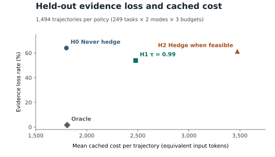

# 任务09　低置信度时多保留一个片段的成本与证据丢失

在 22,158 个训练状态上，平均单步奖励最高的阈值为 **τ=0.99**，平均奖励 1.204460（n=22,158）。留出集采用这一阈值时（H1），有 53.95%（806/1,494） 的轨迹在末步缺失至少一个金标片段，末步平均召回为 90.623%（n=1,494），每条轨迹平均缓存成本为 2,478.70（n=1,494） 等价输入 token。

## 打分核对

策略使用原始 Qwen3-1.7B 加任务06的 SFT v2 checkpoint-2000 适配器。对每个本步新到且尚未保留的片段，在原评测提示下累加 JSON 前缀 `{"add":[`、片段本地编号和结束分隔符 `],"` 的 token 对数概率。候选分数经 softmax 归一化，最高概率低于阈值时，先执行有效的贪心动作，再尝试加入排名最高且尚未加入的候选。增加片段后仍须满足预算。贪心动作无效时沿用原评测的空操作。

从任务06的全部 13,926 个有效步骤中随机固定 n=300 步。打分器对所有候选的共同贪心前缀，由模型原始 logits 在 float64 中独立归一化，分叉后的 token 按指定候选强制解码。评估时读取同一次前向计算中 vLLM 自行返回的生成对数概率。

| 检查 | 观测 |
| --- | --- |
| 最高分候选与原贪心添加编号一致 | 99.00%（297/300，门槛 99%） |
| 贪心候选分数与生成对数概率的差值不超过 0.02 nat | 300/300，最大绝对差 7.023534e-07 nat（n=300） |
| 包含终止符的诊断原文重编码后与完整生成 ID 相同 | 300/300 |
| 任务06默认展示正文重编码后与正文 token 相同 | 300/300 |
| 任务06默认展示正文直接重编码后与含终止符的完整 ID 相同 | 0/300 |

原档案有 300/300 个输出以 EOS 终止。按原始记录补回 EOS，完整序列逐条相同 （300/300）。CPU 逐项复算 5,966/5,966 个候选分数，概率核对覆盖 n=3,134 个生成 token。 [打分回执](score_checks.json) · [CPU 复核](score_checks_cpu_replay.json)

## 训练状态上的阈值选择

固定 SFT 策略提供 n=400 个训练任务、n=2,400 条轨迹、n=22,158 个状态。在每个状态上对同一贪心动作试算各阈值；按合并平均单步奖励取最大值，并列时选较小阈值。奖励系数 λ=0.3。阈值表的当前金标漏加率只计当前金标在新候选中、此前未保留的步骤。加段率与额外 token 按全部状态平均，命中率按实际额外加段的次数计算。 [训练集选点回执](train_selection.json)

### 合并

| 阈值 τ | 加段率 | 当前金标漏加率 | 平均额外 token/步 | 平均单步奖励 | 加段命中率 |
| --- | --- | --- | --- | --- | --- |
| 0 | 0.00%（0/22,158） | 6.90%（1,529/22,146） | 0.000（n=22,158） | 1.187236（n=22,158） | 未定义（n=0） |
| 0.5 | 3.16%（700/22,158） | 5.93%（1,313/22,146） | 5.078（n=22,158） | 1.191784（n=22,158） | 31.71%（222/700） |
| 0.6 | 5.30%（1,175/22,158） | 5.13%（1,136/22,146） | 8.424（n=22,158） | 1.196387（n=22,158） | 34.30%（403/1,175） |
| 0.7 | 8.22%（1,821/22,158） | 4.37%（967/22,146） | 12.932（n=22,158） | 1.199905（n=22,158） | 31.63%（576/1,821） |
| 0.8 | 11.12%（2,465/22,158） | 3.87%（857/22,146） | 17.139（n=22,158） | 1.202050（n=22,158） | 28.19%（695/2,465） |
| 0.9 | 15.23%（3,374/22,158） | 3.39%（750/22,146） | 23.075（n=22,158） | 1.203744（n=22,158） | 23.77%（802/3,374） |
| 0.95 | 18.97%（4,203/22,158） | 3.22%（714/22,146） | 28.064（n=22,158） | 1.204174（n=22,158） | 19.94%（838/4,203） |
| 0.99 | 30.41%（6,739/22,158） | 2.84%（630/22,146） | 43.472（n=22,158） | 1.204460（n=22,158） | 13.71%（924/6,739） |
| 1.01 | 99.72%（22,096/22,158） | 2.73%（604/22,146） | 119.863（n=22,158） | 1.196955（n=22,158） | 4.33%（957/22,096） |

### 重选 · 紧

| 阈值 τ | 加段率 | 当前金标漏加率 | 平均额外 token/步 | 平均单步奖励 | 加段命中率 |
| --- | --- | --- | --- | --- | --- |
| 0 | 0.00%（0/3,693） | 6.83%（252/3,691） | 0.000（n=3,693） | 1.152538（n=3,693） | 未定义（n=0） |
| 0.5 | 3.09%（114/3,693） | 6.01%（222/3,691） | 4.776（n=3,693） | 1.155544（n=3,693） | 27.19%（31/114） |
| 0.6 | 5.20%（192/3,693） | 5.23%（193/3,691） | 8.076（n=3,693） | 1.159637（n=3,693） | 31.77%（61/192） |
| 0.7 | 7.99%（295/3,693） | 4.47%（165/3,691） | 12.234（n=3,693） | 1.162729（n=3,693） | 30.51%（90/295） |
| 0.8 | 10.97%（405/3,693） | 3.96%（146/3,691） | 16.774（n=3,693） | 1.164616（n=3,693） | 27.41%（111/405） |
| 0.9 | 15.00%（554/3,693） | 3.47%（128/3,691） | 22.434（n=3,693） | 1.166049（n=3,693） | 23.29%（129/554） |
| 0.95 | 18.49%（683/3,693） | 3.33%（123/3,691） | 27.155（n=3,693） | 1.166005（n=3,693） | 19.62%（134/683） |
| 0.99 | 29.98%（1,107/3,693） | 2.93%（108/3,691） | 42.396（n=3,693） | 1.165549（n=3,693） | 13.46%（149/1,107） |
| 1.01 | 99.30%（3,667/3,693） | 2.82%（104/3,691） | 118.788（n=3,693） | 1.153962（n=3,693） | 4.20%（154/3,667） |

### 重选 · 中

| 阈值 τ | 加段率 | 当前金标漏加率 | 平均额外 token/步 | 平均单步奖励 | 加段命中率 |
| --- | --- | --- | --- | --- | --- |
| 0 | 0.00%（0/3,693） | 6.91%（255/3,691） | 0.000（n=3,693） | 1.186040（n=3,693） | 未定义（n=0） |
| 0.5 | 3.14%（116/3,693） | 5.99%（221/3,691） | 4.999（n=3,693） | 1.189716（n=3,693） | 29.31%（34/116） |
| 0.6 | 5.33%（197/3,693） | 5.17%（191/3,691） | 8.430（n=3,693） | 1.194749（n=3,693） | 32.49%（64/197） |
| 0.7 | 8.23%（304/3,693） | 4.31%（159/3,691） | 12.779（n=3,693） | 1.198591（n=3,693） | 31.58%（96/304） |
| 0.8 | 11.08%（409/3,693） | 3.87%（143/3,691） | 16.858（n=3,693） | 1.200679（n=3,693） | 27.87%（114/409） |
| 0.9 | 15.19%（561/3,693） | 3.33%（123/3,691） | 22.934（n=3,693） | 1.202637（n=3,693） | 23.89%（134/561） |
| 0.95 | 18.87%（697/3,693） | 3.20%（118/3,691） | 27.681（n=3,693） | 1.202880（n=3,693） | 19.94%（139/697） |
| 0.99 | 30.41%（1,123/3,693） | 2.79%（103/3,691） | 43.286（n=3,693） | 1.203314（n=3,693） | 13.71%（154/1,123） |
| 1.01 | 99.97%（3,692/3,693） | 2.66%（98/3,691） | 120.214（n=3,693） | 1.195844（n=3,693） | 4.33%（160/3,692） |

### 重选 · 松

| 阈值 τ | 加段率 | 当前金标漏加率 | 平均额外 token/步 | 平均单步奖励 | 加段命中率 |
| --- | --- | --- | --- | --- | --- |
| 0 | 0.00%（0/3,693） | 6.85%（253/3,691） | 0.000（n=3,693） | 1.218724（n=3,693） | 未定义（n=0） |
| 0.5 | 3.11%（115/3,693） | 6.01%（222/3,691） | 5.010（n=3,693） | 1.222817（n=3,693） | 26.96%（31/115） |
| 0.6 | 5.42%（200/3,693） | 5.07%（187/3,691） | 8.585（n=3,693） | 1.228571（n=3,693） | 33.00%（66/200） |
| 0.7 | 8.10%（299/3,693） | 4.39%（162/3,691） | 12.834（n=3,693） | 1.231912（n=3,693） | 30.43%（91/299） |
| 0.8 | 10.94%（404/3,693） | 3.90%（144/3,691） | 16.916（n=3,693） | 1.234671（n=3,693） | 27.48%（111/404） |
| 0.9 | 15.19%（561/3,693） | 3.36%（124/3,691） | 23.060（n=3,693） | 1.237218（n=3,693） | 23.35%（131/561） |
| 0.95 | 18.85%（696/3,693） | 3.20%（118/3,691） | 27.992（n=3,693） | 1.238111（n=3,693） | 19.68%（137/696） |
| 0.99 | 30.41%（1,123/3,693） | 2.84%（105/3,691） | 43.507（n=3,693） | 1.238951（n=3,693） | 13.36%（150/1,123） |
| 1.01 | 100.00%（3,693/3,693） | 2.71%（100/3,691） | 119.766（n=3,693） | 1.235742（n=3,693） | 4.25%（157/3,693） |

### 只追加 · 紧

| 阈值 τ | 加段率 | 当前金标漏加率 | 平均额外 token/步 | 平均单步奖励 | 加段命中率 |
| --- | --- | --- | --- | --- | --- |
| 0 | 0.00%（0/3,693） | 6.96%（257/3,691） | 0.000（n=3,693） | 1.154096（n=3,693） | 未定义（n=0） |
| 0.5 | 3.17%（117/3,693） | 5.96%（220/3,691） | 5.108（n=3,693） | 1.158365（n=3,693） | 33.33%（39/117） |
| 0.6 | 5.33%（197/3,693） | 5.20%（192/3,691） | 8.552（n=3,693） | 1.162425（n=3,693） | 34.52%（68/197） |
| 0.7 | 8.29%（306/3,693） | 4.55%（168/3,691） | 13.018（n=3,693） | 1.164888（n=3,693） | 30.39%（93/306） |
| 0.8 | 11.24%（415/3,693） | 3.93%（145/3,691） | 17.193（n=3,693） | 1.166913（n=3,693） | 28.19%（117/415） |
| 0.9 | 15.22%（562/3,693） | 3.55%（131/3,691） | 23.067（n=3,693） | 1.167605（n=3,693） | 23.31%（131/562） |
| 0.95 | 18.95%（700/3,693） | 3.36%（124/3,691） | 28.070（n=3,693） | 1.167724（n=3,693） | 19.71%（138/700） |
| 0.99 | 30.30%（1,119/3,693） | 2.98%（110/3,691） | 43.428（n=3,693） | 1.167104（n=3,693） | 13.58%（152/1,119） |
| 1.01 | 99.08%（3,659/3,693） | 2.87%（106/3,691） | 118.978（n=3,693） | 1.155611（n=3,693） | 4.32%（158/3,659） |

### 只追加 · 中

| 阈值 τ | 加段率 | 当前金标漏加率 | 平均额外 token/步 | 平均单步奖励 | 加段命中率 |
| --- | --- | --- | --- | --- | --- |
| 0 | 0.00%（0/3,693） | 6.96%（257/3,691） | 0.000（n=3,693） | 1.189587（n=3,693） | 未定义（n=0） |
| 0.5 | 3.11%（115/3,693） | 5.91%（218/3,691） | 4.938（n=3,693） | 1.194942（n=3,693） | 34.78%（40/115） |
| 0.6 | 5.39%（199/3,693） | 5.07%（187/3,691） | 8.538（n=3,693） | 1.199299（n=3,693） | 36.18%（72/199） |
| 0.7 | 8.39%（310/3,693） | 4.28%（158/3,691） | 13.384（n=3,693） | 1.203083（n=3,693） | 32.90%（102/310） |
| 0.8 | 11.24%（415/3,693） | 3.82%（141/3,691） | 17.378（n=3,693） | 1.204967（n=3,693） | 28.92%（120/415） |
| 0.9 | 15.35%（567/3,693） | 3.33%（123/3,691） | 23.411（n=3,693） | 1.206534（n=3,693） | 24.34%（138/567） |
| 0.95 | 19.28%（712/3,693） | 3.17%（117/3,691） | 28.684（n=3,693） | 1.206883（n=3,693） | 20.22%（144/712） |
| 0.99 | 30.71%（1,134/3,693） | 2.79%（103/3,691） | 44.119（n=3,693） | 1.207322（n=3,693） | 14.02%（159/1,134） |
| 1.01 | 99.97%（3,692/3,693） | 2.68%（99/3,691） | 120.665（n=3,693） | 1.199677（n=3,693） | 4.44%（164/3,692） |

### 只追加 · 松

| 阈值 τ | 加段率 | 当前金标漏加率 | 平均额外 token/步 | 平均单步奖励 | 加段命中率 |
| --- | --- | --- | --- | --- | --- |
| 0 | 0.00%（0/3,693） | 6.91%（255/3,691） | 0.000（n=3,693） | 1.222433（n=3,693） | 未定义（n=0） |
| 0.5 | 3.33%（123/3,693） | 5.69%（210/3,691） | 5.638（n=3,693） | 1.229322（n=3,693） | 38.21%（47/123） |
| 0.6 | 5.14%（190/3,693） | 5.04%（186/3,691） | 8.361（n=3,693） | 1.233639（n=3,693） | 37.89%（72/190） |
| 0.7 | 8.31%（307/3,693） | 4.20%（155/3,691） | 13.345（n=3,693） | 1.238230（n=3,693） | 33.88%（104/307） |
| 0.8 | 11.29%（417/3,693） | 3.74%（138/3,691） | 17.715（n=3,693） | 1.240451（n=3,693） | 29.26%（122/417） |
| 0.9 | 15.41%（569/3,693） | 3.28%（121/3,691） | 23.545（n=3,693） | 1.242420（n=3,693） | 24.43%（139/569） |
| 0.95 | 19.36%（715/3,693） | 3.09%（114/3,691） | 28.800（n=3,693） | 1.243442（n=3,693） | 20.42%（146/715） |
| 0.99 | 30.68%（1,133/3,693） | 2.74%（101/3,691） | 44.095（n=3,693） | 1.244517（n=3,693） | 14.12%（160/1,133） |
| 1.01 | 100.00%（3,693/3,693） | 2.63%（97/3,691） | 120.764（n=3,693） | 1.240893（n=3,693） | 4.44%（164/3,693） |

## H0 与任务06的一致性

H0 关闭额外加段。每次闭环复用任务05留出文件的 SHA-256，并与任务06对齐首步用户文本与提示 token ID；H0、H1、H2 的两项首步差异均为 0/1,494（每次运行）。下表逐步对齐模式、预算、任务、步号，核对提示和完整输入状态（包括金标与片段编号映射），再比对原始贪心输出。差值采用 H0 减 SFT v2，比例差为百分点，成本差为等价输入 token。 [H0 逐项对照](nohedge/extra.json) · [任务06指标](../sft_run_v2/checkpoint-2000_results.json)

| 模式与预算 | 相同状态上原始输出不同 | 末召回差 | 证据丢失率差 | 单步召回差 | 按轨迹平均的单步召回差 | 末步占用率差 | 缓存成本差 |
| --- | --- | --- | --- | --- | --- | --- | --- |
| 合并 | 0.705%（96/13,618） | -0.0144（n=1,494） | +0.0669（n=1,494） | -0.0132（n=13,956） | -0.0105（n=1,494） | -0.0385（n=1,494） | -2.2651（n=1,494） |
| 重选 · 紧 | 0.839%（19/2,264） | -0.1344（n=249） | +0.4016（n=249） | +0.0225（n=2,326） | +0.0297（n=249） | -0.1899（n=249） | -4.9588（n=249） |
| 重选 · 中 | 0.840%（19/2,263） | +0.1573（n=249） | -0.4016（n=249） | -0.0030（n=2,326） | +0.0078（n=249） | -0.0491（n=249） | -6.8769（n=249） |
| 重选 · 松 | 0.794%（18/2,268） | +0.0596（n=249） | -0.8032（n=249） | -0.0120（n=2,326） | -0.0075（n=249） | +0.0056（n=249） | -2.3361（n=249） |
| 只追加 · 紧 | 0.662%（15/2,265） | -0.0886（n=249） | +0.8032（n=249） | -0.0163（n=2,326） | -0.0174（n=249） | -0.0638（n=249） | -1.5954（n=249） |
| 只追加 · 中 | 0.707%（16/2,263） | +0.1238（n=249） | +0.0000（n=249） | -0.0257（n=2,326） | -0.0255（n=249） | +0.0682（n=249） | +2.3442（n=249） |
| 只追加 · 松 | 0.392%（9/2,295） | -0.2038（n=249） | +0.4016（n=249） | -0.0445（n=2,326） | -0.0500（n=249） | -0.0021（n=249） | -0.1673（n=249） |

| 模式与预算 | 非法 JSON 率差 | 无效候选编号率差 | 只追加模式删除率差 | 超预算率差 |
| --- | --- | --- | --- | --- |
| 合并 | +0.0000（n=13,956） | +0.0000（n=13,956） | +0.0000（n=13,956） | -0.0072（n=13,956） |
| 重选 · 紧 | +0.0000（n=2,326） | +0.0000（n=2,326） | +0.0000（n=2,326） | -0.0430（n=2,326） |
| 重选 · 中 | +0.0000（n=2,326） | +0.0000（n=2,326） | +0.0000（n=2,326） | +0.0000（n=2,326） |
| 重选 · 松 | +0.0000（n=2,326） | +0.0000（n=2,326） | +0.0000（n=2,326） | +0.0000（n=2,326） |
| 只追加 · 紧 | +0.0000（n=2,326） | +0.0000（n=2,326） | +0.0000（n=2,326） | +0.0000（n=2,326） |
| 只追加 · 中 | +0.0000（n=2,326） | +0.0000（n=2,326） | +0.0000（n=2,326） | +0.0000（n=2,326） |
| 只追加 · 松 | +0.0000（n=2,326） | +0.0000（n=2,326） | +0.0000（n=2,326） | +0.0000（n=2,326） |

## 留出集闭环比较

每种策略在 n=249 个相同的留出任务上执行两种模式与三档预算，合并 n=1,494 条轨迹。每种加段策略各运行一次（n=1 次/策略）。末召回按轨迹平均，证据丢失指末步缺失至少一个金标片段；单步召回以步为单位汇总。末步占用率为最后一步保留 token 数除以有效预算。缓存成本为每条轨迹累计的等价基础输入 token，延续原评测的读写计价。每步新增的分母包括无效动作的空操作，同时列出仅按有效步计算的均值。历史基线未使用额外加段机制，两个加段指标记为不适用。 [SFT v2](../sft_run_v2/checkpoint-2000_results.json) · [GRPO](../grpo_v2/checkpoint-500/checkpoint-500_results.json) · [BM25](../sft_run/bm25_results.json) · [Oracle](../sft_run/oracle_results.json) · [历史新增片段统计](../grpo_v2/merged_sft_v2/extra.json)

### 合并

| 策略 | 末召回 | 证据丢失率 | 单步召回 | 末步占用率 | 缓存成本/轨迹 | 新增片段/步 | 新增片段/有效步 | 加段率 | 加段命中率 |
| --- | --- | --- | --- | --- | --- | --- | --- | --- | --- |
| H0 关闭加段 | 88.992%（n=1,494） | 64.06%（957/1,494） | 96.165%（n=13,956） | 43.32%（n=1,494） | 1,800.30（n=1,494） | 0.9979（n=13,956） | 1.0000（n=13,927） | 0.00%（0/13,956） | 未定义（n=0） |
| H1 训练阈值 | 90.623%（n=1,494） | 53.95%（806/1,494） | 97.323%（n=13,956） | 51.17%（n=1,494） | 2,478.70（n=1,494） | 1.3247（n=13,956） | 1.3369（n=13,828） | 33.42%（4,664/13,956） | 17.37%（810/4,664） |
| H2 预算允许即加段 | 88.136%（n=1,494） | 61.31%（916/1,494） | 97.041%（n=13,956） | 60.35%（n=1,494） | 3,475.33（n=1,494） | 1.9215（n=13,956） | 1.9834（n=13,521） | 95.32%（13,303/13,956） | 5.92%（787/13,303） |
| SFT v2 checkpoint-2000 | 89.006%（n=1,494） | 63.99%（956/1,494） | 96.178%（n=13,956） | 43.36%（n=1,494） | 1,802.57（n=1,494） | 0.9979（n=13,956） | 1.0000（n=13,926） | 不适用 | 不适用 |
| GRPO checkpoint-500 | 89.297%（n=1,494） | 63.39%（947/1,494） | 96.237%（n=13,956） | 43.60%（n=1,494） | 1,799.63（n=1,494） | 0.9982（n=13,956） | 0.9998（n=13,934） | 不适用 | 不适用 |
| BM25 | 30.737%（n=1,494） | 99.93%（1,493/1,494） | 73.070%（n=13,956） | 99.50%（n=1,494） | 15,910.42（n=1,494） | 5.6611（n=13,956） | 5.6611（n=13,956） | 不适用 | 不适用 |
| Oracle | 99.781%（n=1,494） | 1.61%（24/1,494） | 99.973%（n=13,956） | 43.65%（n=1,494） | 1,807.52（n=1,494） | 0.9983（n=13,956） | 0.9983（n=13,956） | 不适用 | 不适用 |

| 策略 | 非法 JSON | 无效候选编号 | 只追加模式删除 | 超预算 | 全部无效 |
| --- | --- | --- | --- | --- | --- |
| H0 关闭加段 | 0.000%（0/13,956） | 0.000%（0/13,956） | 0.000%（0/13,956） | 0.208%（29/13,956） | 0.208%（29/13,956） |
| H1 训练阈值 | 0.000%（0/13,956） | 0.000%（0/13,956） | 0.000%（0/13,956） | 0.917%（128/13,956） | 0.917%（128/13,956） |
| H2 预算允许即加段 | 0.000%（0/13,956） | 0.021%（3/13,956） | 0.000%（0/13,956） | 3.095%（432/13,956） | 3.117%（435/13,956） |
| SFT v2 checkpoint-2000 | 0.000%（0/13,956） | 0.000%（0/13,956） | 0.000%（0/13,956） | 0.215%（30/13,956） | 0.215%（30/13,956） |
| GRPO checkpoint-500 | 0.000%（0/13,956） | 0.000%（0/13,956） | 0.000%（0/13,956） | 0.158%（22/13,956） | 0.158%（22/13,956） |
| BM25 | 0.000%（0/13,956） | 0.000%（0/13,956） | 0.000%（0/13,956） | 0.000%（0/13,956） | 0.000%（0/13,956） |
| Oracle | 0.000%（0/13,956） | 0.000%（0/13,956） | 0.000%（0/13,956） | 0.000%（0/13,956） | 0.000%（0/13,956） |

### 重选 · 紧

| 策略 | 末召回 | 证据丢失率 | 单步召回 | 末步占用率 | 缓存成本/轨迹 | 新增片段/步 | 新增片段/有效步 | 加段率 | 加段命中率 |
| --- | --- | --- | --- | --- | --- | --- | --- | --- | --- |
| H0 关闭加段 | 88.080%（n=249） | 66.27%（165/249） | 95.992%（n=2,326） | 64.18%（n=249） | 1,791.91（n=249） | 0.9944（n=2,326） | 1.0000（n=2,313） | 0.00%（0/2,326） | 未定义（n=0） |
| H1 训练阈值 | 87.161%（n=249） | 69.48%（173/249） | 96.463%（n=2,326） | 67.63%（n=249） | 2,558.66（n=249） | 1.3336（n=2,326） | 1.3382（n=2,318） | 33.71%（784/2,326） | 17.35%（136/784） |
| H2 预算允许即加段 | 86.140%（n=249） | 73.49%（183/249） | 96.411%（n=2,326） | 71.48%（n=249） | 3,772.92（n=249） | 1.9841（n=2,326） | 1.9935（n=2,315） | 98.88%（2,300/2,326） | 6.09%（140/2,300） |
| SFT v2 checkpoint-2000 | 88.215%（n=249） | 65.86%（164/249） | 95.969%（n=2,326） | 64.37%（n=249） | 1,796.87（n=249） | 0.9940（n=2,326） | 1.0000（n=2,312） | 不适用 | 不适用 |
| GRPO checkpoint-500 | 88.702%（n=249） | 64.66%（161/249） | 96.114%（n=2,326） | 65.11%（n=249） | 1,794.34（n=249） | 0.9953（n=2,326） | 1.0000（n=2,315） | 不适用 | 不适用 |
| BM25 | 31.768%（n=249） | 100.00%（249/249） | 73.601%（n=2,326） | 99.07%（n=249） | 13,689.11（n=249） | 5.0365（n=2,326） | 5.0365（n=2,326） | 不适用 | 不适用 |
| Oracle | 99.531%（n=249） | 4.42%（11/249） | 99.945%（n=2,326） | 64.56%（n=249） | 1,818.14（n=249） | 0.9987（n=2,326） | 0.9987（n=2,326） | 不适用 | 不适用 |

| 策略 | 非法 JSON | 无效候选编号 | 只追加模式删除 | 超预算 | 全部无效 |
| --- | --- | --- | --- | --- | --- |
| H0 关闭加段 | 0.000%（0/2,326） | 0.000%（0/2,326） | 0.000%（0/2,326） | 0.559%（13/2,326） | 0.559%（13/2,326） |
| H1 训练阈值 | 0.000%（0/2,326） | 0.000%（0/2,326） | 0.000%（0/2,326） | 0.344%（8/2,326） | 0.344%（8/2,326） |
| H2 预算允许即加段 | 0.000%（0/2,326） | 0.000%（0/2,326） | 0.000%（0/2,326） | 0.473%（11/2,326） | 0.473%（11/2,326） |
| SFT v2 checkpoint-2000 | 0.000%（0/2,326） | 0.000%（0/2,326） | 0.000%（0/2,326） | 0.602%（14/2,326） | 0.602%（14/2,326） |
| GRPO checkpoint-500 | 0.000%（0/2,326） | 0.000%（0/2,326） | 0.000%（0/2,326） | 0.473%（11/2,326） | 0.473%（11/2,326） |
| BM25 | 0.000%（0/2,326） | 0.000%（0/2,326） | 0.000%（0/2,326） | 0.000%（0/2,326） | 0.000%（0/2,326） |
| Oracle | 0.000%（0/2,326） | 0.000%（0/2,326） | 0.000%（0/2,326） | 0.000%（0/2,326） | 0.000%（0/2,326） |

### 只追加 · 紧

| 策略 | 末召回 | 证据丢失率 | 单步召回 | 末步占用率 | 缓存成本/轨迹 | 新增片段/步 | 新增片段/有效步 | 加段率 | 加段命中率 |
| --- | --- | --- | --- | --- | --- | --- | --- | --- | --- |
| H0 关闭加段 | 89.339%（n=249） | 63.05%（157/249） | 96.243%（n=2,326） | 65.07%（n=249） | 1,785.07（n=249） | 0.9940（n=2,326） | 1.0000（n=2,312） | 0.00%（0/2,326） | 未定义（n=0） |
| H1 训练阈值 | 90.968%（n=249） | 46.18%（115/249） | 97.684%（n=2,326） | 81.43%（n=249） | 2,247.83（n=249） | 1.2472（n=2,326） | 1.3115（n=2,212） | 29.71%（691/2,326） | 17.95%（124/691） |
| H2 预算允许即加段 | 80.510%（n=249） | 75.10%（187/249） | 96.221%（n=2,326） | 95.58%（n=249） | 2,697.68（n=249） | 1.5959（n=2,326） | 1.9134（n=1,940） | 76.31%（1,775/2,326） | 5.92%（105/1,775） |
| SFT v2 checkpoint-2000 | 89.427%（n=249） | 62.25%（155/249） | 96.259%（n=2,326） | 65.13%（n=249） | 1,786.66（n=249） | 0.9940（n=2,326） | 1.0000（n=2,312） | 不适用 | 不适用 |
| GRPO checkpoint-500 | 89.238%（n=249） | 63.86%（159/249） | 96.234%（n=2,326） | 65.23%（n=249） | 1,789.16（n=249） | 0.9948（n=2,326） | 0.9996（n=2,315） | 不适用 | 不适用 |
| BM25 | 11.659%（n=249） | 100.00%（249/249） | 52.769%（n=2,326） | 99.36%（n=249） | 3,101.38（n=249） | 2.0189（n=2,326） | 2.0189（n=2,326） | 不适用 | 不适用 |
| Oracle | 99.243%（n=249） | 4.42%（11/249） | 99.903%（n=2,326） | 65.16%（n=249） | 1,786.94（n=249） | 0.9918（n=2,326） | 0.9918（n=2,326） | 不适用 | 不适用 |

| 策略 | 非法 JSON | 无效候选编号 | 只追加模式删除 | 超预算 | 全部无效 |
| --- | --- | --- | --- | --- | --- |
| H0 关闭加段 | 0.000%（0/2,326） | 0.000%（0/2,326） | 0.000%（0/2,326） | 0.602%（14/2,326） | 0.602%（14/2,326） |
| H1 训练阈值 | 0.000%（0/2,326） | 0.000%（0/2,326） | 0.000%（0/2,326） | 4.901%（114/2,326） | 4.901%（114/2,326） |
| H2 预算允许即加段 | 0.000%（0/2,326） | 0.086%（2/2,326） | 0.000%（0/2,326） | 16.509%（384/2,326） | 16.595%（386/2,326） |
| SFT v2 checkpoint-2000 | 0.000%（0/2,326） | 0.000%（0/2,326） | 0.000%（0/2,326） | 0.602%（14/2,326） | 0.602%（14/2,326） |
| GRPO checkpoint-500 | 0.000%（0/2,326） | 0.000%（0/2,326） | 0.000%（0/2,326） | 0.473%（11/2,326） | 0.473%（11/2,326） |
| BM25 | 0.000%（0/2,326） | 0.000%（0/2,326） | 0.000%（0/2,326） | 0.000%（0/2,326） | 0.000%（0/2,326） |
| Oracle | 0.000%（0/2,326） | 0.000%（0/2,326） | 0.000%（0/2,326） | 0.000%（0/2,326） | 0.000%（0/2,326） |

### 重选 · 中

| 策略 | 末召回 | 证据丢失率 | 单步召回 | 末步占用率 | 缓存成本/轨迹 | 新增片段/步 | 新增片段/有效步 | 加段率 | 加段命中率 |
| --- | --- | --- | --- | --- | --- | --- | --- | --- | --- |
| H0 关闭加段 | 88.664%（n=249） | 65.06%（162/249） | 96.075%（n=2,326） | 43.32%（n=249） | 1,810.37（n=249） | 0.9996（n=2,326） | 1.0000（n=2,325） | 0.00%（0/2,326） | 未定义（n=0） |
| H1 训练阈值 | 87.274%（n=249） | 69.48%（173/249） | 96.480%（n=2,326） | 45.62%（n=249） | 2,582.20（n=249） | 1.3457（n=2,326） | 1.3457（n=2,326） | 34.57%（804/2,326） | 17.16%（138/804） |
| H2 预算允许即加段 | 86.532%（n=249） | 72.69%（181/249） | 96.406%（n=2,326） | 48.43%（n=249） | 3,815.05（n=249） | 2.0000（n=2,326） | 2.0000（n=2,326） | 100.00%（2,326/2,326） | 6.02%（140/2,326） |
| SFT v2 checkpoint-2000 | 88.506%（n=249） | 65.46%（163/249） | 96.078%（n=2,326） | 43.37%（n=249） | 1,817.25（n=249） | 0.9996（n=2,326） | 1.0000（n=2,325） | 不适用 | 不适用 |
| GRPO checkpoint-500 | 89.148%（n=249） | 63.05%（157/249） | 96.212%（n=2,326） | 43.71%（n=249） | 1,805.75（n=249） | 1.0000（n=2,326） | 1.0000（n=2,326） | 不适用 | 不适用 |
| BM25 | 39.266%（n=249） | 100.00%（249/249） | 80.321%（n=2,326） | 99.48%（n=249） | 21,578.66（n=249） | 6.9445（n=2,326） | 6.9445（n=2,326） | 不适用 | 不适用 |
| Oracle | 99.955%（n=249） | 0.40%（1/249） | 99.995%（n=2,326） | 44.02%（n=249） | 1,807.65（n=249） | 0.9996（n=2,326） | 0.9996（n=2,326） | 不适用 | 不适用 |

| 策略 | 非法 JSON | 无效候选编号 | 只追加模式删除 | 超预算 | 全部无效 |
| --- | --- | --- | --- | --- | --- |
| H0 关闭加段 | 0.000%（0/2,326） | 0.000%（0/2,326） | 0.000%（0/2,326） | 0.043%（1/2,326） | 0.043%（1/2,326） |
| H1 训练阈值 | 0.000%（0/2,326） | 0.000%（0/2,326） | 0.000%（0/2,326） | 0.000%（0/2,326） | 0.000%（0/2,326） |
| H2 预算允许即加段 | 0.000%（0/2,326） | 0.000%（0/2,326） | 0.000%（0/2,326） | 0.000%（0/2,326） | 0.000%（0/2,326） |
| SFT v2 checkpoint-2000 | 0.000%（0/2,326） | 0.000%（0/2,326） | 0.000%（0/2,326） | 0.043%（1/2,326） | 0.043%（1/2,326） |
| GRPO checkpoint-500 | 0.000%（0/2,326） | 0.000%（0/2,326） | 0.000%（0/2,326） | 0.000%（0/2,326） | 0.000%（0/2,326） |
| BM25 | 0.000%（0/2,326） | 0.000%（0/2,326） | 0.000%（0/2,326） | 0.000%（0/2,326） | 0.000%（0/2,326） |
| Oracle | 0.000%（0/2,326） | 0.000%（0/2,326） | 0.000%（0/2,326） | 0.000%（0/2,326） | 0.000%（0/2,326） |

### 只追加 · 中

| 策略 | 末召回 | 证据丢失率 | 单步召回 | 末步占用率 | 缓存成本/轨迹 | 新增片段/步 | 新增片段/有效步 | 加段率 | 加段命中率 |
| --- | --- | --- | --- | --- | --- | --- | --- | --- | --- |
| H0 关闭加段 | 89.710%（n=249） | 62.65%（156/249） | 96.286%（n=2,326） | 43.84%（n=249） | 1,801.75（n=249） | 0.9996（n=2,326） | 1.0000（n=2,325） | 0.00%（0/2,326） | 未定义（n=0） |
| H1 训练阈值 | 95.369%（n=249） | 34.54%（86/249） | 98.419%（n=2,326） | 59.59%（n=249） | 2,443.53（n=249） | 1.3366（n=2,326） | 1.3401（n=2,320） | 33.96%（790/2,326） | 17.59%（139/790） |
| H2 预算允许即加段 | 93.834%（n=249） | 40.16%（100/249） | 98.306%（n=2,326） | 80.58%（n=249） | 3,323.33（n=249） | 1.9510（n=2,326） | 1.9825（n=2,289） | 96.78%（2,251/2,326） | 5.64%（127/2,251） |
| SFT v2 checkpoint-2000 | 89.586%（n=249） | 62.65%（156/249） | 96.311%（n=2,326） | 43.77%（n=249） | 1,799.41（n=249） | 0.9996（n=2,326） | 1.0000（n=2,325） | 不适用 | 不适用 |
| GRPO checkpoint-500 | 89.694%（n=249） | 62.65%（156/249） | 96.304%（n=2,326） | 43.75%（n=249） | 1,798.39（n=249） | 0.9996（n=2,326） | 0.9996（n=2,326） | 不适用 | 不适用 |
| BM25 | 16.705%（n=249） | 100.00%（249/249） | 62.547%（n=2,326） | 99.60%（n=249） | 4,632.73（n=249） | 2.9428（n=2,326） | 2.9428（n=2,326） | 不适用 | 不适用 |
| Oracle | 99.955%（n=249） | 0.40%（1/249） | 99.995%（n=2,326） | 44.02%（n=249） | 1,807.65（n=249） | 0.9996（n=2,326） | 0.9996（n=2,326） | 不适用 | 不适用 |

| 策略 | 非法 JSON | 无效候选编号 | 只追加模式删除 | 超预算 | 全部无效 |
| --- | --- | --- | --- | --- | --- |
| H0 关闭加段 | 0.000%（0/2,326） | 0.000%（0/2,326） | 0.000%（0/2,326） | 0.043%（1/2,326） | 0.043%（1/2,326） |
| H1 训练阈值 | 0.000%（0/2,326） | 0.000%（0/2,326） | 0.000%（0/2,326） | 0.258%（6/2,326） | 0.258%（6/2,326） |
| H2 预算允许即加段 | 0.000%（0/2,326） | 0.000%（0/2,326） | 0.000%（0/2,326） | 1.591%（37/2,326） | 1.591%（37/2,326） |
| SFT v2 checkpoint-2000 | 0.000%（0/2,326） | 0.000%（0/2,326） | 0.000%（0/2,326） | 0.043%（1/2,326） | 0.043%（1/2,326） |
| GRPO checkpoint-500 | 0.000%（0/2,326） | 0.000%（0/2,326） | 0.000%（0/2,326） | 0.000%（0/2,326） | 0.000%（0/2,326） |
| BM25 | 0.000%（0/2,326） | 0.000%（0/2,326） | 0.000%（0/2,326） | 0.000%（0/2,326） | 0.000%（0/2,326） |
| Oracle | 0.000%（0/2,326） | 0.000%（0/2,326） | 0.000%（0/2,326） | 0.000%（0/2,326） | 0.000%（0/2,326） |

## 加段后的动作与证据

每步新增数量按执行后实际多保留的片段计数。无效动作维持原状，计入新增零段。同标题组指原始检索返回中另有不同片段与合格金标的标题完全相同；异标题组指没有这样的同标题片段。两组均按新返回、此前未保留、截至本步已揭示的金标片段计数，包含无效步。 [H0](nohedge/extra.json) · [H1](tau_star/extra.json) · [H2](always/extra.json)

### H0 关闭加段

| 模式与预算 | 新增 0 段 | 新增 1 段 | 新增 2 段 | 新增 ≥3 段 | 平均保留 token/步 | 平均额外 token/步 | 同标题新金标添加率 | 异标题新金标添加率 |
| --- | --- | --- | --- | --- | --- | --- | --- | --- |
| 合并 | 0.208%（29/13,956） | 99.792%（13,927/13,956） | 0.000%（0/13,956） | 0.000%（0/13,956） | 684.31（n=13,956） | 0.00（n=13,956） | 77.07%（2,460/3,192） | 90.74%（9,980/10,998） |
| 重选 · 紧 | 0.559%（13/2,326） | 99.441%（2,313/2,326） | 0.000%（0/2,326） | 0.000%（0/2,326） | 678.60（n=2,326） | 0.00（n=2,326） | 76.13%（405/532） | 90.46%（1,659/1,834） |
| 重选 · 中 | 0.043%（1/2,326） | 99.957%（2,325/2,326） | 0.000%（0/2,326） | 0.000%（0/2,326） | 682.79（n=2,326） | 0.00（n=2,326） | 76.65%（407/531） | 90.99%（1,667/1,832） |
| 重选 · 松 | 0.000%（0/2,326） | 100.000%（2,326/2,326） | 0.000%（0/2,326） | 0.000%（0/2,326） | 682.14（n=2,326） | 0.00（n=2,326） | 76.88%（409/532） | 90.78%（1,664/1,833） |
| 只追加 · 紧 | 0.602%（14/2,326） | 99.398%（2,312/2,326） | 0.000%（0/2,326） | 0.000%（0/2,326） | 685.80（n=2,326） | 0.00（n=2,326） | 77.63%（413/532） | 90.35%（1,657/1,834） |
| 只追加 · 中 | 0.043%（1/2,326） | 99.957%（2,325/2,326） | 0.000%（0/2,326） | 0.000%（0/2,326） | 688.34（n=2,326） | 0.00（n=2,326） | 77.44%（412/532） | 91.00%（1,668/1,833） |
| 只追加 · 松 | 0.000%（0/2,326） | 100.000%（2,326/2,326） | 0.000%（0/2,326） | 0.000%（0/2,326） | 688.16（n=2,326） | 0.00（n=2,326） | 77.67%（414/533） | 90.88%（1,665/1,832） |

### H1 训练阈值

| 模式与预算 | 新增 0 段 | 新增 1 段 | 新增 2 段 | 新增 ≥3 段 | 平均保留 token/步 | 平均额外 token/步 | 同标题新金标添加率 | 异标题新金标添加率 |
| --- | --- | --- | --- | --- | --- | --- | --- | --- |
| 合并 | 0.917%（128/13,956） | 65.699%（9,169/13,956） | 33.383%（4,659/13,956） | 0.000%（0/13,956） | 819.65（n=13,956） | 46.68（n=13,956） | 88.83%（2,791/3,142） | 94.90%（10,339/10,895） |
| 重选 · 紧 | 0.344%（8/2,326） | 65.950%（1,534/2,326） | 33.706%（784/2,326） | 0.000%（0/2,326） | 725.30（n=2,326） | 47.03（n=2,326） | 90.06%（471/523） | 95.37%（1,730/1,814） |
| 重选 · 中 | 0.000%（0/2,326） | 65.434%（1,522/2,326） | 34.566%（804/2,326） | 0.000%（0/2,326） | 727.66（n=2,326） | 48.29（n=2,326） | 90.25%（472/523） | 95.87%（1,739/1,814） |
| 重选 · 松 | 0.000%（0/2,326） | 65.735%（1,529/2,326） | 34.265%（797/2,326） | 0.000%（0/2,326） | 728.61（n=2,326） | 48.32（n=2,326） | 90.25%（472/523） | 95.59%（1,733/1,813） |
| 只追加 · 紧 | 4.901%（114/2,326） | 65.477%（1,523/2,326） | 29.622%（689/2,326） | 0.000%（0/2,326） | 887.86（n=2,326） | 40.29（n=2,326） | 81.90%（430/525） | 91.44%（1,666/1,822） |
| 只追加 · 中 | 0.258%（6/2,326） | 65.821%（1,531/2,326） | 33.921%（789/2,326） | 0.000%（0/2,326） | 923.50（n=2,326） | 47.91（n=2,326） | 90.46%（474/524） | 95.48%（1,734/1,816） |
| 只追加 · 松 | 0.000%（0/2,326） | 65.778%（1,530/2,326） | 34.222%（796/2,326） | 0.000%（0/2,326） | 924.96（n=2,326） | 48.21（n=2,326） | 90.08%（472/524） | 95.65%（1,737/1,816） |

### H2 预算允许即加段

| 模式与预算 | 新增 0 段 | 新增 1 段 | 新增 2 段 | 新增 ≥3 段 | 平均保留 token/步 | 平均额外 token/步 | 同标题新金标添加率 | 异标题新金标添加率 |
| --- | --- | --- | --- | --- | --- | --- | --- | --- |
| 合并 | 3.117%（435/13,956） | 1.612%（225/13,956） | 95.271%（13,296/13,956） | 0.000%（0/13,956） | 1,028.04（n=13,956） | 112.62（n=13,956） | 86.34%（2,706/3,134） | 92.79%（10,093/10,877） |
| 重选 · 紧 | 0.473%（11/2,326） | 0.645%（15/2,326） | 98.882%（2,300/2,326） | 0.000%（0/2,326） | 799.60（n=2,326） | 117.55（n=2,326） | 89.85%（469/522） | 95.46%（1,724/1,806） |
| 重选 · 中 | 0.000%（0/2,326） | 0.000%（0/2,326） | 100.000%（2,326/2,326） | 0.000%（0/2,326） | 802.40（n=2,326） | 119.67（n=2,326） | 90.61%（473/522） | 95.79%（1,729/1,805） |
| 重选 · 松 | 0.000%（0/2,326） | 0.000%（0/2,326） | 100.000%（2,326/2,326） | 0.000%（0/2,326） | 803.12（n=2,326） | 119.92（n=2,326） | 90.79%（473/521） | 95.68%（1,728/1,806） |
| 只追加 · 紧 | 16.595%（386/2,326） | 7.223%（168/2,326） | 76.182%（1,772/2,326） | 0.000%（0/2,326） | 1,169.16（n=2,326） | 86.41（n=2,326） | 68.44%（360/526） | 80.32%（1,477/1,839） |
| 只追加 · 中 | 1.591%（37/2,326） | 1.720%（40/2,326） | 96.690%（2,249/2,326） | 0.000%（0/2,326） | 1,289.88（n=2,326） | 113.15（n=2,326） | 88.12%（460/522） | 94.04%（1,704/1,812） |
| 只追加 · 松 | 0.043%（1/2,326） | 0.086%（2/2,326） | 99.871%（2,323/2,326） | 0.000%（0/2,326） | 1,304.07（n=2,326） | 119.04（n=2,326） | 90.40%（471/521） | 95.69%（1,731/1,809） |

## 缓存成本与证据丢失

| 策略 | 每条轨迹的平均缓存成本（等价输入 token） | 末步证据丢失率 |
| --- | --- | --- |
| H0 关闭加段 | 1,800.30（n=1,494） | 64.056%（957/1,494） |
| H1 训练阈值 | 2,478.70（n=1,494） | 53.949%（806/1,494） |
| H2 预算允许即加段 | 3,475.33（n=1,494） | 61.312%（916/1,494） |
| Oracle | 1,807.52（n=1,494） | 1.606%（24/1,494） |

[结构化结果与数据来源](hedge_v2_results.json)
