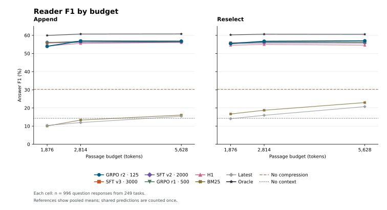
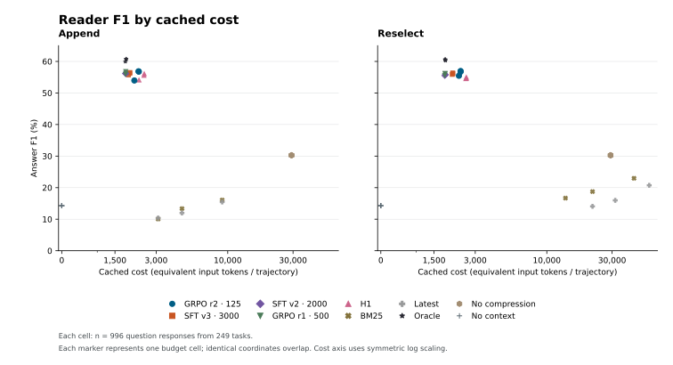

# MuSiQue 留出集阅读模型评测

Qwen3-8B 根据压缩器在轨迹末步保留的原文，分别回答每个任务的四道题。本次实际评分 49,800 条（n=249 个不同任务，996 道不同题）。同一问题在不同模式与预算下重复出现。合并分数对各格等权，每个预测均按任务03协议取标准答案和别名中的最高 EM 与 F1。

不压缩基线以 reselect|tight 为参照，逐任务比较末步段号及其顺序。有差异的任务数为 0/249，有差异的配置数为 0/6。六种配置共用一组读者预测。

用同一引擎重跑任务03的一致性小样，原始输出不同的提示共 1/40 条。

## 合并 F1 与 EM

| 策略 | 实测题次 n | F1 | EM |
| --- | --- | --- | --- |
| grpo_r2:checkpoint-125 | 5976 | 56.118% | 46.034% |
| sft_v3:checkpoint-3000 | 5976 | 56.137% | 45.716% |
| sft_v2:checkpoint-2000 | 5976 | 55.921% | 45.649% |
| grpo_r1:checkpoint-500 | 5976 | 56.147% | 45.750% |
| h1:tau_star | 5976 | 54.972% | 44.679% |
| bm25 | 5976 | 16.311% | 10.040% |
| latest | 5976 | 14.763% | 9.003% |
| oracle | 5976 | 60.480% | 50.067% |
| no_compress | 996 | 30.255% | 21.084% |
| no_context | 996 | 14.294% | 7.229% |

## 预注册的逐题配对比较

### grpo_r2:checkpoint-125 与 sft_v3:checkpoint-3000

左列模型减右列模型，F1 差 -0.019 个百分点，EM 差 +0.318 个百分点（各 n=5,976 对）。逐题 F1 左高 289、相等 5,396、右高 291（n=5,976 对）。

| EM 配对（n=5,976） | sft_v3:checkpoint-3000 正确 | sft_v3:checkpoint-3000 错误 |
| --- | --- | --- |
| grpo_r2:checkpoint-125 正确 | 2555 | 196 |
| grpo_r2:checkpoint-125 错误 | 177 | 3048 |

### grpo_r2:checkpoint-125 与 h1:tau_star

左列模型减右列模型，F1 差 +1.145 个百分点，EM 差 +1.355 个百分点（各 n=5,976 对）。逐题 F1 左高 439、相等 5,193、右高 344（n=5,976 对）。

| EM 配对（n=5,976） | h1:tau_star 正确 | h1:tau_star 错误 |
| --- | --- | --- |
| grpo_r2:checkpoint-125 正确 | 2459 | 292 |
| grpo_r2:checkpoint-125 错误 | 211 | 3014 |

## 按模式与预算

| 策略 | 模式 / 档 | 题次 n | F1 | EM | 缓存成本均值 | 成本轨迹 n |
| --- | --- | --- | --- | --- | --- | --- |
| grpo_r2:checkpoint-125 | reselect / tight | 996 | 55.454% | 45.783% | 2,279.40 | 249 |
| grpo_r2:checkpoint-125 | reselect / mid | 996 | 56.714% | 46.687% | 2,345.90 | 249 |
| grpo_r2:checkpoint-125 | reselect / loose | 996 | 56.956% | 46.988% | 2,345.27 | 249 |
| grpo_r2:checkpoint-125 | append / tight | 996 | 53.957% | 43.876% | 2,078.19 | 249 |
| grpo_r2:checkpoint-125 | append / mid | 996 | 56.865% | 46.586% | 2,229.01 | 249 |
| grpo_r2:checkpoint-125 | append / loose | 996 | 56.762% | 46.285% | 2,241.17 | 249 |
| sft_v3:checkpoint-3000 | reselect / tight | 996 | 55.877% | 45.984% | 2,037.49 | 249 |
| sft_v3:checkpoint-3000 | reselect / mid | 996 | 56.329% | 46.185% | 2,052.67 | 249 |
| sft_v3:checkpoint-3000 | reselect / loose | 996 | 56.165% | 45.884% | 2,058.70 | 249 |
| sft_v3:checkpoint-3000 | append / tight | 996 | 55.729% | 44.980% | 1,882.69 | 249 |
| sft_v3:checkpoint-3000 | append / mid | 996 | 56.235% | 45.683% | 1,924.13 | 249 |
| sft_v3:checkpoint-3000 | append / loose | 996 | 56.484% | 45.582% | 1,927.36 | 249 |
| sft_v2:checkpoint-2000 | reselect / tight | 996 | 55.502% | 45.482% | 1,796.87 | 249 |
| sft_v2:checkpoint-2000 | reselect / mid | 996 | 55.784% | 45.582% | 1,817.25 | 249 |
| sft_v2:checkpoint-2000 | reselect / loose | 996 | 55.765% | 45.783% | 1,814.18 | 249 |
| sft_v2:checkpoint-2000 | append / tight | 996 | 56.191% | 45.783% | 1,786.66 | 249 |
| sft_v2:checkpoint-2000 | append / mid | 996 | 56.105% | 45.582% | 1,799.41 | 249 |
| sft_v2:checkpoint-2000 | append / loose | 996 | 56.181% | 45.683% | 1,801.04 | 249 |
| grpo_r1:checkpoint-500 | reselect / tight | 996 | 55.566% | 45.382% | 1,794.34 | 249 |
| grpo_r1:checkpoint-500 | reselect / mid | 996 | 56.231% | 45.884% | 1,805.75 | 249 |
| grpo_r1:checkpoint-500 | reselect / loose | 996 | 56.062% | 45.683% | 1,809.21 | 249 |
| grpo_r1:checkpoint-500 | append / tight | 996 | 55.950% | 45.582% | 1,789.16 | 249 |
| grpo_r1:checkpoint-500 | append / mid | 996 | 56.806% | 46.386% | 1,798.39 | 249 |
| grpo_r1:checkpoint-500 | append / loose | 996 | 56.265% | 45.582% | 1,800.92 | 249 |
| h1:tau_star | reselect / tight | 996 | 54.524% | 44.277% | 2,558.66 | 249 |
| h1:tau_star | reselect / mid | 996 | 54.982% | 44.880% | 2,582.20 | 249 |
| h1:tau_star | reselect / loose | 996 | 54.591% | 44.578% | 2,585.73 | 249 |
| h1:tau_star | append / tight | 996 | 54.099% | 44.177% | 2,247.83 | 249 |
| h1:tau_star | append / mid | 996 | 55.559% | 44.779% | 2,443.53 | 249 |
| h1:tau_star | append / loose | 996 | 56.080% | 45.382% | 2,454.23 | 249 |
| bm25 | reselect / tight | 996 | 16.681% | 9.940% | 13,689.11 | 249 |
| bm25 | reselect / mid | 996 | 18.749% | 11.847% | 21,578.66 | 249 |
| bm25 | reselect / loose | 996 | 22.964% | 15.060% | 43,352.20 | 249 |
| bm25 | append / tight | 996 | 10.048% | 5.622% | 3,101.38 | 249 |
| bm25 | append / mid | 996 | 13.346% | 7.731% | 4,632.73 | 249 |
| bm25 | append / loose | 996 | 16.079% | 10.040% | 9,108.42 | 249 |
| latest | reselect / tight | 996 | 14.073% | 9.137% | 21,572.71 | 249 |
| latest | reselect / mid | 996 | 15.970% | 10.341% | 31,628.89 | 249 |
| latest | reselect / loose | 996 | 20.740% | 13.755% | 56,002.11 | 249 |
| latest | append / tight | 996 | 10.378% | 5.221% | 3,100.99 | 249 |
| latest | append / mid | 996 | 11.965% | 6.325% | 4,630.79 | 249 |
| latest | append / loose | 996 | 15.453% | 9.237% | 9,109.21 | 249 |
| oracle | reselect / tight | 996 | 60.269% | 49.900% | 1,818.14 | 249 |
| oracle | reselect / mid | 996 | 60.630% | 50.301% | 1,807.65 | 249 |
| oracle | reselect / loose | 996 | 60.572% | 50.100% | 1,812.38 | 249 |
| oracle | append / tight | 996 | 59.951% | 49.699% | 1,786.94 | 249 |
| oracle | append / mid | 996 | 60.701% | 50.100% | 1,807.65 | 249 |
| oracle | append / loose | 996 | 60.759% | 50.301% | 1,812.38 | 249 |
| no_compress | 各档共用 | 996 | 30.255% | 21.084% | 29,248.57 | 1494 |
| no_context | 各档共用 | 996 | 14.294% | 7.229% | 0.00 | 249 |

成本单位为每条压缩轨迹的等价输入 token。每格成本按已有策略结果计算，并与归档轨迹重算值核对。无上下文行的段落缓存成本取零。

## 证据齐全与轨迹丢失

题级齐全指该题的全部支撑段都在最终上下文中。轨迹级丢失指最终上下文缺少该任务任一证据，同一轨迹的四题一同分组。表中列出平均 F1 和实际题次，空组用破折号。

| 策略 | 该题证据齐全 | 该题证据不齐 | 轨迹丢证据 | 轨迹无丢失 |
| --- | --- | --- | --- | --- |
| grpo_r2:checkpoint-125 | 60.094%（n=5,039） | 34.736%（n=937） | 51.158%（n=2,856） | 60.658%（n=3,120） |
| sft_v3:checkpoint-3000 | 61.234%（n=4,776） | 35.850%（n=1,200） | 52.529%（n=3,544） | 61.394%（n=2,432） |
| sft_v2:checkpoint-2000 | 61.852%（n=4,596） | 36.170%（n=1,380） | 52.280%（n=3,824） | 62.391%（n=2,152） |
| grpo_r1:checkpoint-500 | 61.990%（n=4,629） | 36.068%（n=1,347） | 52.885%（n=3,788） | 61.793%（n=2,188） |
| h1:tau_star | 59.623%（n=4,813） | 35.725%（n=1,163） | 50.847%（n=3,224） | 59.806%（n=2,752） |
| bm25 | 43.740%（n=733） | 12.476%（n=5,243） | 16.322%（n=5,972） | 0.000%（n=4） |
| latest | 36.317%（n=589） | 12.407%（n=5,387） | 14.763%（n=5,976） | —（n=0） |
| oracle | 60.576%（n=5,951） | 37.668%（n=25） | 41.739%（n=96） | 60.786%（n=5,880） |
| no_compress | 30.255%（n=996） | —（n=0） | —（n=0） | 30.255%（n=996） |
| no_context | —（n=0） | 14.294%（n=996） | 14.294%（n=996） | —（n=0） |

## 题目跳数

| 策略 | 2 跳 | 3 跳 | 4 跳 |
| --- | --- | --- | --- |
| grpo_r2:checkpoint-125 | 60.242%（n=4,344） | 46.584%（n=1,260） | 40.251%（n=372） |
| sft_v3:checkpoint-3000 | 60.479%（n=4,344） | 44.894%（n=1,260） | 43.512%（n=372） |
| sft_v2:checkpoint-2000 | 60.245%（n=4,344） | 45.180%（n=1,260） | 41.820%（n=372） |
| grpo_r1:checkpoint-500 | 60.524%（n=4,344） | 45.240%（n=1,260） | 41.974%（n=372） |
| h1:tau_star | 58.862%（n=4,344） | 46.430%（n=1,260） | 38.482%（n=372） |
| bm25 | 16.002%（n=4,344） | 17.649%（n=1,260） | 15.384%（n=372） |
| latest | 13.866%（n=4,344） | 17.119%（n=1,260） | 17.259%（n=372） |
| oracle | 63.935%（n=4,344） | 53.403%（n=1,260） | 44.106%（n=372） |
| no_compress | 31.292%（n=724） | 28.089%（n=210） | 25.485%（n=62） |
| no_context | 13.460%（n=724） | 15.977%（n=210） | 18.341%（n=62） |

## 题目在任务中的位置

| 策略 | 第 1 题 | 第 2 题 | 第 3 题 | 第 4 题 |
| --- | --- | --- | --- | --- |
| grpo_r2:checkpoint-125 | 55.401%（n=1,494） | 50.239%（n=1,494） | 60.249%（n=1,494） | 58.583%（n=1,494） |
| sft_v3:checkpoint-3000 | 55.220%（n=1,494） | 50.548%（n=1,494） | 58.878%（n=1,494） | 59.901%（n=1,494） |
| sft_v2:checkpoint-2000 | 54.612%（n=1,494） | 51.459%（n=1,494） | 58.041%（n=1,494） | 59.573%（n=1,494） |
| grpo_r1:checkpoint-500 | 55.263%（n=1,494） | 51.315%（n=1,494） | 57.933%（n=1,494） | 60.076%（n=1,494） |
| h1:tau_star | 54.053%（n=1,494） | 51.984%（n=1,494） | 56.931%（n=1,494） | 56.922%（n=1,494） |
| bm25 | 22.900%（n=1,494） | 10.950%（n=1,494） | 15.718%（n=1,494） | 15.676%（n=1,494） |
| latest | 16.055%（n=1,494） | 6.253%（n=1,494） | 13.431%（n=1,494） | 23.313%（n=1,494） |
| oracle | 59.248%（n=1,494） | 56.992%（n=1,494） | 62.609%（n=1,494） | 63.072%（n=1,494） |
| no_compress | 29.280%（n=249） | 22.294%（n=249） | 35.821%（n=249） | 33.626%（n=249） |
| no_context | 13.731%（n=249） | 12.117%（n=249） | 15.420%（n=249） | 15.909%（n=249） |

## 每题提示 token

长度为套用任务03对话模板后的实际输入 token 数。分位数沿用任务03的线性插值。

| 策略 | 题次 n | 均值 | P50 | P90 | 最大值 |
| --- | --- | --- | --- | --- | --- |
| grpo_r2:checkpoint-125 | 5976 | 1,487.18 | 1,422.0 | 2,026.5 | 3375 |
| sft_v3:checkpoint-3000 | 5976 | 1,322.46 | 1,281.0 | 1,799.5 | 2945 |
| sft_v2:checkpoint-2000 | 5976 | 1,292.77 | 1,250.0 | 1,737.0 | 2926 |
| grpo_r1:checkpoint-500 | 5976 | 1,299.43 | 1,254.0 | 1,753.0 | 2552 |
| h1:tau_star | 5976 | 1,525.62 | 1,461.0 | 2,061.5 | 3680 |
| bm25 | 5976 | 3,497.00 | 2,874.0 | 5,694.0 | 5728 |
| latest | 5976 | 3,496.76 | 2,873.0 | 5,694.0 | 5728 |
| oracle | 5976 | 1,303.72 | 1,264.0 | 1,728.0 | 2894 |
| no_compress | 996 | 20,080.77 | 19,453.5 | 24,978.0 | 31297 |
| no_context | 996 | 62.53 | 61.0 | 71.5 | 99 |

[运行配置](run_config.json) · [逐格结果与输入指纹](reader_heldout_results.json)
