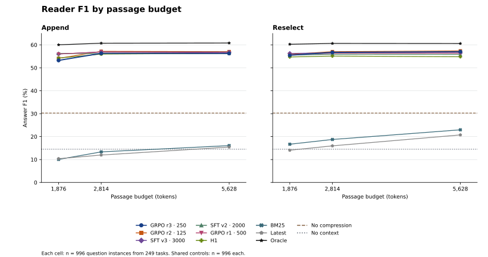
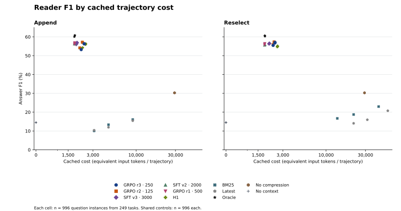

# 任务16 · 关闭 cascade attention 的留出集读者评测

引擎确认 disable_cascade_attn=True。Qwen3-8B 根据压缩器在轨迹末步保留的原文，分别回答每个任务的四道题。本次实际评分 55,776 条（n=249 个不同任务，996 道不同题）。同一问题在不同模式与预算下重复出现。合并分数对各格等权，每个预测均按任务03协议取标准答案和别名中的最高 EM 与 F1。

不压缩基线以 reselect|tight 为参照，逐任务比较末步段号及其顺序。有差异的任务数为 0/249，有差异的配置数为 0/6。六种配置共用一组读者预测。

用同一引擎重跑任务03的一致性小样，原始输出不同的提示共 1/40 条。

## 合并 F1 与 EM

| 策略 | 实测题次 n | F1 | EM |
| --- | --- | --- | --- |
| grpo_r3:checkpoint-250 | 5976 | 55.845% | 45.214% |
| grpo_r2:checkpoint-125 | 5976 | 56.452% | 46.352% |
| sft_v3:checkpoint-3000 | 5976 | 56.511% | 46.118% |
| sft_v2:checkpoint-2000 | 5976 | 56.017% | 45.699% |
| grpo_r1:checkpoint-500 | 5976 | 56.328% | 45.900% |
| h1:tau_star | 5976 | 55.207% | 44.980% |
| bm25 | 5976 | 16.311% | 10.040% |
| latest | 5976 | 14.763% | 9.003% |
| oracle | 5976 | 60.513% | 50.100% |
| no_compress | 996 | 30.255% | 21.084% |
| no_context | 996 | 14.503% | 7.229% |

## 预注册的逐题配对比较

### grpo_r2:checkpoint-125 与 sft_v3:checkpoint-3000

左列模型减右列模型，F1 差 -0.059 个百分点，EM 差 +0.234 个百分点（各 n=5,976 对）。逐题 F1 左高 264、相等 5,440、右高 272（n=5,976 对）。

| EM 配对（n=5,976） | sft_v3:checkpoint-3000 正确 | sft_v3:checkpoint-3000 错误 |
| --- | --- | --- |
| grpo_r2:checkpoint-125 正确 | 2584 | 186 |
| grpo_r2:checkpoint-125 错误 | 172 | 3034 |

### grpo_r2:checkpoint-125 与 h1:tau_star

左列模型减右列模型，F1 差 +1.245 个百分点，EM 差 +1.372 个百分点（各 n=5,976 对）。逐题 F1 左高 419、相等 5,243、右高 314（n=5,976 对）。

| EM 配对（n=5,976） | h1:tau_star 正确 | h1:tau_star 错误 |
| --- | --- | --- |
| grpo_r2:checkpoint-125 正确 | 2489 | 281 |
| grpo_r2:checkpoint-125 错误 | 199 | 3007 |

### grpo_r3:checkpoint-250 与 grpo_r2:checkpoint-125

左列模型减右列模型，F1 差 -0.607 个百分点，EM 差 -1.138 个百分点（各 n=5,976 对）。逐题 F1 左高 208、相等 5,521、右高 247（n=5,976 对）。

| EM 配对（n=5,976） | grpo_r2:checkpoint-125 正确 | grpo_r2:checkpoint-125 错误 |
| --- | --- | --- |
| grpo_r3:checkpoint-250 正确 | 2591 | 111 |
| grpo_r3:checkpoint-250 错误 | 179 | 3095 |

## 按模式与预算

| 策略 | 模式 / 档 | 题次 n | F1 | EM | 缓存成本均值 | 成本轨迹 n |
| --- | --- | --- | --- | --- | --- | --- |
| grpo_r3:checkpoint-250 | reselect / tight | 996 | 55.468% | 44.980% | 2,283.99 | 249 |
| grpo_r3:checkpoint-250 | reselect / mid | 996 | 56.730% | 46.185% | 2,398.26 | 249 |
| grpo_r3:checkpoint-250 | reselect / loose | 996 | 57.043% | 46.386% | 2,408.76 | 249 |
| grpo_r3:checkpoint-250 | append / tight | 996 | 53.235% | 43.072% | 2,161.71 | 249 |
| grpo_r3:checkpoint-250 | append / mid | 996 | 56.326% | 45.382% | 2,343.91 | 249 |
| grpo_r3:checkpoint-250 | append / loose | 996 | 56.266% | 45.281% | 2,361.37 | 249 |
| grpo_r2:checkpoint-125 | reselect / tight | 996 | 55.892% | 46.084% | 2,279.40 | 249 |
| grpo_r2:checkpoint-125 | reselect / mid | 996 | 57.053% | 47.088% | 2,345.90 | 249 |
| grpo_r2:checkpoint-125 | reselect / loose | 996 | 57.379% | 47.490% | 2,345.27 | 249 |
| grpo_r2:checkpoint-125 | append / tight | 996 | 54.137% | 44.177% | 2,078.19 | 249 |
| grpo_r2:checkpoint-125 | append / mid | 996 | 57.191% | 46.787% | 2,229.01 | 249 |
| grpo_r2:checkpoint-125 | append / loose | 996 | 57.060% | 46.486% | 2,241.17 | 249 |
| sft_v3:checkpoint-3000 | reselect / tight | 996 | 56.282% | 46.285% | 2,037.49 | 249 |
| sft_v3:checkpoint-3000 | reselect / mid | 996 | 56.535% | 46.486% | 2,052.67 | 249 |
| sft_v3:checkpoint-3000 | reselect / loose | 996 | 56.484% | 46.185% | 2,058.70 | 249 |
| sft_v3:checkpoint-3000 | append / tight | 996 | 55.999% | 45.181% | 1,882.69 | 249 |
| sft_v3:checkpoint-3000 | append / mid | 996 | 56.936% | 46.386% | 1,924.13 | 249 |
| sft_v3:checkpoint-3000 | append / loose | 996 | 56.830% | 46.185% | 1,927.36 | 249 |
| sft_v2:checkpoint-2000 | reselect / tight | 996 | 55.575% | 45.482% | 1,796.87 | 249 |
| sft_v2:checkpoint-2000 | reselect / mid | 996 | 55.884% | 45.683% | 1,817.25 | 249 |
| sft_v2:checkpoint-2000 | reselect / loose | 996 | 55.851% | 45.783% | 1,814.18 | 249 |
| sft_v2:checkpoint-2000 | append / tight | 996 | 56.278% | 45.783% | 1,786.66 | 249 |
| sft_v2:checkpoint-2000 | append / mid | 996 | 56.196% | 45.683% | 1,799.41 | 249 |
| sft_v2:checkpoint-2000 | append / loose | 996 | 56.317% | 45.783% | 1,801.04 | 249 |
| grpo_r1:checkpoint-500 | reselect / tight | 996 | 55.744% | 45.482% | 1,794.34 | 249 |
| grpo_r1:checkpoint-500 | reselect / mid | 996 | 56.396% | 45.884% | 1,805.75 | 249 |
| grpo_r1:checkpoint-500 | reselect / loose | 996 | 56.384% | 45.984% | 1,809.21 | 249 |
| grpo_r1:checkpoint-500 | append / tight | 996 | 56.032% | 45.683% | 1,789.16 | 249 |
| grpo_r1:checkpoint-500 | append / mid | 996 | 56.890% | 46.386% | 1,798.39 | 249 |
| grpo_r1:checkpoint-500 | append / loose | 996 | 56.522% | 45.984% | 1,800.92 | 249 |
| h1:tau_star | reselect / tight | 996 | 54.726% | 44.478% | 2,558.66 | 249 |
| h1:tau_star | reselect / mid | 996 | 55.123% | 44.980% | 2,582.20 | 249 |
| h1:tau_star | reselect / loose | 996 | 54.827% | 44.880% | 2,585.73 | 249 |
| h1:tau_star | append / tight | 996 | 54.247% | 44.478% | 2,247.83 | 249 |
| h1:tau_star | append / mid | 996 | 55.980% | 45.382% | 2,443.53 | 249 |
| h1:tau_star | append / loose | 996 | 56.338% | 45.683% | 2,454.23 | 249 |
| bm25 | reselect / tight | 996 | 16.681% | 9.940% | 13,689.11 | 249 |
| bm25 | reselect / mid | 996 | 18.749% | 11.847% | 21,578.66 | 249 |
| bm25 | reselect / loose | 996 | 22.964% | 15.060% | 43,352.20 | 249 |
| bm25 | append / tight | 996 | 10.048% | 5.622% | 3,101.38 | 249 |
| bm25 | append / mid | 996 | 13.346% | 7.731% | 4,632.73 | 249 |
| bm25 | append / loose | 996 | 16.079% | 10.040% | 9,108.42 | 249 |
| latest | reselect / tight | 996 | 14.073% | 9.137% | 21,572.71 | 249 |
| latest | reselect / mid | 996 | 15.970% | 10.341% | 31,628.89 | 249 |
| latest | reselect / loose | 996 | 20.740% | 13.755% | 56,002.11 | 249 |
| latest | append / tight | 996 | 10.378% | 5.221% | 3,100.99 | 249 |
| latest | append / mid | 996 | 11.965% | 6.325% | 4,630.79 | 249 |
| latest | append / loose | 996 | 15.453% | 9.237% | 9,109.21 | 249 |
| oracle | reselect / tight | 996 | 60.269% | 49.900% | 1,818.14 | 249 |
| oracle | reselect / mid | 996 | 60.640% | 50.301% | 1,807.65 | 249 |
| oracle | reselect / loose | 996 | 60.592% | 50.100% | 1,812.38 | 249 |
| oracle | append / tight | 996 | 60.036% | 49.699% | 1,786.94 | 249 |
| oracle | append / mid | 996 | 60.729% | 50.201% | 1,807.65 | 249 |
| oracle | append / loose | 996 | 60.812% | 50.402% | 1,812.38 | 249 |
| no_compress | 各档共用 | 996 | 30.255% | 21.084% | 29,248.57 | 1494 |
| no_context | 各档共用 | 996 | 14.503% | 7.229% | 0.00 | 249 |

成本单位为每条压缩轨迹的等价输入 token。每格成本按已有策略结果计算，并与归档轨迹重算值核对。无上下文行的段落缓存成本取零。

## 证据齐全与轨迹丢失

题级齐全指该题的全部支撑段都在最终上下文中。轨迹级丢失指最终上下文缺少该任务任一证据，同一轨迹的四题一同分组。表中列出平均 F1 和实际题次，空组用破折号。

| 策略 | 该题证据齐全 | 该题证据不齐 | 轨迹丢证据 | 轨迹无丢失 |
| --- | --- | --- | --- | --- |
| grpo_r3:checkpoint-250 | 59.259%（n=5,177） | 33.723%（n=799） | 48.227%（n=2,368） | 60.844%（n=3,608） |
| grpo_r2:checkpoint-125 | 60.456%（n=5,039） | 34.918%（n=937） | 51.534%（n=2,856） | 60.954%（n=3,120） |
| sft_v3:checkpoint-3000 | 61.818%（n=4,776） | 35.388%（n=1,200） | 52.603%（n=3,544） | 62.206%（n=2,432） |
| sft_v2:checkpoint-2000 | 61.943%（n=4,596） | 36.281%（n=1,380） | 52.427%（n=3,824） | 62.395%（n=2,152） |
| grpo_r1:checkpoint-500 | 62.176%（n=4,629） | 36.232%（n=1,347） | 53.136%（n=3,788） | 61.854%（n=2,188） |
| h1:tau_star | 59.879%（n=4,813） | 35.871%（n=1,163） | 51.104%（n=3,224） | 60.014%（n=2,752） |
| bm25 | 43.740%（n=733） | 12.476%（n=5,243） | 16.322%（n=5,972） | 0.000%（n=4） |
| latest | 36.317%（n=589） | 12.407%（n=5,387） | 14.763%（n=5,976） | —（n=0） |
| oracle | 60.609%（n=5,951） | 37.668%（n=25） | 41.749%（n=96） | 60.819%（n=5,880） |
| no_compress | 30.255%（n=996） | —（n=0） | —（n=0） | 30.255%（n=996） |
| no_context | —（n=0） | 14.503%（n=996） | 14.503%（n=996） | —（n=0） |

## 题目跳数

| 策略 | 2 跳 | 3 跳 | 4 跳 |
| --- | --- | --- | --- |
| grpo_r3:checkpoint-250 | 60.213%（n=4,344） | 45.731%（n=1,260） | 39.087%（n=372） |
| grpo_r2:checkpoint-125 | 60.682%（n=4,344） | 46.610%（n=1,260） | 40.386%（n=372） |
| sft_v3:checkpoint-3000 | 60.933%（n=4,344） | 44.940%（n=1,260） | 44.066%（n=372） |
| sft_v2:checkpoint-2000 | 60.346%（n=4,344） | 45.232%（n=1,260） | 41.988%（n=372） |
| grpo_r1:checkpoint-500 | 60.687%（n=4,344） | 45.407%（n=1,260） | 42.419%（n=372） |
| h1:tau_star | 59.157%（n=4,344） | 46.434%（n=1,260） | 38.789%（n=372） |
| bm25 | 16.002%（n=4,344） | 17.649%（n=1,260） | 15.384%（n=372） |
| latest | 13.866%（n=4,344） | 17.119%（n=1,260） | 17.259%（n=372） |
| oracle | 63.947%（n=4,344） | 53.485%（n=1,260） | 44.213%（n=372） |
| no_compress | 31.292%（n=724） | 28.089%（n=210） | 25.485%（n=62） |
| no_context | 13.588%（n=724） | 16.524%（n=210） | 18.341%（n=62） |

## 题目在任务中的位置

| 策略 | 第 1 题 | 第 2 题 | 第 3 题 | 第 4 题 |
| --- | --- | --- | --- | --- |
| grpo_r3:checkpoint-250 | 55.737%（n=1,494） | 50.819%（n=1,494） | 59.757%（n=1,494） | 57.065%（n=1,494） |
| grpo_r2:checkpoint-125 | 55.785%（n=1,494） | 50.476%（n=1,494） | 60.581%（n=1,494） | 58.966%（n=1,494） |
| sft_v3:checkpoint-3000 | 55.620%（n=1,494） | 50.977%（n=1,494） | 59.078%（n=1,494） | 60.370%（n=1,494） |
| sft_v2:checkpoint-2000 | 54.780%（n=1,494） | 51.464%（n=1,494） | 58.238%（n=1,494） | 59.586%（n=1,494） |
| grpo_r1:checkpoint-500 | 55.371%（n=1,494） | 51.362%（n=1,494） | 58.342%（n=1,494） | 60.238%（n=1,494） |
| h1:tau_star | 54.361%（n=1,494） | 52.057%（n=1,494） | 57.332%（n=1,494） | 57.077%（n=1,494） |
| bm25 | 22.900%（n=1,494） | 10.950%（n=1,494） | 15.718%（n=1,494） | 15.676%（n=1,494） |
| latest | 16.055%（n=1,494） | 6.253%（n=1,494） | 13.431%（n=1,494） | 23.313%（n=1,494） |
| oracle | 59.278%（n=1,494） | 56.996%（n=1,494） | 62.695%（n=1,494） | 63.083%（n=1,494） |
| no_compress | 29.280%（n=249） | 22.294%（n=249） | 35.821%（n=249） | 33.626%（n=249） |
| no_context | 13.664%（n=249） | 12.386%（n=249） | 15.691%（n=249） | 16.271%（n=249） |

## 每题提示 token

长度为套用任务03对话模板后的实际输入 token 数。分位数沿用任务03的线性插值。

| 策略 | 题次 n | 均值 | P50 | P90 | 最大值 |
| --- | --- | --- | --- | --- | --- |
| grpo_r3:checkpoint-250 | 5976 | 1,573.94 | 1,515.0 | 2,118.0 | 3711 |
| grpo_r2:checkpoint-125 | 5976 | 1,487.18 | 1,422.0 | 2,026.5 | 3375 |
| sft_v3:checkpoint-3000 | 5976 | 1,322.46 | 1,281.0 | 1,799.5 | 2945 |
| sft_v2:checkpoint-2000 | 5976 | 1,292.77 | 1,250.0 | 1,737.0 | 2926 |
| grpo_r1:checkpoint-500 | 5976 | 1,299.43 | 1,254.0 | 1,753.0 | 2552 |
| h1:tau_star | 5976 | 1,525.62 | 1,461.0 | 2,061.5 | 3680 |
| bm25 | 5976 | 3,497.00 | 2,874.0 | 5,694.0 | 5728 |
| latest | 5976 | 3,496.76 | 2,873.0 | 5,694.0 | 5728 |
| oracle | 5976 | 1,303.72 | 1,264.0 | 1,728.0 | 2894 |
| no_compress | 996 | 20,080.77 | 19,453.5 | 24,978.0 | 31297 |
| no_context | 996 | 62.53 | 61.0 | 71.5 | 99 |

[运行配置](run_config.json) · [逐格结果与输入指纹](reader_heldout_v2_results.json)

## 新旧读者逐题对照

| 策略 | 旧运行 | 配对题次 n | 旧 F1 | 本次 F1 | 本次减旧值（百分点） | 原始输出不同（条） |
| --- | --- | --- | --- | --- | --- | --- |
| grpo_r3:checkpoint-250 | 任务13 try2 | 5976 | 50.709% | 55.845% | +5.136 | 1276 |
| grpo_r3:checkpoint-250 | 任务15 臂 a | 5976 | 55.719% | 55.845% | +0.126 | 138 |
| grpo_r2:checkpoint-125 | 任务12 | 5976 | 56.118% | 56.452% | +0.334 | 161 |
| sft_v3:checkpoint-3000 | 任务12 | 5976 | 56.137% | 56.511% | +0.374 | 191 |
| sft_v2:checkpoint-2000 | 任务12 | 5976 | 55.921% | 56.017% | +0.095 | 92 |
| grpo_r1:checkpoint-500 | 任务12 | 5976 | 56.147% | 56.328% | +0.181 | 131 |
| h1:tau_star | 任务12 | 5976 | 54.972% | 55.207% | +0.234 | 166 |
| bm25 | 任务12 | 5976 | 16.311% | 16.311% | +0.000 | 0 |
| latest | 任务12 | 5976 | 14.763% | 14.763% | +0.000 | 0 |
| oracle | 任务12 | 5976 | 60.480% | 60.513% | +0.033 | 38 |
| no_compress | 任务12 | 996 | 30.255% | 30.255% | +0.000 | 0 |
| no_context | 任务12 | 996 | 14.294% | 14.503% | +0.209 | 51 |

## 同次运行的一致性

按完整输入 token 序列分组，分母为出现至少两次的组。分子为组内出现多种原始输出的组，每组计一次。

| 范围 | 原始输出不一致组数 | 重复组数 n | 不一致率 |
| --- | --- | --- | --- |
| 合并 | 172 | 6812 | 2.525% |
| grpo_r3:checkpoint-250 | 31 | 1612 | 1.923% |
| grpo_r2:checkpoint-125 | 33 | 1672 | 1.974% |
| sft_v3:checkpoint-3000 | 28 | 1492 | 1.877% |
| sft_v2:checkpoint-2000 | 30 | 1240 | 2.419% |
| grpo_r1:checkpoint-500 | 30 | 1164 | 2.577% |
| h1:tau_star | 31 | 1852 | 1.674% |
| bm25 | 0 | 0 | — |
| latest | 0 | 0 | — |
| oracle | 28 | 1008 | 2.778% |
| no_compress | 0 | 0 | — |
| no_context | 0 | 0 | — |
