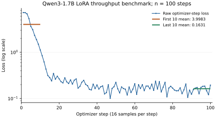

# 任务04：SFT 数据、环境与吞吐准备报告

状态：**ok**。所有 token 长度均来自实际 ms-swift 训练编码；未正式训练、未选择训练样本量方案。

## 引用修复与数据划分

保留超出已完成跳数的原始 `#k`：恢复 2 题（n=19938 train题），原始出现 2 次；受影响 ID：`2hop__169108_61463`、`2hop__444285_737459`。
dev 查询差异 0（n=2417 题/6404 hops）；保存轨迹查询差异 0（n=150 任务/1594 queries）。

语料由全部 19938 题构建，去重后 84559 段；训练与留出共用该 train 语料库。按题留出 5%，向下取整；两部分独立拼四题任务。

| 分区 | 题池 n | 使用题数 | 丢弃余数 | 任务 n | 状态 n | 自然命中（命中/检索步数） |
|---|---:|---:|---:|---:|---:|---|
| train | 18942 | 18940 | 2 | 4735 | 88562 | 84.402% (37374/44281) |
| heldout | 996 | 996 | 0 | 249 | 4652 | 82.975% (1930/2326) |

丢弃题 ID：train: 3hop2__683614_28338_160498, 3hop1__239060_830682_68600; heldout: 无。

预算 tight/mid/loose=1876/2814/5628；题划分与拼任务 seed=20261118。每部分任务从 0 编号，检索/noise seed=task；tier 由 Random(20261118+task) 抽取。同任务两模式共用检索，reselect 使用 oracle+noise 状态、append 使用纯 oracle；全部 SFT 目标为纯 oracle。

## 长度与 SFT 目标统计

下表长度为完整训练序列 token（屏蔽输入+监督目标），每行 n 为状态/样本数。

| 分区 | n | 输入均值 | 目标均值 | 总长均值 | P50 | P90 | P99 | max |
|---|---:|---:|---:|---:|---:|---:|---:|---:|
| train | 88562 | 3236.74 | 17.90 | 3254.65 | 3194.00 | 4288.00 | 5306.00 | 8390 |
| heldout | 4652 | 3244.75 | 17.91 | 3262.65 | 3187.00 | 4315.90 | 5325.45 | 7857 |
| all | 93214 | 3237.14 | 17.90 | 3255.05 | 3194.00 | 4290.00 | 5308.00 | 8390 |

| 分区 | mode | tier | n | P50 | P90 | P99 | max | add为空 | drop非空 | 预算约束 |
|---|---|---|---:|---:|---:|---:|---:|---|---|---|
| train | reselect | tight | 14850 | 3325.00 | 4417.00 | 5391.02 | 8349 | 0.303% (45/14850) | 89.320% (13264/14850) | 0.357% (53/14850) |
| train | reselect | mid | 14470 | 3302.00 | 4388.10 | 5411.00 | 8270 | 0.194% (28/14470) | 89.254% (12915/14470) | 0.014% (2/14470) |
| train | reselect | loose | 14961 | 3310.00 | 4406.00 | 5445.00 | 8390 | 0.261% (39/14961) | 89.279% (13357/14961) | 0.000% (0/14961) |
| train | append | tight | 14850 | 3092.00 | 4162.00 | 5146.53 | 8300 | 0.532% (79/14850) | 0.000% (0/14850) | 0.478% (71/14850) |
| train | append | mid | 14470 | 3076.00 | 4126.00 | 5127.55 | 7952 | 0.083% (12/14470) | 0.000% (0/14470) | 0.014% (2/14470) |
| train | append | loose | 14961 | 3077.00 | 4138.00 | 5154.00 | 8297 | 0.087% (13/14961) | 0.000% (0/14961) | 0.000% (0/14961) |
| heldout | reselect | tight | 675 | 3317.00 | 4425.80 | 5170.52 | 5516 | 0.148% (1/675) | 89.481% (604/675) | 0.444% (3/675) |
| heldout | reselect | mid | 709 | 3276.00 | 4441.60 | 5429.40 | 7836 | 0.423% (3/709) | 89.140% (632/709) | 0.141% (1/709) |
| heldout | reselect | loose | 942 | 3278.00 | 4473.80 | 5569.21 | 7857 | 0.106% (1/942) | 89.172% (840/942) | 0.000% (0/942) |
| heldout | append | tight | 675 | 3059.00 | 4191.20 | 4979.60 | 5414 | 0.593% (4/675) | 0.000% (0/675) | 0.593% (4/675) |
| heldout | append | mid | 709 | 3061.00 | 4120.60 | 5234.56 | 7525 | 0.141% (1/709) | 0.000% (0/709) | 0.141% (1/709) |
| heldout | append | loose | 942 | 3067.50 | 4173.80 | 5307.01 | 7706 | 0.000% (0/942) | 0.000% (0/942) | 0.000% (0/942) |
| all | reselect | tight | 15525 | 3324.00 | 4417.00 | 5383.28 | 8349 | 0.296% (46/15525) | 89.327% (13868/15525) | 0.361% (56/15525) |
| all | reselect | mid | 15179 | 3302.00 | 4391.20 | 5412.32 | 8270 | 0.204% (31/15179) | 89.248% (13547/15179) | 0.020% (3/15179) |
| all | reselect | loose | 15903 | 3308.00 | 4409.00 | 5448.98 | 8390 | 0.252% (40/15903) | 89.272% (14197/15903) | 0.000% (0/15903) |
| all | append | tight | 15525 | 3091.00 | 4162.60 | 5142.76 | 8300 | 0.535% (83/15525) | 0.000% (0/15525) | 0.483% (75/15525) |
| all | append | mid | 15179 | 3075.00 | 4126.00 | 5132.44 | 7952 | 0.086% (13/15179) | 0.000% (0/15179) | 0.020% (3/15179) |
| all | append | loose | 15903 | 3077.00 | 4138.80 | 5158.96 | 8297 | 0.082% (13/15903) | 0.000% (0/15903) | 0.000% (0/15903) |

max_length=8392，观测最大=8390（n=93214）；截断 0、丢弃 0（同一 n）。预算约束比例指纯 oracle 动作不能保留全部当前可得证据的步数比例。

模板为 Qwen3、enable_thinking=False；仅 assistant 内容计 loss。assistant 内容前有空 `<think>\n\n</think>\n\n`，4 token 计 loss；目标 JSON 与末尾 2 token 终止符计 loss。用户内容和 assistant 角色头全部屏蔽。推理 prefix 与训练 token 前缀一致；已检查 12 条（n=12），见 [完整模板与 labels 核验](template_check.md)。

## 环境与模型

环境：`/root/userfolder/ctx-compressor/envs/train`；包版本：`{"ms-swift": "3.12.6", "torch": "2.8.0", "transformers": "4.57.6", "tokenizers": "0.22.2", "peft": "0.18.0", "trl": "0.24.0", "accelerate": "1.12.0", "datasets": "3.6.0", "numpy": "2.2.6", "scipy": "1.17.1", "pandas": "2.3.3", "bm25s": "0.3.16"}`；attention=sdpa。

模型 Qwen/Qwen3-1.7B：状态 verified，逐文件校验 13 个（n=13），共 4079450740 bytes。tokenizer.json 与任务01逐字节一致；ntok影响：none; tokenizer.json is byte-identical。

## 吞吐与最长样本实测

LoRA r=16、alpha=32、dropout=0.05、target=all-linear；bf16、gradient checkpointing、batch=1、累积=16、lr=0.0001、cosine、warmup=0.03；packing=False，只用物理 GPU 1。抽样 1600 条（每模式 n=800）。

状态 ok；optimizer steps=100（计划 n=100），消费样本 1600（计划 n=1600）。实际完整序列 token=5190363（n=1600 样本）；训练 926.37 s，吞吐 5602.89 token/s，0.5790 s/样本（同一 n）。
loss 首10步均值=3.998265，末10步均值=0.163077（各 n=10），下降=True；OOM=False（n=1 次基准）。

训练 torch allocated/reserved 峰值=6266041344/7430209536 bytes（n=1 次基准）；全卡监控 memory.used 峰值=8279 MiB（n=472 个监控点，含最长样本探测）。

最长样本 8390 token（n=1）；在100个optimizer step后、优化器状态驻留=True 时做一次 forward/backward；额外 optimizer step=0，耗时=1.74 s，OOM=False，梯度有限=True。torch allocated/reserved 峰值=6443319296/7845445632 bytes（n=1 次探测）。

原始 optimizer-step loss 曲线（n=100 个日志点）：

[下载原始 loss CSV](loss_curve.csv)（n=100 个日志点）。

## 训练样本量估时（仅列方案）

以全训练集平均完整序列长度 × 样本曝光次数 ÷ 实测 token/s 估算训练时间；每个方案加一次启动开销 max(0, wall_seconds−train_seconds−longest_probe.seconds)。20k/40k 子集尚未抽取，长度使用全训练均值。单卡独占预留时将 GPU 1 占用时长保守取为墙钟时长。假设数据和模型已就绪、无评估、无保存；正式 checkpoint 保存、checkpoint 评估、新数据准备和下载开销均未包含。

| 方案 | 样本 n | epoch | 曝光 n | 训练均长来源 n | 一次启动 s | 预计墙钟 h | GPU 1 占用 h |
|---|---:|---:|---:|---:|---:|---:|---:|
| 全训练集 | 88562 | 1 | 88562 | 88562 | 43.60 | 14.302 | 14.302 |
| 全训练集 | 88562 | 2 | 177124 | 88562 | 43.60 | 28.592 | 28.592 |
| 全训练集 | 88562 | 3 | 265686 | 88562 | 43.60 | 42.883 | 42.883 |
| 抽样 20k | 20000 | 2 | 40000 | 88562 | 43.60 | 6.466 | 6.466 |
| 抽样 40k | 40000 | 2 | 80000 | 88562 | 43.60 | 12.921 | 12.921 |

## 测试、资源与产物

完整测试：{"n": 264, "failures": 0, "errors": 0, "skipped": 0, "passed": true}。

根目录增量=32804864 bytes，限额=300000000 bytes，通过=True（n=1 次基线到终态比较）；GPU已释放=True，仅GPU1=True，剩余任务GPU进程数=0（n=1 次终态检查）。
GPU1终态：`{"index": 1, "uuid": "GPU-4318dc90-4126-038a-9402-1323533db94f", "memory_used_mib": 375, "utilization_percent": 0}`。

数据和模型均保存在 userfolder；正式目录保存代码、小结果及拆分ID。文件行数、字节与 SHA256：

| 类型 | 路径 | 行数 n | bytes | SHA256 |
|---|---|---:|---:|---|
| trajectory/train | `/root/userfolder/ctx-compressor/data/traj_train/train_tasks.jsonl` | 4735 | 1184195307 | `ae96199b83b264bd926312e1e91e3b2af753b20117a6cb88161c8f3b23033e56` |
| trajectory/heldout | `/root/userfolder/ctx-compressor/data/traj_train/heldout_tasks.jsonl` | 249 | 62323855 | `5a6c8ce2c2c738ff2a0e3a15e95d43e8b6ecde7806d7104e5472cf74dddaafac` |
| sft/train | `/root/userfolder/ctx-compressor/data/sft/train.jsonl` | 88562 | 1169658306 | `34c2179e3b9d42d67ae8e129dc72f414712e92fb13411dd9652936db42837004` |
| sft/heldout | `/root/userfolder/ctx-compressor/data/sft/heldout.jsonl` | 4652 | 61561401 | `7cb660ddb328f932cca4932613caf620cbbd113f67bd29be5d11eea784e20613` |

报告证据文件：[reference_fix_checks](reference_fix_checks.json)、[trajectory_stats](trajectory_stats.json)、[sft_data_stats](sft_data_stats.json)、[model_manifest](model_manifest.json)、[environment_metadata](environment_metadata.json)、[bench_run_config](bench_run_config.json)、[bench_results](bench_results.json)、[final_resource_check](final_resource_check.json)、[tests](tests.xml)、[loss_curve_svg](loss_curve.svg)、[loss_curve_csv](loss_curve.csv)。
