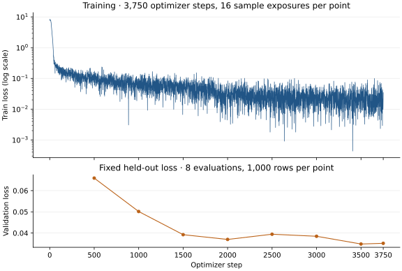

# 任务10 · SFT v3 的加段与丢段

按预登记的留出集规则，四个候选中选中 **checkpoint-3000**。它在 1,494 条轨迹中丢失证据 886 条（59.30%），最终平均召回为 90.46%（n=1,494）。SFT v2 checkpoint-2000 在相同轨迹上丢失 956/1,494 条（63.99%），最终平均召回为 89.01%（n=1,494）。两者合计相差 70 条。按模式拆分，只追加模式从 466/747 降至 396/747，重选模式两者均为 490/747。

任务09的 H1 在同一留出集丢失 806/1,494 条。平均每条轨迹的缓存成本分别为 SFT v2 的 1,802.57、SFT v3 的 1,980.51 和 H1 的 2,478.70 个等价输入 token（各 n=1,494）。在训练池中另抽的同一批状态上，SFT v3 采样时请求一次新增至少两段的比例为 420/2,400，SFT v2 为 0/2,400（各 n=300 个状态，每状态 8 次采样）。以下均为单次训练的点估计。

## A · 锁定的最终测试集

MuSiQue-Ans dev 共 2,417 题。逐个查找历史实验数据、报告、日志和留存样例中的原始题目 ID，扫描 n=758 个文件。任务01验收的 12/12 题均在任务02/03的 600 题中。另有 12 题见于任务01数据审计及 README 示例，合并排除 612/2,417 题。对余下 1,805 题以种子 20261122 洗牌，按每组 4 题保留原题内跳序，锁定 451 个任务（1,804/1,805 题），余 1 题。最终测试集仅统计结构，策略运行数为 0（n=451 个锁定任务）。

检索复用任务02流程，以 dev 语料的 21,100 段为索引，替换前置答案占位符后逐跳取 BM25 前 20 段，未自然命中时插入金段。重建任务文件逐字节相同（150/150 个任务），检索的题序、跳序、金段及有序返回列表逐字段相同（30,286/30,286 条记录，共 1,594 步，每步 19 个配置）。新集沿用 tight/mid/loose 预算 1,876/2,814/5,628 token。

| 锁定集结构 | 计数或估计 |
|---|---|
| 两跳 / 三跳 / 四跳问题 | 942 / 561 / 301（n=1,804 题） |
| 自然检索命中 | 4,330/4,771 跳（90.76%） |
| 每任务去重金段 token 的 P90 | 1,850.0（n=451 任务），任务02为 1,875.6（n=150 任务），差 −25.6 token |
| 金段原文见于训练语料 | 574/2,155 段（26.64%） |
| 金段在 SFT v2 训练池中曾为金段 | 0/2,155 段（训练池 n=88,562 行） |
| 金段在 SFT v2 实际训练行中曾为金段 | 0/2,155 段（优化用 n=20,000 个不同行） |

原文重合按唯一的「标题、段落原文」对计数，保留大小写和空白。下表列出锁定记录中的文件与本次核验的 SHA256（n=5 文件）。

| 文件 | SHA256 |
|---|---|
| `test_tasks.jsonl` | `f2e1856acb54991badddab06ebea99bba942e1c51aaa429d69756751d0ffc71a` |
| `steps.jsonl` | `e285d284d4baed60b09bfc7cae73b469b4b1e0e0d966468116faa2315f41293b` |
| `excluded_ids.json` | `1d0e27ddb8f88c4d53374f3a1257fb265836fe79135c21629afeccdaa9915ad9` |
| `exclusion_audit.json` | `aa114c1e677293bc9e30a4947b4c2ea3efb9c4074e6865bf473228a578edcc19` |
| `structural_stats.json` | `70d0d86e2dd3412334248e1f456fee2f45f59ce1ac163da500fd2704463fc80a` |

首次在该集上运行策略需另有 Claude 撰写的任务书。[锁定记录](../test_dev_v1/LOCK.md) · [结构统计](../test_dev_v1/structural_stats.json) · [排除来源](../test_dev_v1/exclusion_audit.json)

## B · 训练状态上的保留阈值与 token 价格

在任务09既有的训练状态上重放动作（n=22,158 步）。可得金段取此前揭示或当前揭示的金段与本步已保留或新出现段落的交集。奖励 v2 按每个丢失金段扣 1，按每千个执行后保留 token 扣 μ；无效或超预算动作维持原保留区并再扣 1。任务09奖励 v1 的 199,422/199,422 个状态×阈值结果及 63/63 个表格单元复现。

每个 μ 在 9 个候选阈值中选平均奖励最高者，并列取较小值。加一段率、奖励、平均额外 token 以本行状态为分母。当前金段遗漏率只计当前金段为新候选的步骤。

| 模式 | μ | τ* | 平均奖励 | 加一段率 | 当前金段遗漏率 | 平均额外 token | 状态 n |
|---|---:|---:|---:|---:|---:|---:|---:|
| 合并 | 0 | 1.01 | -0.037910 | 22,096/22,158（99.72%） | 604/22,146（2.73%） | 119.863 | 22,158 |
| 合并 | 0.1 | 0.99 | -0.109922 | 6,739/22,158（30.41%） | 630/22,146（2.84%） | 43.472 | 22,158 |
| 合并 | 0.25 | 0.99 | -0.215707 | 6,739/22,158（30.41%） | 630/22,146（2.84%） | 43.472 | 22,158 |
| 合并 | 0.5 | 0.9 | -0.387324 | 3,374/22,158（15.23%） | 750/22,146（3.39%） | 23.075 | 22,158 |
| 合并 | 1.0 | 0.8 | -0.728636 | 2,465/22,158（11.12%） | 857/22,146（3.87%） | 17.139 | 22,158 |
| append | 0 | 1.01 | -0.032313 | 11,044/11,079（99.68%） | 302/11,073（2.73%） | 120.136 | 11,079 |
| append | 0.1 | 0.99 | -0.104554 | 3,386/11,079（30.56%） | 314/11,073（2.84%） | 43.881 | 11,079 |
| append | 0.25 | 0.99 | -0.210884 | 3,386/11,079（30.56%） | 314/11,073（2.84%） | 43.881 | 11,079 |
| append | 0.5 | 0.9 | -0.383517 | 1,698/11,079（15.33%） | 375/11,073（3.39%） | 23.341 | 11,079 |
| append | 1.0 | 0.8 | -0.726191 | 1,247/11,079（11.26%） | 424/11,073（3.83%） | 17.429 | 11,079 |
| reselect | 0 | 1.01 | -0.043506 | 11,052/11,079（99.76%） | 302/11,073（2.73%） | 119.589 | 11,079 |
| reselect | 0.1 | 0.99 | -0.115291 | 3,353/11,079（30.26%） | 316/11,073（2.85%） | 43.063 | 11,079 |
| reselect | 0.25 | 0.99 | -0.220531 | 3,353/11,079（30.26%） | 316/11,073（2.85%） | 43.063 | 11,079 |
| reselect | 0.5 | 0.9 | -0.391130 | 1,676/11,079（15.13%） | 375/11,073（3.39%） | 22.809 | 11,079 |
| reselect | 1.0 | 0.8 | -0.731080 | 1,218/11,079（10.99%） | 433/11,073（3.91%） | 16.849 | 11,079 |

全部阈值下的奖励、加一段率、当前金段遗漏率及额外 token 见[离线阈值全表](../reward_v2/offline_tau_table.md)。

## C · 产生监督状态的闭环轨迹

SFT v2 checkpoint-2000 在任务08/09的同一批训练题上按 τ=0.99 执行加一段策略，任务 ID 相同（400/400 任务），与留出集题目 ID 交集为 0（训练 n=1,600 题、留出 n=996 题）。冒烟覆盖 2 个任务、12 条轨迹及 120 步，目标与输入 token 核验均为 120/120。正式闭环为 2,400 条轨迹（400 任务 × 2 模式 × 3 预算），实际执行加一段 6,565/22,158（29.63%）。

## D · 监督目标与训练样本

每步先计算预算内的 oracle 目标，在重选模式丢弃先前保留区中的非金段。若记录的首选概率 p1 小于 0.99，则从新候选中取分数最高、既未保留又未列入 oracle 添加项的段落，且仅在它与 oracle 目标共同满足预算时追加。每个目标都通过闭环评测解析器验证有效性和预算，同时核对 oracle 保住的金段、额外段的非金身份和触发条件（22,158/22,158 个目标）。

下表同时列出 C 实际执行的加一段动作和 D 中教给模型的动作。双添加指目标中恰有两个添加项。保留区含非金段率只在重选且步序至少为 1 的状态上计算。

| 模式 | 预算 | C 实际加一段 | D 双添加 | D 保留区含非金段 | D 至少丢一段 | D 平均丢段数 | D 抽入训练 | 状态 n |
|---|---|---:|---:|---:|---:|---:|---:|---:|
| append | tight | 1,008/3,693（27.29%） | 987/3,693（26.73%） | 不适用（n=0） | 0/3,693（0.00%） | 0.000（0/3,693） | 1,670 | 3,693 |
| append | mid | 1,114/3,693（30.17%） | 1,092/3,693（29.57%） | 不适用（n=0） | 0/3,693（0.00%） | 0.000（0/3,693） | 1,606 | 3,693 |
| append | loose | 1,113/3,693（30.14%） | 1,088/3,693（29.46%） | 不适用（n=0） | 0/3,693（0.00%） | 0.000（0/3,693） | 1,724 | 3,693 |
| reselect | tight | 1,104/3,693（29.89%） | 1,098/3,693（29.73%） | 1,581/3,293（48.01%） | 1,586/3,693（42.95%） | 0.582（2,150/3,693） | 1,658 | 3,693 |
| reselect | mid | 1,108/3,693（30.00%） | 1,091/3,693（29.54%） | 1,572/3,293（47.74%） | 1,572/3,693（42.57%） | 0.579（2,139/3,693） | 1,669 | 3,693 |
| reselect | loose | 1,118/3,693（30.27%） | 1,098/3,693（29.73%） | 1,574/3,293（47.80%） | 1,574/3,693（42.62%） | 0.576（2,126/3,693） | 1,673 | 3,693 |

| 模式 | 预算 | 完整训练序列均长（token） | P50 | P90 | P99 | 最大 | 状态 n |
|---|---|---:|---:|---:|---:|---:|---:|
| append | tight | 3,295.9 | 3,231 | 4,390.8 | 5,364.24 | 7,958 | 3,693 |
| append | mid | 3,306.5 | 3,227 | 4,435.2 | 5,508.12 | 7,965 | 3,693 |
| append | loose | 3,304.8 | 3,227 | 4,441.0 | 5,508.12 | 7,965 | 3,693 |
| reselect | tight | 3,157.2 | 3,104 | 4,143.8 | 5,079.96 | 7,541 | 3,693 |
| reselect | mid | 3,155.6 | 3,094 | 4,151.4 | 5,104.32 | 7,305 | 3,693 |
| reselect | loose | 3,157.7 | 3,100 | 4,143.8 | 5,104.32 | 7,541 | 3,693 |

训练文本和实际策略输入的 SHA256 相同（22,158/22,158 状态）。系统抽查 prompt token ID 均相同（444/444 状态，占总体 2.00%）。完整训练序列最长 7,965 token（n=22,158），超过 8,392 token 的 0/22,158 行。训练集保留任务06原始行及 ID（20,000/20,000 逐字节相同），并从 append 与 reselect 各自的 11,079 个合格状态中各抽取 5,000 个（单一随机种子 20261122）。复核重现 10,000/10,000 个抽样 ID 及顺序。最终 n=30,000 个训练样本。计算验证损失沿用任务06固定留出样本（1,000/1,000 个 ID 核对相同）。[训练轨迹回执](dagger_rollouts.json) · [数据清单](sample_manifest.json)

## D-train　训练曲线与验收

从 Qwen3-1.7B 基座新建 LoRA，30,000 条训练样本各看 2 遍，共 60,000 次样本暴露（n=1 次训练）。每步累积 16 条（单卡 batch=1，累积 16 次），完成 3,750/3,750 个优化步，处理 192,107,994 个非填充 token（n=60,000 次样本暴露）。固定评估使用任务06的同一组 1,000 条验证样本（n=8 次测量）。

逐字段复核任务06配置。登记配置中 4/44 个字段有差异，分别为训练输入、运行目录、输出目录和总步数。显式 Swift 参数差异为 3/60 项（dataset、output_dir、max_steps）。实际解析后 6/348 项随这些路径或步数变化（另含 logging_dir、run_name、training_args）。余下参数逐项相同。两次训练均用 LoRA r=16、α=32、dropout=0.05、all-linear，学习率 0.0001、cosine、warmup 3%、bf16、梯度检查点、序列上限 8,392、超长报错、种子 20261118（n=2 份训练配置）。[字段差异](config_diff_vs_task06.json)

训练器计时 35,897.66 秒（9.97 小时），worker 总耗时 36,256.48 秒（10.07 小时），包含启动 358.62 秒。上述计时从进程获准运行后开始，另有等卡 6.84 小时（n=1 次训练）。吞吐 5,351.55 个非填充 token/秒（n=192,107,994 token）。PyTorch 分配和预留峰值分别为 6,371,984,384 和 8,401,190,912 字节（n=1 次训练）。整卡监控峰值 8,809 MiB（n=1,207 次采样），相邻记录最长间隔 30.56 秒（n=1,206 个间隔）。非有限训练 loss 或梯度范数 0/3,750 步，监控 OOM 0/1,207 次。

训练 loss 均值 0.10512187（n=3,750 步）。首步 8.41063786，末步 0.03447163（各 n=16 次样本暴露）。共保留 8 个 adapter，保存点见下表；其中 4 个进入预注册闭环评测。固定验证 loss 最低值为 0.03483550（步 3,500，n=1,000 条验证样本）。checkpoint 按闭环轨迹损失率、最终召回与步数选取。

| 优化步（共 3,750 步） | 固定验证 loss | 验证样本 n | 进入 E 闭环 |
|---:|---:|---:|:---:|
| 500 | 0.06591110 | 1,000 | — |
| 1,000 | 0.05015684 | 1,000 | 是 |
| 1,500 | 0.03923532 | 1,000 | — |
| 2,000 | 0.03698957 | 1,000 | 是 |
| 2,500 | 0.03945040 | 1,000 | — |
| 3,000 | 0.03848431 | 1,000 | 是 |
| 3,500 | 0.03483550 | 1,000 | — |
| 3,750 | 0.03516370 | 1,000 | 是 |

图中上半部给出每一优化步的原始训练 loss，对数纵轴保留初始峰值和低损失区的变化。下半部给出固定验证集的全部观测点。两部分共享步数横轴。

[逐步训练和验证数据](loss_curve.csv) · [训练配置](train_run_config.json)

## E　留出集闭环与 checkpoint 选择

每个 checkpoint 均以纯贪心完成 249 个留出任务的六种模式与预算组合（n=1,494 条轨迹、13,956 步）。四次评测各自核对首步的用户文本和提示 token，两项差异均为 0/1,494。按合并证据丢失率从低到高选择，并列时依次取最终召回较高、训练步较早者，四个候选中选中 **checkpoint-3000**。

| Checkpoint | 轨迹证据丢失率 | 最终召回 | 单步召回 | 无效动作 | 每步新增段数 |
|---|---|---|---|---|---|
| checkpoint-1000 | 77.91%（1,164/1,494） | 82.72%（n=1,494） | 94.58%（n=13,956） | 0.16%（22/13,956） | 1.000（n=13,956） |
| checkpoint-2000 | 68.27%（1,020/1,494） | 87.33%（n=1,494） | 95.74%（n=13,956） | 0.12%（17/13,956） | 0.999（n=13,956） |
| checkpoint-3000 | 59.30%（886/1,494） | 90.46%（n=1,494） | 96.94%（n=13,956） | 0.32%（44/13,956） | 1.061（n=13,956） |
| checkpoint-3750 | 61.58%（920/1,494） | 90.15%（n=1,494） | 96.67%（n=13,956） | 0.26%（36/13,956） | 1.019（n=13,956） |

### 与历史方法在同一留出集上的比较

最终召回按轨迹平均；证据丢失率为末步缺失至少一个已揭示金标的轨迹比例。单步召回按动作步平均。占用是每条轨迹末步已用 token 占有效预算的比率，再对轨迹取平均；缓存成本是每条轨迹累计的等价输入 token。每步新增按执行前后保留集合的差计算，以全部动作步为分母，无效动作贡献零。丢弃精确率以有效动作实际丢弃的片段为分母，分子为不属于截至当步已揭示金标的片段。表中“—（0/0）”表示未发生丢弃。

SFT v2、GRPO 和两个确定性基线取各任务已归档的留出集结果；H0、H1 取任务09的无加段和阈值加段闭环。对照行的每步新增和丢弃精确率均从相应已保存轨迹复核。参见[任务06](../sft_run_v2/checkpoint-2000_results.json)、[任务08](../grpo_v2/checkpoint-500/checkpoint-500_results.json)、[任务09](../hedge_v2/hedge_v2_results.json)、[bm25](../sft_run/bm25_results.json) 和 [oracle](../sft_run/oracle_results.json)。

#### 合并

| 方法 | 最终召回 | 轨迹证据丢失率 | 单步召回 | 末步占用 | 缓存成本 | 每步新增段数 | 丢弃精确率 |
|---|---|---|---|---|---|---|---|
| SFT v3 ckpt-3000 | 90.46%（n=1,494） | 59.30%（886/1,494） | 96.94%（n=13,956） | 44.32%（n=1,494） | 1,980.51（n=1,494） | 1.061（n=13,956） | 66.33%（526/793） |
| SFT v2 ckpt-2000 | 89.01%（n=1,494） | 63.99%（956/1,494） | 96.18%（n=13,956） | 43.36%（n=1,494） | 1,802.57（n=1,494） | 0.998（n=13,956） | 47.29%（61/129） |
| H0 | 88.99%（n=1,494） | 64.06%（957/1,494） | 96.17%（n=13,956） | 43.32%（n=1,494） | 1,800.30（n=1,494） | 0.998（n=13,956） | 47.24%（60/127） |
| H1 | 90.62%（n=1,494） | 53.95%（806/1,494） | 97.32%（n=13,956） | 51.17%（n=1,494） | 2,478.70（n=1,494） | 1.325（n=13,956） | 73.57%（1,587/2,157） |
| GRPO ckpt-500 | 89.30%（n=1,494） | 63.39%（947/1,494） | 96.24%（n=13,956） | 43.60%（n=1,494） | 1,799.63（n=1,494） | 0.998（n=13,956） | 23.81%（10/42） |
| bm25 | 30.74%（n=1,494） | 99.93%（1,493/1,494） | 73.07%（n=13,956） | 99.50%（n=1,494） | 15,910.42（n=1,494） | 5.661（n=13,956） | 96.20%（30,918/32,140） |
| oracle | 99.78%（n=1,494） | 1.61%（24/1,494） | 99.97%（n=13,956） | 43.65%（n=1,494） | 1,807.52（n=1,494） | 0.998（n=13,956） | 0.00%（0/9） |

#### append / tight

| 方法 | 最终召回 | 轨迹证据丢失率 | 单步召回 | 末步占用 | 缓存成本 | 每步新增段数 | 丢弃精确率 |
|---|---|---|---|---|---|---|---|
| SFT v3 ckpt-3000 | 91.41%（n=249） | 55.02%（137/249） | 97.21%（n=2,326） | 68.43%（n=249） | 1,882.69（n=249） | 1.035（n=2,326） | —（0/0） |
| SFT v2 ckpt-2000 | 89.43%（n=249） | 62.25%（155/249） | 96.26%（n=2,326） | 65.13%（n=249） | 1,786.66（n=249） | 0.994（n=2,326） | —（0/0） |
| H0 | 89.34%（n=249） | 63.05%（157/249） | 96.24%（n=2,326） | 65.07%（n=249） | 1,785.07（n=249） | 0.994（n=2,326） | —（0/0） |
| H1 | 90.97%（n=249） | 46.18%（115/249） | 97.68%（n=2,326） | 81.43%（n=249） | 2,247.83（n=249） | 1.247（n=2,326） | —（0/0） |
| GRPO ckpt-500 | 89.24%（n=249） | 63.86%（159/249） | 96.23%（n=2,326） | 65.23%（n=249） | 1,789.16（n=249） | 0.995（n=2,326） | —（0/0） |
| bm25 | 11.66%（n=249） | 100.00%（249/249） | 52.77%（n=2,326） | 99.36%（n=249） | 3,101.38（n=249） | 2.019（n=2,326） | —（0/0） |
| oracle | 99.24%（n=249） | 4.42%（11/249） | 99.90%（n=2,326） | 65.16%（n=249） | 1,786.94（n=249） | 0.992（n=2,326） | —（0/0） |

#### append / mid

| 方法 | 最终召回 | 轨迹证据丢失率 | 单步召回 | 末步占用 | 缓存成本 | 每步新增段数 | 丢弃精确率 |
|---|---|---|---|---|---|---|---|
| SFT v3 ckpt-3000 | 92.32%（n=249） | 53.01%（132/249） | 97.34%（n=2,326） | 46.71%（n=249） | 1,924.13（n=249） | 1.048（n=2,326） | —（0/0） |
| SFT v2 ckpt-2000 | 89.59%（n=249） | 62.65%（156/249） | 96.31%（n=2,326） | 43.77%（n=249） | 1,799.41（n=249） | 1.000（n=2,326） | —（0/0） |
| H0 | 89.71%（n=249） | 62.65%（156/249） | 96.29%（n=2,326） | 43.84%（n=249） | 1,801.75（n=249） | 1.000（n=2,326） | —（0/0） |
| H1 | 95.37%（n=249） | 34.54%（86/249） | 98.42%（n=2,326） | 59.59%（n=249） | 2,443.53（n=249） | 1.337（n=2,326） | —（0/0） |
| GRPO ckpt-500 | 89.69%（n=249） | 62.65%（156/249） | 96.30%（n=2,326） | 43.75%（n=249） | 1,798.39（n=249） | 1.000（n=2,326） | —（0/0） |
| bm25 | 16.70%（n=249） | 100.00%（249/249） | 62.55%（n=2,326） | 99.60%（n=249） | 4,632.73（n=249） | 2.943（n=2,326） | —（0/0） |
| oracle | 99.96%（n=249） | 0.40%（1/249） | 100.00%（n=2,326） | 44.02%（n=249） | 1,807.65（n=249） | 1.000（n=2,326） | —（0/0） |

#### reselect / tight

| 方法 | 最终召回 | 轨迹证据丢失率 | 单步召回 | 末步占用 | 缓存成本 | 每步新增段数 | 丢弃精确率 |
|---|---|---|---|---|---|---|---|
| SFT v3 ckpt-3000 | 88.66%（n=249） | 66.27%（165/249） | 96.54%（n=2,326） | 63.32%（n=249） | 2,037.49（n=249） | 1.070（n=2,326） | 67.05%（173/258） |
| SFT v2 ckpt-2000 | 88.21%（n=249） | 65.86%（164/249） | 95.97%（n=2,326） | 64.37%（n=249） | 1,796.87（n=249） | 0.994（n=2,326） | 47.50%（19/40） |
| H0 | 88.08%（n=249） | 66.27%（165/249） | 95.99%（n=2,326） | 64.18%（n=249） | 1,791.91（n=249） | 0.994（n=2,326） | 42.86%（18/42） |
| H1 | 87.16%（n=249） | 69.48%（173/249） | 96.46%（n=2,326） | 67.63%（n=249） | 2,558.66（n=249） | 1.334（n=2,326） | 73.50%（527/717） |
| GRPO ckpt-500 | 88.70%（n=249） | 64.66%（161/249） | 96.11%（n=2,326） | 65.11%（n=249） | 1,794.34（n=249） | 0.995（n=2,326） | 15.38%（2/13） |
| bm25 | 31.77%（n=249） | 100.00%（249/249） | 73.60%（n=2,326） | 99.07%（n=249） | 13,689.11（n=249） | 5.037（n=2,326） | 95.30%（7,274/7,633） |
| oracle | 99.53%（n=249） | 4.42%（11/249） | 99.94%（n=2,326） | 64.56%（n=249） | 1,818.14（n=249） | 0.999（n=2,326） | 0.00%（0/9） |

#### reselect / mid

| 方法 | 最终召回 | 轨迹证据丢失率 | 单步召回 | 末步占用 | 缓存成本 | 每步新增段数 | 丢弃精确率 |
|---|---|---|---|---|---|---|---|
| SFT v3 ckpt-3000 | 88.85%（n=249） | 65.86%（164/249） | 96.56%（n=2,326） | 42.66%（n=249） | 2,052.67（n=249） | 1.078（n=2,326） | 66.04%（175/265） |
| SFT v2 ckpt-2000 | 88.51%（n=249） | 65.46%（163/249） | 96.08%（n=2,326） | 43.37%（n=249） | 1,817.25（n=249） | 1.000（n=2,326） | 48.84%（21/43） |
| H0 | 88.66%（n=249） | 65.06%（162/249） | 96.07%（n=2,326） | 43.32%（n=249） | 1,810.37（n=249） | 1.000（n=2,326） | 50.00%（20/40） |
| H1 | 87.27%（n=249） | 69.48%（173/249） | 96.48%（n=2,326） | 45.62%（n=249） | 2,582.20（n=249） | 1.346（n=2,326） | 72.85%（526/722） |
| GRPO ckpt-500 | 89.15%（n=249） | 63.05%（157/249） | 96.21%（n=2,326） | 43.71%（n=249） | 1,805.75（n=249） | 1.000（n=2,326） | 28.57%（4/14） |
| bm25 | 39.27%（n=249） | 100.00%（249/249） | 80.32%（n=2,326） | 99.48%（n=249） | 21,578.66（n=249） | 6.945（n=2,326） | 96.10%（9,686/10,079） |
| oracle | 99.96%（n=249） | 0.40%（1/249） | 100.00%（n=2,326） | 44.02%（n=249） | 1,807.65（n=249） | 1.000（n=2,326） | —（0/0） |

#### 无效动作分类

以下每格均列事件数/全部动作步，顺序为 JSON 无法解析、候选编号错误、append 模式请求丢弃、动作超出预算。四个原因互斥。百分比精确值和任意无效的合计均见机器可读结果中的 <code>comparison</code>。

| 合并 · 方法 | JSON 无效 | 编号错误 | append 请求丢弃 | 超预算 |
|---|---|---|---|---|
| SFT v3 ckpt-3000 | 0.00%（0/13,956） | 0.03%（4/13,956） | 0.00%（0/13,956） | 0.29%（40/13,956） |
| SFT v2 ckpt-2000 | 0.00%（0/13,956） | 0.00%（0/13,956） | 0.00%（0/13,956） | 0.21%（30/13,956） |
| H0 | 0.00%（0/13,956） | 0.00%（0/13,956） | 0.00%（0/13,956） | 0.21%（29/13,956） |
| H1 | 0.00%（0/13,956） | 0.00%（0/13,956） | 0.00%（0/13,956） | 0.92%（128/13,956） |
| GRPO ckpt-500 | 0.00%（0/13,956） | 0.00%（0/13,956） | 0.00%（0/13,956） | 0.16%（22/13,956） |
| bm25 | 0.00%（0/13,956） | 0.00%（0/13,956） | 0.00%（0/13,956） | 0.00%（0/13,956） |
| oracle | 0.00%（0/13,956） | 0.00%（0/13,956） | 0.00%（0/13,956） | 0.00%（0/13,956） |

| append / tight · 方法 | JSON 无效 | 编号错误 | append 请求丢弃 | 超预算 |
|---|---|---|---|---|
| SFT v3 ckpt-3000 | 0.00%（0/2,326） | 0.04%（1/2,326） | 0.00%（0/2,326） | 1.07%（25/2,326） |
| SFT v2 ckpt-2000 | 0.00%（0/2,326） | 0.00%（0/2,326） | 0.00%（0/2,326） | 0.60%（14/2,326） |
| H0 | 0.00%（0/2,326） | 0.00%（0/2,326） | 0.00%（0/2,326） | 0.60%（14/2,326） |
| H1 | 0.00%（0/2,326） | 0.00%（0/2,326） | 0.00%（0/2,326） | 4.90%（114/2,326） |
| GRPO ckpt-500 | 0.00%（0/2,326） | 0.00%（0/2,326） | 0.00%（0/2,326） | 0.47%（11/2,326） |
| bm25 | 0.00%（0/2,326） | 0.00%（0/2,326） | 0.00%（0/2,326） | 0.00%（0/2,326） |
| oracle | 0.00%（0/2,326） | 0.00%（0/2,326） | 0.00%（0/2,326） | 0.00%（0/2,326） |

| append / mid · 方法 | JSON 无效 | 编号错误 | append 请求丢弃 | 超预算 |
|---|---|---|---|---|
| SFT v3 ckpt-3000 | 0.00%（0/2,326） | 0.04%（1/2,326） | 0.00%（0/2,326） | 0.04%（1/2,326） |
| SFT v2 ckpt-2000 | 0.00%（0/2,326） | 0.00%（0/2,326） | 0.00%（0/2,326） | 0.04%（1/2,326） |
| H0 | 0.00%（0/2,326） | 0.00%（0/2,326） | 0.00%（0/2,326） | 0.04%（1/2,326） |
| H1 | 0.00%（0/2,326） | 0.00%（0/2,326） | 0.00%（0/2,326） | 0.26%（6/2,326） |
| GRPO ckpt-500 | 0.00%（0/2,326） | 0.00%（0/2,326） | 0.00%（0/2,326） | 0.00%（0/2,326） |
| bm25 | 0.00%（0/2,326） | 0.00%（0/2,326） | 0.00%（0/2,326） | 0.00%（0/2,326） |
| oracle | 0.00%（0/2,326） | 0.00%（0/2,326） | 0.00%（0/2,326） | 0.00%（0/2,326） |

| reselect / tight · 方法 | JSON 无效 | 编号错误 | append 请求丢弃 | 超预算 |
|---|---|---|---|---|
| SFT v3 ckpt-3000 | 0.00%（0/2,326） | 0.00%（0/2,326） | 0.00%（0/2,326） | 0.60%（14/2,326） |
| SFT v2 ckpt-2000 | 0.00%（0/2,326） | 0.00%（0/2,326） | 0.00%（0/2,326） | 0.60%（14/2,326） |
| H0 | 0.00%（0/2,326） | 0.00%（0/2,326） | 0.00%（0/2,326） | 0.56%（13/2,326） |
| H1 | 0.00%（0/2,326） | 0.00%（0/2,326） | 0.00%（0/2,326） | 0.34%（8/2,326） |
| GRPO ckpt-500 | 0.00%（0/2,326） | 0.00%（0/2,326） | 0.00%（0/2,326） | 0.47%（11/2,326） |
| bm25 | 0.00%（0/2,326） | 0.00%（0/2,326） | 0.00%（0/2,326） | 0.00%（0/2,326） |
| oracle | 0.00%（0/2,326） | 0.00%（0/2,326） | 0.00%（0/2,326） | 0.00%（0/2,326） |

| reselect / mid · 方法 | JSON 无效 | 编号错误 | append 请求丢弃 | 超预算 |
|---|---|---|---|---|
| SFT v3 ckpt-3000 | 0.00%（0/2,326） | 0.04%（1/2,326） | 0.00%（0/2,326） | 0.00%（0/2,326） |
| SFT v2 ckpt-2000 | 0.00%（0/2,326） | 0.00%（0/2,326） | 0.00%（0/2,326） | 0.04%（1/2,326） |
| H0 | 0.00%（0/2,326） | 0.00%（0/2,326） | 0.00%（0/2,326） | 0.04%（1/2,326） |
| H1 | 0.00%（0/2,326） | 0.00%（0/2,326） | 0.00%（0/2,326） | 0.00%（0/2,326） |
| GRPO ckpt-500 | 0.00%（0/2,326） | 0.00%（0/2,326） | 0.00%（0/2,326） | 0.00%（0/2,326） |
| bm25 | 0.00%（0/2,326） | 0.00%（0/2,326） | 0.00%（0/2,326） | 0.00%（0/2,326） |
| oracle | 0.00%（0/2,326） | 0.00%（0/2,326） | 0.00%（0/2,326） | 0.00%（0/2,326） |

### 各 checkpoint 的逐模式与预算诊断

每条轨迹的首错按首次出现记录。有效动作中，同步出现新金标遗漏与旧金标丢弃记作“同时”；无效动作优先归入“无效”。新增段数分布只含有效步。多加命中以实际新增至少两个不同片段的步为分母；多加金标占比以这些步新增的全部片段为分母。保留区旧金标存活率以 reselect 模式此前揭示且仍在保留区的金标片段为分母。“混有非金标时丢旧金标”只看首步之后、保留区已有非金标的有效 reselect 步。按标题分组的新金标加段率沿用任务08口径，包括无效步；同题名指原始检索结果中另有不同段号的段落与目标标题完全相同。

#### checkpoint-1000

| 范围 | 新增 0 / 1 / 2 / ≥3（有效步数） | 多加命中当前金标 | 多加片段中金标 | 丢弃精确率 | 保留区旧金标存活 | 混有非金标时丢旧金标 |
|---|---|---|---|---|---|---|
| 合并 | 0 / 13,908 / 26 / 0（n=13,934） | 17/26 | 17/52 | 254/566 | 24,426/24,735 | 168/2,677 |
| append / tight | 0 / 2,308 / 3 / 0（n=2,311） | 2/3 | 2/6 | —（0/0） | —（0/0） | —（0/0） |
| append / mid | 0 / 2,321 / 5 / 0（n=2,326） | 3/5 | 3/10 | —（0/0） | —（0/0） | —（0/0） |
| append / loose | 0 / 2,324 / 2 / 0（n=2,326） | 1/2 | 1/4 | —（0/0） | —（0/0） | —（0/0） |
| reselect / tight | 0 / 2,314 / 5 / 0（n=2,319） | 3/5 | 3/10 | 86/200 | 8,094/8,207 | 61/897 |
| reselect / mid | 0 / 2,319 / 7 / 0（n=2,326） | 5/7 | 5/14 | 83/187 | 8,163/8,266 | 56/888 |
| reselect / loose | 0 / 2,322 / 4 / 0（n=2,326） | 3/4 | 3/8 | 85/179 | 8,169/8,262 | 51/892 |

| 范围 | 末步占用 | 缓存成本 | 首错类别（无效 / 漏新 / 丢旧 / 同时 / 无错） | 同标题新金标加段率 | 异标题新金标加段率 |
|---|---|---|---|---|---|
| 合并 | 41.62%（n=1,494） | 1,824.36（n=1,494） | 1 / 1,091 / 62 / 13 / 327（n=1,494） | 2,225/3,218 | 9,561/11,025 |
| append / tight | 64.74%（n=249） | 1,776.97（n=249） | 1 / 185 / 0 / 0 / 63（n=249） | 371/536 | 1,587/1,838 |
| append / mid | 43.88%（n=249） | 1,803.84（n=249） | 0 / 188 / 0 / 0 / 61（n=249） | 374/536 | 1,590/1,838 |
| append / loose | 21.90%（n=249） | 1,800.03（n=249） | 0 / 185 / 0 / 0 / 64（n=249） | 375/535 | 1,590/1,837 |
| reselect / tight | 59.10%（n=249） | 1,853.42（n=249） | 0 / 176 / 23 / 5 / 45（n=249） | 367/537 | 1,597/1,837 |
| reselect / mid | 40.06%（n=249） | 1,862.23（n=249） | 0 / 177 / 22 / 4 / 46（n=249） | 371/537 | 1,601/1,836 |
| reselect / loose | 20.06%（n=249） | 1,849.67（n=249） | 0 / 180 / 17 / 4 / 48（n=249） | 367/537 | 1,596/1,839 |

#### checkpoint-2000

| 范围 | 新增 0 / 1 / 2 / ≥3（有效步数） | 多加命中当前金标 | 多加片段中金标 | 丢弃精确率 | 保留区旧金标存活 | 混有非金标时丢旧金标 |
|---|---|---|---|---|---|---|
| 合并 | 0 / 13,939 / 0 / 0（n=13,939） | —（0/0） | —（0/0） | 162/367 | 25,629/25,831 | 81/2,200 |
| append / tight | 0 / 2,315 / 0 / 0（n=2,315） | —（0/0） | —（0/0） | —（0/0） | —（0/0） | —（0/0） |
| append / mid | 0 / 2,326 / 0 / 0（n=2,326） | —（0/0） | —（0/0） | —（0/0） | —（0/0） | —（0/0） |
| append / loose | 0 / 2,326 / 0 / 0（n=2,326） | —（0/0） | —（0/0） | —（0/0） | —（0/0） | —（0/0） |
| reselect / tight | 0 / 2,320 / 0 / 0（n=2,320） | —（0/0） | —（0/0） | 53/120 | 8,534/8,600 | 24/734 |
| reselect / mid | 0 / 2,326 / 0 / 0（n=2,326） | —（0/0） | —（0/0） | 52/122 | 8,553/8,622 | 29/731 |
| reselect / loose | 0 / 2,326 / 0 / 0（n=2,326） | —（0/0） | —（0/0） | 57/125 | 8,542/8,609 | 28/735 |

| 范围 | 末步占用 | 缓存成本 | 首错类别（无效 / 漏新 / 丢旧 / 同时 / 无错） | 同标题新金标加段率 | 异标题新金标加段率 |
|---|---|---|---|---|---|
| 合并 | 42.69%（n=1,494） | 1,816.68（n=1,494） | 0 / 954 / 66 / 4 / 470（n=1,494） | 2,420/3,180 | 9,922/10,989 |
| append / tight | 65.59%（n=249） | 1,798.23（n=249） | 0 / 164 / 0 / 0 / 85（n=249） | 402/530 | 1,645/1,834 |
| append / mid | 43.89%（n=249） | 1,803.11（n=249） | 0 / 160 / 0 / 0 / 89（n=249） | 405/530 | 1,657/1,832 |
| append / loose | 21.98%（n=249） | 1,806.04（n=249） | 0 / 161 / 0 / 0 / 88（n=249） | 405/529 | 1,657/1,831 |
| reselect / tight | 62.35%（n=249） | 1,823.80（n=249） | 0 / 155 / 24 / 2 / 68（n=249） | 401/529 | 1,652/1,831 |
| reselect / mid | 41.58%（n=249） | 1,834.42（n=249） | 0 / 157 / 21 / 1 / 70（n=249） | 405/531 | 1,657/1,832 |
| reselect / loose | 20.76%（n=249） | 1,834.48（n=249） | 0 / 157 / 21 / 1 / 70（n=249） | 402/531 | 1,654/1,829 |

#### checkpoint-3000

| 范围 | 新增 0 / 1 / 2 / ≥3（有效步数） | 多加命中当前金标 | 多加片段中金标 | 丢弃精确率 | 保留区旧金标存活 | 混有非金标时丢旧金标 |
|---|---|---|---|---|---|---|
| 合并 | 1 / 13,021 / 890 / 0（n=13,912） | 781/890 | 802/1,780 | 526/793 | 26,297/26,563 | 180/2,257 |
| append / tight | 1 / 2,190 / 109 / 0（n=2,300） | 97/109 | 100/218 | —（0/0） | —（0/0） | —（0/0） |
| append / mid | 0 / 2,210 / 114 / 0（n=2,324） | 99/114 | 103/228 | —（0/0） | —（0/0） | —（0/0） |
| append / loose | 0 / 2,205 / 120 / 0（n=2,325） | 107/120 | 111/240 | —（0/0） | —（0/0） | —（0/0） |
| reselect / tight | 0 / 2,135 / 177 / 0（n=2,312） | 153/177 | 156/354 | 173/258 | 8,778/8,863 | 59/738 |
| reselect / mid | 0 / 2,142 / 183 / 0（n=2,325） | 161/183 | 165/366 | 175/265 | 8,761/8,850 | 59/761 |
| reselect / loose | 0 / 2,139 / 187 / 0（n=2,326） | 164/187 | 167/374 | 178/270 | 8,758/8,850 | 62/758 |

| 范围 | 末步占用 | 缓存成本 | 首错类别（无效 / 漏新 / 丢旧 / 同时 / 无错） | 同标题新金标加段率 | 异标题新金标加段率 |
|---|---|---|---|---|---|
| 合并 | 44.32%（n=1,494） | 1,980.51（n=1,494） | 14 / 746 / 135 / 9 / 590（n=1,494） | 2,613/3,176 | 10,222/10,928 |
| append / tight | 68.43%（n=249） | 1,882.69（n=249） | 8 / 135 / 0 / 0 / 106（n=249） | 428/530 | 1,688/1,823 |
| append / mid | 46.71%（n=249） | 1,924.13（n=249） | 1 / 136 / 0 / 0 / 112（n=249） | 436/530 | 1,703/1,823 |
| append / loose | 23.41%（n=249） | 1,927.36（n=249） | 1 / 131 / 0 / 0 / 117（n=249） | 440/529 | 1,706/1,821 |
| reselect / tight | 63.32%（n=249） | 2,037.49（n=249） | 3 / 115 / 45 / 3 / 83（n=249） | 437/529 | 1,700/1,823 |
| reselect / mid | 42.66%（n=249） | 2,052.67（n=249） | 1 / 115 / 45 / 3 / 85（n=249） | 434/530 | 1,712/1,819 |
| reselect / loose | 21.40%（n=249） | 2,058.70（n=249） | 0 / 114 / 45 / 3 / 87（n=249） | 438/528 | 1,713/1,819 |

#### checkpoint-3750

| 范围 | 新增 0 / 1 / 2 / ≥3（有效步数） | 多加命中当前金标 | 多加片段中金标 | 丢弃精确率 | 保留区旧金标存活 | 混有非金标时丢旧金标 |
|---|---|---|---|---|---|---|
| 合并 | 0 / 13,622 / 298 / 0（n=13,920） | 269/298 | 275/596 | 289/472 | 26,455/26,638 | 112/2,074 |
| append / tight | 0 / 2,284 / 23 / 0（n=2,307） | 18/23 | 18/46 | —（0/0） | —（0/0） | —（0/0） |
| append / mid | 0 / 2,304 / 21 / 0（n=2,325） | 17/21 | 17/42 | —（0/0） | —（0/0） | —（0/0） |
| append / loose | 0 / 2,299 / 26 / 0（n=2,325） | 23/26 | 23/52 | —（0/0） | —（0/0） | —（0/0） |
| reselect / tight | 0 / 2,237 / 76 / 0（n=2,313） | 69/76 | 71/152 | 99/162 | 8,808/8,871 | 38/678 |
| reselect / mid | 0 / 2,246 / 79 / 0（n=2,325） | 73/79 | 75/158 | 96/156 | 8,821/8,881 | 37/703 |
| reselect / loose | 0 / 2,252 / 73 / 0（n=2,325） | 69/73 | 71/146 | 94/154 | 8,826/8,886 | 37/693 |

| 范围 | 末步占用 | 缓存成本 | 首错类别（无效 / 漏新 / 丢旧 / 同时 / 无错） | 同标题新金标加段率 | 异标题新金标加段率 |
|---|---|---|---|---|---|
| 合并 | 43.40%（n=1,494） | 1,886.13（n=1,494） | 11 / 835 / 80 / 3 / 565（n=1,494） | 2,540/3,184 | 10,175/10,952 |
| append / tight | 66.17%（n=249） | 1,817.44（n=249） | 4 / 148 / 0 / 0 / 97（n=249） | 415/531 | 1,684/1,826 |
| append / mid | 44.78%（n=249） | 1,841.22（n=249） | 1 / 144 / 0 / 0 / 104（n=249） | 424/531 | 1,697/1,826 |
| append / loose | 22.44%（n=249） | 1,845.20（n=249） | 1 / 141 / 0 / 0 / 107（n=249） | 427/531 | 1,699/1,825 |
| reselect / tight | 62.95%（n=249） | 1,922.21（n=249） | 3 / 133 / 28 / 1 / 84（n=249） | 423/531 | 1,694/1,825 |
| reselect / mid | 42.76%（n=249） | 1,948.81（n=249） | 1 / 134 / 26 / 1 / 87（n=249） | 425/530 | 1,700/1,825 |
| reselect / loose | 21.33%（n=249） | 1,941.88（n=249） | 1 / 135 / 26 / 1 / 86（n=249） | 426/530 | 1,701/1,825 |

## F　训练状态上的采样探针

用状态抽样种子 20261123 从未入选本次 DAgger 训练样本的状态中抽取 300 组（append 和 reselect 各 150 组，与 10,000 个入选训练状态重叠 0 组）。两个模型使用完全相同的 300 个状态，各组生成 8 条，共 2,400 条/模型。温度及 top_p 均为 1，top_k 关闭，最长 256 token，沿用原探针的生成种子 20261120。已对两个模型共 4,800 条留存生成逐条重算统计。

“多加”计请求至少两个不同新增片段的样本；“执行多加”还要求动作有效。不同请求动作数按新增和丢弃的编号集合去重并在组内计数。零方差以同组 8 个奖励的总体标准差精确等于零计。

| 模型 | 范围 | 请求多加 | 执行多加 | 无效率 | 每组不同请求动作数 |
|---|---|---|---|---|---|
| SFT v3 ckpt-3000 | 合并 | 17.50%（420/2,400） | 17.25%（414/2,400） | 0.75%（18/2,400） | 1.867（n=300） |
| SFT v3 ckpt-3000 | append | 15.67%（188/1,200） | 15.25%（183/1,200） | 1.08%（13/1,200） | 1.647（n=150） |
| SFT v3 ckpt-3000 | reselect | 19.33%（232/1,200） | 19.25%（231/1,200） | 0.42%（5/1,200） | 2.087（n=150） |
| SFT v2 ckpt-2000 | 合并 | 0.00%（0/2,400） | 0.00%（0/2,400） | 0.38%（9/2,400） | 1.420（n=300） |
| SFT v2 ckpt-2000 | append | 0.00%（0/1,200） | 0.00%（0/1,200） | 0.67%（8/1,200） | 1.247（n=150） |
| SFT v2 ckpt-2000 | reselect | 0.00%（0/1,200） | 0.00%（0/1,200） | 0.08%（1/1,200） | 1.593（n=150） |

| 模型 | 范围 | v1（λ=0.3） | v2（μ=0） | v2（μ=0.1） | v2（μ=0.25） | v2（μ=0.5） | v2（μ=1） |
|---|---|---|---|---|---|---|---|
| SFT v3 ckpt-3000 | 合并 | 51.00%（153/300） | 87.00%（261/300） | 49.67%（149/300） | 49.67%（149/300） | 49.67%（149/300） | 49.67%（149/300） |
| SFT v3 ckpt-3000 | append | 54.67%（82/150） | 92.67%（139/150） | 54.67%（82/150） | 54.67%（82/150） | 54.67%（82/150） | 54.67%（82/150） |
| SFT v3 ckpt-3000 | reselect | 47.33%（71/150） | 81.33%（122/150） | 44.67%（67/150） | 44.67%（67/150） | 44.67%（67/150） | 44.67%（67/150） |
| SFT v2 ckpt-2000 | 合并 | 74.33%（223/300） | 76.00%（228/300） | 72.67%（218/300） | 72.67%（218/300） | 72.67%（218/300） | 72.67%（218/300） |
| SFT v2 ckpt-2000 | append | 84.00%（126/150） | 84.67%（127/150） | 82.67%（124/150） | 82.67%（124/150） | 82.67%（124/150） | 82.67%（124/150） |
| SFT v2 ckpt-2000 | reselect | 64.67%（97/150） | 67.33%（101/150） | 62.67%（94/150） | 62.67%（94/150） | 62.67%（94/150） | 62.67%（94/150） |

历史参照采用任务08自己的训练状态样本。其 v1 零方差组为 18,156/22,158（81.94%）；在全部 177,264 个生成样本中，177,257 个可解析，实际请求两段或以上为 0/177,257。[任务08采样汇总](../grpo_v2/grpo_v2_results.json)

## 收尾核验

流水线于北京时间 2026-11-23 01:06:48 写入 `evaluation_complete`。C 和 D-data 复用了首次运行的原始产物（2/2 个阶段），D-train、四个 E 评测、E 选点和两个 F 探针退出码均为零（8/8 个阶段）。CPU 重放与原评测在 55,824/55,824 个决策步上得到相同的动作执行结果，重算四个候选的丢失数和最终召回后选点一致。两个模型使用同一批 300/300 个探针状态，与 DAgger 抽样训练行的交集为 0/300。复算覆盖 4,800/4,800 个采样输出。全量 CPU 测试通过 691/691 项，包含任务书登记的 568/568 项和续跑时的 644/644 项。[逐步复核](final_audit.json) · [测试回执](final_tests.json) · [结果 JSON](sft_v3_results.json) · [校验清单](TASK10_SHA256SUMS)
